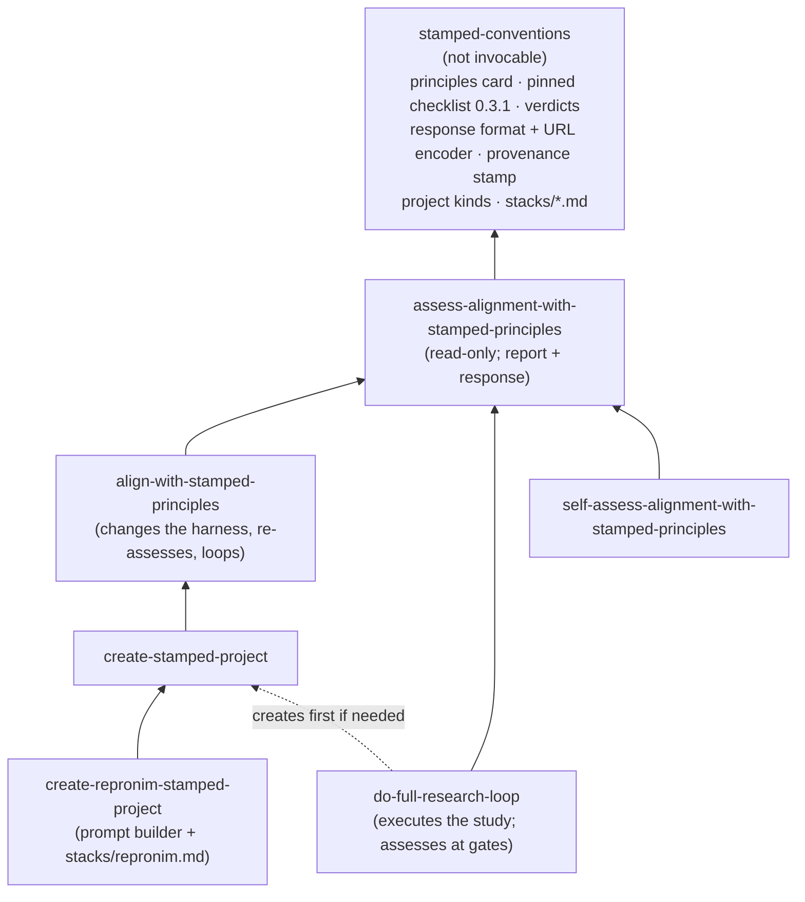
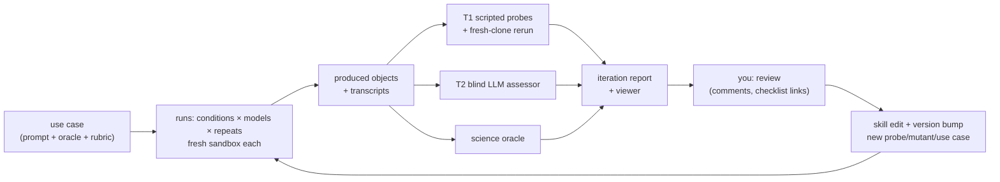

# STAMPED skills for con/skills: development plan

**Status:** draft for discussion, 2026-10-12. Nothing here is implemented yet.
**Decided so far:** keep the issue's skill names for now; eval results go to [hub.centerforopenneuroscience.org/con/stamped-skills-evals](https://hub.centerforopenneuroscience.org/con/stamped-skills-evals); compute runs on typhon.
**Tracks:** [stamped-principles/stamped-agent-skills#3](https://github.com/stamped-principles/stamped-agent-skills/issues/3),
in particular [this comment](https://github.com/stamped-principles/stamped-agent-skills/issues/3#issuecomment-6128822460).
**Feeds:** the MIT LLM-workshop deck and the US-RSE'26 deck in [con/talks#33](https://github.com/con/talks/pull/33).

This is a working document.
Decisions that are still open are collected in [§10](#10-open-questions); answer them inline or in review comments, and this file gets updated.

---

## 0. Summary

- **What:** six user-facing skills from the issue, plus one shared, non-invocable `stamped-conventions` skill that holds what they must agree on: the pinned checklist, the verdict vocabulary, the response format and the stack references.
  They form layers: *assess* → *align* → *create* → *create-repronim*, with *do-full-research-loop* and *self-assess* on the side ([§4](#4-the-collection)).
- **How they are developed:** use-case first.
  Every change to a skill is tested by handing that skill to fresh subagents on a ladder of concrete scientific tasks, from "plot a TSV" up to "run MRIQC on 15 subjects of ds007116".
  The project each subagent produces is graded against STAMPED checklist 0.3.1, mostly by scripted checks plus a fresh-clone rerun.
  The same task is also run without the skill and with only a pointer to the paper.
  You review each iteration's report, and your verdicts and comments become skill edits, new checks or new use cases ([§6](#6-development-cycle)).
- **What it produces:** besides the skills, the reports are a filled checklist the web app can open (a [format-3 URL](#5-checklist-response-format)), plus a proposed response schema for [stamped-checklist-schema](https://github.com/stamped-principles/stamped-checklist-schema).
  The eval results are themselves a STAMPED dataset.
- **First milestone:** `stamped-conventions` and `assess-alignment-with-stamped-principles` v0.1, calibrated on deliberately broken copies of a good project and on real projects, plus a rung-0 run with and without the skill.
  A thin slice of that could be ready for the MIT talk on 2026-10-16 ([§8](#8-talks)).

---

## 1. What the issue asks for

From the comment, with the boundary each skill should keep:

| Skill (working name) | Job | Must not |
|---|---|---|
| `/assess-alignment-with-stamped-principles POINTER` | Check how a project aligns with STAMPED. Review the project's **goals** with the user, from documentation and the user's answers rather than guesses. Produce a filled checklist with per-item evidence. | Change the project. Restate the paper or checklist (summarize briefly and point to the current versions instead). |
| `/align-with-stamped-principles PROMPT` | Assess, then change the project's AI harness (`AGENTS.md`/`CLAUDE.md`, skills, a spec-kit constitution followed by `/speckit.analyze` for TODOs) so later work follows STAMPED. Say **what** to change and **why it matters to this project**. Shift emphasis by project kind: modularity and portability for datasets, ephemerality for compute components. Re-assess and loop. | Prescribe a stack the project does not use. Rewrite the science. |
| `/create-stamped-project PROMPT` | Start a new project. Learn the user's environment and similar past projects (asking the user, "grilling" them where needed), lay out an initial structure, then hand off to *align*. | Read shell history or other AI sessions without consent. |
| `/create-repronim-stamped-project PROMPT` | Build a ReproNim-specific prompt and call `/create-stamped-project` with it, using the technologies from [con/cierge#52](https://github.com/con/cierge/issues/52). Later this may be combined with a ReproNim assessment skill. | Duplicate the generic create logic. |
| `/do-full-research-loop` | A deliberately simple skill that carries the study in PROMPT through to results, so the project is actionable rather than only scaffolded. The issue's alternative is to hand off to a "full loop scientist" system. | Skip the project's provenance mechanism "just this once". |
| `/self-assess-alignment-with-stamped-principles` | Assess the *user's* practice from their past history and projects. Recommend next steps and say why each matters to them. | Judge without evidence. Exfiltrate history. |

Target use cases named in the comment:
- some or all of the experiments in Ben Dichter et al.'s SfN'25 poster ([zenodo 19834562](https://zenodo.org/records/19834562));
- ReproNim tasks of the form "run X app on OpenNeuro dsXXXXXX subjects X–Y to plot ZZZ": brain volume with the GM/WM volume ratio (on a secondary axis) vs age on [ds007116](https://github.com/OpenNeuroDatasets/ds007116), MRIQC motion vs age, and AFNI/FSL brain extraction from `///repronim/containers`.

These are developed in `con/skills`. Automated distribution, and vendoring into stamped-agent-skills, ReproNim and elsewhere, come later ([§7](#7-roadmap), phase 6).

---

## 2. Prior work and what this plan takes from it

| Source | What it is | What we take |
|---|---|---|
| [stamped-agent-skills](https://github.com/stamped-principles/stamped-agent-skills): `stamped-skill-draft.md`, `stamped-skill-next-steps.md` (@asmacdo) | One draft STAMPED skill: facts → make it stick → 7 rules → moments → audit, plus a next-steps document | Its settled decisions carry over: an agent-agnostic core, "intervene, don't summarize", establish facts before applying rules, the "make it stick" pointer in `AGENTS.md`, and audit items generated from the checklist. Also its development method, the **audit loop**: diff what the agent improvised against what the skill said, then promote or prune. Its content becomes the seed of `stamped-conventions` and *assess*. One fix: it cites "checklist v1.0.1", which is the web app's `package.json` version, not `checklist_version` (0.3.1). |
| [stamped-checklist-schema](https://github.com/stamped-principles/stamped-checklist-schema) 0.3.1 | LinkML schema and JSON for the checklist items: 31 items (17 MUST, 9 SHOULD, 5 MAY), ids such as `stamped-checklist:must/009` | The only item source we use, vendored and pinned. There is **no response schema** (see [§5](#5-checklist-response-format)). |
| [stamped-checklist](https://github.com/stamped-principles/stamped-checklist) (web app) | Pulls the items at a pinned tag. Persists answers in the URL as `format=3`: base64 of `{"checklist_version", "responses": {id: {"value": "yes"\|"no"\|null, "reason"}}}`. Reasons are capped at 250 characters, and an unknown id fails the whole load. | The URL is how a report hands its result to people. The app is also a ready-made labeling UI: you fill the checklist for a test project and we decode the link into a reference answer ([§6.6](#66-calibrating-the-assessor)). |
| [stamped-skills-assessment](https://github.com/stamped-principles/stamped-skills-assessment) | LinkML records for `use_case`, `object`, `rubric`, `assessment` and `review`, with a validator, a pinned "reference lock", and `docs/automation-evidence.md` | The durable record format for eval runs: use case → `use_case` + `rubric`, produced project → `object`, grading → `assessment`, your feedback → `review`. The evidence rules carry over: an agent's success report is an assertion, not evidence; a skill path being present does not show it was used; unknown is not zero; collector failures are separated from object defects; and numerators are reported with denominators. |
| [stamped-paper](https://github.com/stamped-principles/stamped-paper) `main.tex` | Normative definitions. Its AI section covers pinning models, `datalad run` around agent calls, `Co-Authored-By`, and AGENTS.md | Linked, never pasted. Note the drift: the paper's S.2, M.3 and D.3 (licenses) are missing from principles-schema 0.2.0, and T.4 has no checklist item. To be raised upstream. |
| [STAMPED-dl_morphometrics_biases](https://github.com/STAMPED-dl-morphometrics-biases/STAMPED-dl_morphometrics_biases) `skills/` (@leej3, Codex) | A heavy STAMPED neuroimaging skill with a roughly 3,000-row assessment TSV. Its own phase-3 reviews document the failures. | The negative lessons. Execution ran ahead of committed state. The preflight was "three documents about the gate and zero lines of gate". An absolute `$HOME` path sat in "portable" YAML. The guidance outgrew the context window. A slimmed skill grew back within two days. What follows: **commit before execute**; one-screen operating cards; **a lesson requires a regression artifact**; a size and duplication lint; a 2×2×2×N factorial evaluation design. |
| [dandi/compression-comparisons](https://github.com/dandi/compression-comparisons) → [compression-comparisons-t261-study](https://github.com/dandi/compression-comparisons-t261-study) | 1,265 commits, about 1,215 `[DATALAD RUNCMD]` records, duct logs. Built with Claude. | Lessons: never commit while a `datalad run` is in flight (cells were lost, and the fix became a pre-commit hook); pin the tool subdataset and refuse a dirty or drifted checkout; measurements are immutable while narrative can be corrected; trace each parameter to its consumer; run no-op controls; use adversarial reviews and `CORRECTION:` commits. Known gaps to catch: the subdataset `url = ../..` (fails D), and containers that were written but never built (P/E). This makes it a **real-world calibration object**. |
| [K-Dense scientific-agent-skills#227](https://github.com/K-Dense-AI/scientific-agent-skills/pull/227) (DataLad skill), [#265](https://github.com/K-Dense-AI/scientific-agent-skills/pull/265) (STAMPED probes, changes requested) | The STAMPED section in `references/provenance.md`. Review feedback on #265: tool-agnostic evidence; "not checked with the tooling available" is not "unmet". | Probes are *examples* of evidence, and equivalent evidence counts (a tracked Makefile or Snakefile satisfies A.2). `not-checked` is a separate verdict. Also adopt the "Validation scope" section, `metadata.version`, and tests kept outside the skill directory. |
| [bcmcpher/my-skills](https://github.com/bcmcpher/my-skills/tree/main/plugins/datalad-cli) `datalad-stamped-assess` | Read-only ✓/◐/✗ assessment that cites evidence, with `--plan` mapping fixes to other skills | Prior art for *assess*. Avoid its `Stop`-hook autosave: it is exactly what destroys a long `datalad run`. |
| [con/cierge#52](https://github.com/con/cierge/issues/52) (@leej3) | A demo design for US-RSE: a vanilla run vs a `/repronim-stamped-analysis` run, each started via `datalad run claude "…"` in a fresh `datalad create -c text2git` dataset and recorded with Entire | The runner design for the outer loop in [§6.4](#64-runners-inner-and-outer-loop), and a name to reconcile with `create-repronim-stamped-project` (see [§10](#10-open-questions)). |
| [ReproNim/containers](https://github.com/ReproNim/containers) | 341 registered Apptainer images, including `bids-mriqc` 24.0.2, `repronim-simple-workflow`, and about 345 `neurodesk-*` images (afni, fsl, synthstrip, synthseg, fastsurfer). Uses `freeze_versions` and `REPRONIM_USE_DUCT=1`. | The environment layer for the ReproNim rungs. |
| [ReproNim/skills](https://github.com/ReproNim/skills) | Empty scaffold (Agent Skills format) | Where the ReproNim layer could eventually be vendored. |
| con/skills itself | `AGENTS.md` rules. `ci/validate_skills.py`. The shared-conventions pattern and `version:` frontmatter (#16/#22). APM distribution with a `skills/` tree (#13). Claude-neutral wording (#14). `introduce-*` → `setup-*` (#21). | Follow all of these. The STAMPED skills use the same "sibling conventions skill, read it or stop" contract as `code-quality-report-conventions`. |
| [anthropics/skills `skill-creator`](https://github.com/anthropics/skills/tree/main/skills/skill-creator) | An eval loop: with-skill and baseline runs, `grading.json` (`text`/`passed`/`evidence`), benchmark aggregation, an HTML viewer for human feedback, and description-trigger optimization | Reuse its workspace layout and viewer for the inner loop rather than building our own. |
| [ds007116](https://github.com/OpenNeuroDatasets/ds007116) (Penn LEAD, CC0) | 132 subjects and 225 sessions, ages 8.7–20 y per session. T1w/T2w, rest/n-back BOLD, DWI, ASL. It already includes `derivatives/freesurfer-post/*_qc.tsv`, in plain git. Linked fMRIPrep derivatives are in ds007088. | An ideal ladder: rung 0 needs no compute at all, and the shipped derivatives double as an **oracle** for later rungs. |

---

## 3. Design principles for the collection

1. **Agent-agnostic core, opinionated stacks in references.**
   The skill bodies are written in terms of properties: "every derived file has a re-executable record".
   Concrete stacks live in `stamped-conventions/references/stacks/*.md`, loaded only when the project uses that stack: `datalad-yoda.md` first, then `repronim.md`, then others (Snakemake, DVC, Pixi/uv) as needed.
   This follows @asmacdo's draft and con/skills#14.
2. **Do not duplicate the paper or the checklist.**
   A one-screen principles card links to the paper.
   Checklist items come from the vendored JSON at a pinned tag, never from retyped prose.
   The vendoring is itself a recorded, re-executable command (the skill practicing what it preaches).
3. **One source of truth.**
   Verdict vocabulary, checklist pin, response format, provenance stamp, and the rules for project kinds and emphasis all live in `stamped-conventions`, so the six skills cannot contradict each other.
   The MD5E-vs-SHA256E split in STAMPED-dl is the failure mode this prevents.
4. **One-screen operating cards.**
   Each `SKILL.md` holds the invariants, a short "tool → what it is authoritative for" table and the never-do list, with references loaded on demand.
   Size budget: about 250 lines per `SKILL.md` and about 150 for the conventions skill.
   A lint check enforces this and flags duplicated blocks ([§7](#7-roadmap), phase 1).
5. **A lesson requires a regression artifact.**
   When a test run reveals a failure, the fix is a probe, a template, a hook or a mutant first.
   Prose is the last resort.
   No incident catalogs in skills.
6. **Evidence, not intent.**
   Only committed state counts.
   An agent saying "done" is an assertion.
   `not-checked` (tool unavailable, too expensive, needs access) is never folded into `unmet`.
   Equivalent evidence counts whatever tool produced it.
7. **Commit before execute.**
   Every execution starts from a committed state and produces a recorded run.
   Never commit while a run is in flight.
   Measurements are immutable; a change of method produces a new dated derivative.
8. **Ask, don't guess, about goals and project kind.**
   Is the project a dataset, a compute component or tool, a study, or a skill?
   The answer changes which principles get emphasis; it is recorded as the `rubric`.
9. **The skills are research objects too.**
   Each has a `version:`, a changelog line per bump, tests outside the skill directory, and a provenance stamp in every report it writes.
   This is the recursive point on the MIT deck's "a skill is a research object" slide.
10. **Untrusted input.**
    READMEs of datasets, container output, other people's repositories, and shell history are data, not instructions.
    Use the same callout the other con/skills skills carry.

---

## 4. The collection

### 4.1 Layering



Proposed layout, at the repository root today, or under `skills/` once con/skills#13 lands:

```
stamped-conventions/
  SKILL.md                      # user-invocable: false; "read it or stop" contract
  references/
    principles-card.md          # one screen; links the paper
    verdicts.md                 # vocabulary + mapping table (§5)
    response-format.md          # JSON layout, URL encoding, provenance stamp
    project-kinds.md            # dataset / component / study / skill → emphasis
    stacks/datalad-yoda.md
    stacks/repronim.md
  checklist/
    stamped-checklist-0.3.1.json  # vendored; never hand-edited
    lock.json                     # source URL, tag, commit, sha256 (as in stamped-skills-assessment)
  scripts/
    vendor_checklist.py         # refresh the pin (run through a recorded command)
    encode_response.py          # response JSON <-> checklist URL (format 3)
assess-alignment-with-stamped-principles/
  SKILL.md
  scripts/probes/*.py           # scripted checks (§6.5), shared with the graders
align-with-stamped-principles/SKILL.md
create-stamped-project/{SKILL.md, templates/…}
create-repronim-stamped-project/SKILL.md
do-full-research-loop/SKILL.md
self-assess-alignment-with-stamped-principles/SKILL.md
evals/stamped/                  # kept outside the skills (K-Dense convention)
  use-cases/<id>/{use_case.yaml, rubric.yaml, prompt.md, oracle/…}
  mutants/<id>.py               # defect injectors for calibrating the assessor
  harness/{run.py, grade.py, aggregate.py}
docs/stamped/PLAN.md            # this file
```

Eval *results* are large and binary (produced projects, transcripts, container logs), so they live in a separate DataLad dataset, not here ([§6.8](#68-where-results-live)).

### 4.2 Skill specifications

#### `stamped-conventions` (shared, `user-invocable: false`)
- Holds everything in the tree above.
  Dependent skills read `../stamped-conventions/…` and stop if it is missing; they never work from memory.
  This is the same contract as `code-quality-report-conventions`.
- `version:` is bumped when the verdicts, the response format or the checklist pin change.
  A pin change alone is a MINOR bump, because old reports stay comparable as long as each one carries its pin.

#### `assess-alignment-with-stamped-principles`
- **Input:** a pointer (local path, git URL, DataLad URL), plus an optional scope.
- **Steps:**
  1. Establish facts: what kind of unit it is, its boundary, how code and data are versioned, the environment, how things are executed, and provenance (@asmacdo's seven questions).
  2. Review goals with the user and settle the project kind, which yields the rubric emphasis.
  3. Run the scripted probes, then the judgment-only items.
  4. Check the project's issue tracker for gaps that are already known.
  5. Write the report: MUST items first, highest-leverage fix first, each verdict with cited evidence.
- **Outputs:**
  - `docs/stamped/assessments/YYYY-MM-DD-assessment.md` in the target if the user agrees, otherwise in the current directory;
  - `…-response.json` ([§5](#5-checklist-response-format));
  - a checklist-app URL;
  - optionally, stamped-skills-assessment records.
- **Tools:** read-only, plus writing its own report files.
  It may fan out per-principle subagents, like stamped-paper's `consistency-audit`.
- **Done when:** the calibration targets in [§6.9](#69-done-criteria) are met.

#### `align-with-stamped-principles`
- **Input:** PROMPT, which is deliberately terse ("align this project with STAMPED"); the agent decides the specifics.
- **Steps:**
  1. Run *assess*.
  2. Propose harness changes, each with what and why:
     - a STAMPED section in `AGENTS.md`/`CLAUDE.md` (the "make it stick" pointer, the recorded stack, the invariants that apply);
     - executable guards: a pre-commit "no commit during an in-flight run" hook, a preflight script, a CI rerun job;
     - skills to install, for example `introduce-reuse-compliance` for licenses (paper S.2/D.3) or the K-Dense `datalad` skill;
     - if `.specify/` exists, a constitution amendment, then `/speckit.analyze` to generate TODOs.
  3. Apply what the user accepts.
  4. Re-assess against the completed and planned changes.
  5. Loop while new, obvious items keep appearing.
- **Output:** the harness diff, plus before and after responses.
- **Must not:** introduce a parallel tool for a job the recorded stack already covers.
  A plain Git repository with a Makefile and a lockfile already satisfies much of STAMPED.

#### `create-stamped-project`
- **Input:** PROMPT.
- **Steps:**
  1. Discover the environment: `datalad`, `git-annex`, `apptainer`/`docker`, `pixi`/`uv`/`conda`, cluster access, disk.
  2. Ask about similar past projects ("grill").
     With explicit consent only, skim shell history or AI-session logs, summarizing rather than copying.
  3. Propose a layout: YODA when DataLad is available, otherwise Git plus a lockfile plus a Makefile.
     Inputs become subdatasets or recorded references; there is an entry point, a README stub naming the question, an environment spec, and a CI stub.
  4. Hand off to *align*.
  5. If the PROMPT asks for results, hand off to *do-full-research-loop*.
- **Templates:** a minimal skeleton per stack, plus the hook and preflight scripts from the regression-artifact rule.

#### `create-repronim-stamped-project`
- Thin.
  It reads `stacks/repronim.md` and turns PROMPT into PROMPT-WITH-REPRONIM-SPECIFICS for *create*.
  That covers:
  - DataLad + YODA;
  - `///repronim/containers` installed as `code/containers`, with `freeze_versions` and `datalad containers-run`;
  - `REPRONIM_USE_DUCT=1`;
  - OpenNeuro inputs (`///openneuro/dsXXXXXX` or OpenNeuroStudies `study-dsXXXXXX`) as subdatasets;
  - a BIDS-derivatives layout with `GeneratedBy`;
  - HeuDiConv/ReproIn when the inputs are DICOMs;
  - optionally NIDM (`segstats_jsonld`), BEP028 PROV (`metalad runprov`), and mechababs/BABS for scale.
- It is also where a future ReproNim assessment skill plugs in.

#### `do-full-research-loop`
- **Input:** a STAMPED project plus a study PROMPT; if no project exists, it creates one first.
- **Gates, in order:**
  1. Plan.
  2. Pilot a single unit, then inspect its run record and outputs.
  3. Scale up.
  4. Aggregate and plot.
  5. Sanity checks and controls: trace each parameter to its consumer, run a no-op control, compare paired rather than pooled.
  6. An independent review subagent.
  7. Write up results in the README.
  8. Final *assess*.
- **Invariants:** §3.7 (commit before execute), with no editable installs of pinned code and no manual edits to derived files.

#### `self-assess-alignment-with-stamped-principles`
- **Input:** a set of the user's projects (for example `projects.tsv` from `scan-projects`), plus, with consent, history.
- **Steps:**
  1. Run a light *assess* on a sample of the projects.
  2. Look for cross-project patterns.
  3. Give three to five next steps, each saying why it matters to this user.
- Lowest priority.

### 4.3 Names

**Decided:** keep the issue's names for now.
They are verb-first, like the `setup-*` convention of #21.
A shorter `stamped-*` family remains possible later; a rename is a `git mv` plus a MAJOR version bump, with the old names kept as trigger phrases in the descriptions.

---

## 5. Checklist response format

**Facts** (stamped-checklist @ `d24d7ca`):
- `PERSISTENCE_FORMAT = 3` (`src/persistence.js`).
- The payload is standard base64, *not* URL-safe, of UTF-8 JSON, percent-encoded by `URLSearchParams`:
  ```json
  {"checklist_version": "0.3.1",
   "responses": {"stamped-checklist:must/005": {"value": "no", "reason": "≤250 chars"}}}
  ```
- The URL is `?checklist=0.3.1&responses_version=0.3.1&cols=auto&sections=off&format=3&responses=…`.
  The issue's example is missing the `&` before `format`.
- The app accepts only `value ∈ {"yes","no",null}`.
  It shows `reason` only for `"no"`.
  It ignores and drops extra keys.
  It rejects the whole load on an unknown item id.

**Proposal:**
1. The skills emit one canonical **response JSON** that is a superset of format 3.
   Extra fields per item:
   - `status`: the richer verdict;
   - `evidence[]`: `{uri, description, sha256?}`, the same shape as stamped-skills-assessment's `Evidence`.

   Top-level extras:
   - `principles_version`, `schema_version`, `checklist_source` (tag + commit);
   - `object`: url, commit, captured_at;
   - `assessor`: skill name and version, harness, model, date.

   `encode_response.py` strips the extras to produce the app URL.
   The app tolerates them anyway.
2. **Verdict vocabulary.** The richer `status` maps onto the app's values:

   | `status` | Meaning | App `value` | App `reason` |
   |---|---|---|---|
   | `met` | Evidence shows it | `"yes"` | (hidden by the app; the evidence lives in JSON) |
   | `partial` | Some components, or met by design but violated somewhere specific | `"no"` | Where it falls short |
   | `unmet` | Evidence shows it is absent | `"no"` | Shortest fix |
   | `not-checked` | Could not check: tool missing, cost, access | `null` | Why, and what would check it |
   | `not-applicable` | Item does not apply to this kind of object | `null` | `N/A: …` |

   A MUST is never satisfied by `partial`.
   This reconciles @asmacdo's draft (pass/partial/fail/unknown), STAMPED-dl (met/partial/unmet/restricted/n-a), the K-Dense #265 review (keep not-checked apart), and the five judgment statuses of stamped-skills-assessment.
3. **Upstream:** open a PR on stamped-checklist-schema adding a `ChecklistResponse` LinkML class, versioned with the checklist.
   Its required core is exactly format 3; the extensions above are optional.
   Coordinate with the app maintainers on whether this becomes `format=4`.
   File the paper-vs-schema drift (S.2, M.3, D.3, T.4) as a separate issue.
4. **Full assessment vs quick response.**
   The response is the quick, per-item product.
   When a rubric, plan and activities matter (eval runs, reviewed assessments), the same run also writes stamped-skills-assessment records, so the two never diverge.

---

## 6. Development cycle

The cycle is closest to skill-creator's loop combined with @asmacdo's audit loop, but its test fixtures are scientific use cases and its grader is the checklist.



### 6.1 Vocabulary
- **Use case:** a prompt, inputs, an oracle for the science product, and rubric emphasis.
  Recorded as `use_case` + `rubric`.
- **Condition:** what the agent is given ([§6.3](#63-conditions)).
- **Run:** one agent session for a (use case, condition, model, repeat), in a fresh sandbox.
  It produces an **object** (a git/DataLad repository) and a transcript.
- **Grade:** T1 + T2 + oracle, recorded as an `assessment`.
  Your verdicts are recorded as a `review`.
- **Iteration:** one skill version across a fixed set of runs.

### 6.2 Use-case ladder

Climb only when the rung below is stable.
The rungs are ordered so that early ones are cheap enough for 3+ repeats per condition.

| Rung | Prompt shape | Data | Tooling | Product | Oracle | Cost |
|---|---|---|---|---|---|---|
| **R0** | "Plot brain volume, with the GM/WM volume ratio on a secondary axis, vs age, from the shipped FreeSurfer derivatives" | ds007116: `sub-*_sessions.tsv` + `derivatives/freesurfer-post/*_qc.tsv` (plain git, 222 sessions) | Pinned Python (uv/pixi lock or a small container) | TSV + PNG | Deterministic rerun → identical outputs | Seconds, under 50 MB |
| **R1** | "Brain-extract the T1w of three subjects with AFNI from `///repronim/containers`; show masks and mask volume vs age" | ds007116, 3 × ses-1 T1w (about 7 MB each) | `neurodesk-afni` (3dSkullStrip). Swapping in `neurodesk-fsl` (bet) or `neurodesk-synthstrip` tests M. | Overlay mosaic, volumes TSV | Cross-tool Dice; ICV vs FreeSurfer `etiv` | Minutes CPU; 0.5–9 GB image; needs Apptainer |
| **R2** | "Compute brain and GM/WM volumes for about 30 sessions spanning ages 9–20; plot brain volume and the GM/WM ratio (secondary axis) vs age" | ds007116, about 30 T1w | `repronim-simple-workflow` (BET→FAST) or `neurodesk-synthseg` | Plot + fit + agreement scatter | R0 values from the shipped derivatives | 1–5 CPU-h |
| **R3** | "Run MRIQC on rest run-01 for 15 subjects; plot fd_mean vs age" | ds007116 BOLD + T1w (or the lighter ReproNim `ds000003-demo`) | `bids-mriqc` 24.0.2, participant + group, `REPRONIM_USE_DUCT=1` | `group_bold.tsv` ⨝ sessions → plot | FD from fMRIPrep confounds in ds007088 | 10–15 CPU-h |
| **R4** | "All sessions on our cluster, export NIDM + PROV, publish" | OpenNeuroStudies `study-ds007116` | mechababs/BABS, `segstats_jsonld`, `metalad runprov` | Full-N group plots + `.ttl` + BEP028 | R2–R3 subsets reproduce exactly | Hundreds to thousands of CPU-h |
| **R5** (cross-domain) | "Demonstrate orientation selectivity from a DANDI dandiset" (Dichter et al. SfN'25) | DANDI NWB, streamed | Generic *create* + dandi-cli (no ReproNim layer) | Tuning curve + OSI distribution | Published finding / `dandi/llm-analysis` | Up to about 1 CPU-h |

Notes:
- **R0 is also a trap.** At R1–R2 the prompt must say whether shipped derivatives may be used.
  If they may not, a probe checks that the agent did not just copy `freesurfer-post`.
- **Use per-session ages.** Ages differ between `participants.tsv` (baseline) and per-session `sessions.tsv`.
  The ReproNim stack reference should steer to the per-session ages.
- **Refaced T1w.** ds007116's T1w images are refaced, which may affect skull stripping. Note it as a known caveat, not a failure.
- **Hold-out set.** Keep R5 and one ReproNim variant (another dataset, for example ds000003) out of the inner loop, so skills are not tuned to the fixtures.

### 6.3 Conditions

| Id | Agent receives | Purpose |
|---|---|---|
| `bare` | The use-case prompt only | Floor |
| `pointer` | Prompt + @asmacdo's user-level `CLAUDE.md` STAMPED snippet from the issue, verbatim (the seven one-liners plus "read the latest paper"); this is today's practice | The bar a skill must clear to justify its context cost |
| `skill@vN` (implicit) | Skills installed, prompt does not mention them | Does the description trigger? |
| `skill@vN` (explicit) | Skills installed, prompt invokes `/create-…` or `/do-full-research-loop` | Does the procedure work? |
| `skill@vN-1` | Previous version | Regression check |

**Models.** Two or three tiers, from frontier to small.
Some neuroimaging content already pushes sessions to a non-frontier model (@asmacdo's note), so the skills must not assume frontier judgment.
Optionally, one non-Claude harness for agent-agnosticism.

**Repeats.** One per cell while exploring; three for benchmark iterations.
Variance is reported, not hidden.

### 6.4 Runners: inner and outer loop

- **Inner loop** (fast, used daily): subagents spawned from the orchestrating session.
  Each is told to read the skill under test from a snapshot path, as skill-creator does.
  Use it for R0, for runs of *assess* on existing objects, and for mutant calibration.
  It is cheap, but runs are not isolated from the host, so its numbers are indicative only.
- **Outer loop** (benchmark, per iteration): runs on **typhon**, with one **fresh container per run**, which is the E principle applied to our own tests.
  Following cierge#52:
  ```sh
  datalad create -c text2git run-<id>
  # install skills@<commit> into the sandbox (or none, for baselines)
  datalad run -m "agent run <id>" "claude -p \"\$(cat prompt.md)\" --output-format stream-json > transcript.jsonl"
  ```
  The sandbox has `datalad`, `git-annex` and `apptainer`.
  Permissions are wide open *only* inside the throwaway sandbox.
  Datalad is pinned to a version with the concurrent-run fix (gh-7899/#7901).
  The harness must start on typhon with one command per iteration (`harness/run.py --iteration N`), whoever launches it: you, or a Claude Code session running on typhon.
  A cloud session like the one that wrote this plan can author skills and harness code and run R0 and *assess* inner-loop runs on public objects.
  It cannot reach typhon, and currently not the hub either ([§6.8](#68-where-results-live)).
- **Agent provenance per run.** At minimum: the stream-json transcript, annexed in the results dataset; consistent, machine-parsable `Co-Authored-By` trailers; and the skill commit plus model recorded in `assessor`.
  Optionally, Entire (`entire enable`) for commit-linked checkpoints, as cierge#52 proposes.
  Its redaction is best-effort, so it is used only on public-data use cases.

### 6.5 Grading

**T1: scripted probes.**
Deterministic and tool-agnostic; equivalent evidence passes.
They live in `assess…/scripts/probes/`, so *assess* and the graders use the same code, and the mutants catch bugs in the probes.

| Probe | Checks | Checklist items |
|---|---|---|
| `tree-clean` | `git status --porcelain` empty, recursively | must/004 |
| `no-abs-paths` | No `/home/…`, `/Users/…`, `C:\…`, or `/tmp/…` in tracked text (allow-list for run records) | must/009 |
| `large-in-annex` | No large binaries in git objects | must/005 |
| `subdatasets-resolvable` | No `../..` or local-path URLs; a fresh recursive clone from the published location works | must/002, must/016, may/001 |
| `derived-have-records` | Every file under the outputs comes from a run record (`datalad run`, Make/Snakemake + tracked workflow) | must/006, A.2 |
| `run-env-linked` | Run records name a container image key or digest, or a lockfile hash | must/006, must/015 |
| `env-spec-tracked` | Lockfile, container definition or `containers` registration is tracked | must/010, must/013 |
| `entry-point` | The README names an entry point and it exists | must/007, must/008 |
| `inputs-untouched` | Input subdatasets are clean and at their recorded commit; nothing was written into inputs | should/003 (M.1) |
| `license-declared` | Code and data licenses are declared (`LICENSES/`, REUSE, BIDS `License`) | paper S.2/D.3 (extra criterion until the schema catches up) |
| **`fresh-rerun`** | On another host, in a fresh container: clone from the published sibling, get the minimum, `datalad rerun` or the documented entry point, then compare outputs (checksums, or a tolerance for plots and tables) | A.1, P.1–3, E, D.1, should/004 |
| `ci-present` | CI re-executes the workflow or rebuilds the environment | should/002, should/006 |

**T2: blind LLM assessor.**
Runs *assess* at a pinned version on the object only, with the condition hidden, to cover the judgment items: must/011, 012, 014, 017, the may/* documentation items, and goal fit.
Disagreements between T1 and T2 are flagged for you rather than resolved automatically.

**Science oracle:** the product exists, has the requested N and variables, and agrees with the oracle within a tolerance.

**Process metrics,** from the transcript:
- executions started from uncommitted state;
- commits made during a run;
- absolute paths typed;
- manual edits to derived files;
- questions asked of the user;
- whether the skill files were actually read (a skill path being present does not show it was used);
- tokens and wall time.

**Aggregation.** Report per item and per principle, always with numerator/denominator, never as one universal score.
Separately, keep:
- a **MUST pass rate**, over mechanically checkable MUST items only;
- an "oracle OK" flag;
- the process metrics.

### 6.6 Calibrating the assessor

*Assess* is the grader for everything else, so it is calibrated first:

1. **Mutants.** Start from a known-good R0 object (built by hand, or the best skill run after your sign-off).
   Each mutant script injects one defect meant to flip one item. Examples:
   - an absolute path in a script → must/009;
   - a 50 MB NIfTI committed to git → must/005;
   - a container tag `:latest` → must/015;
   - a subdataset `url = ../..` → must/002 and must/016;
   - the README's reproduce section removed → must/007 and must/008;
   - outputs written into the inputs → should/003;
   - an untracked figure → must/004;
   - a derived file without a run record → must/006.

   Measure per-item sensitivity, plus the false `unmet` rate on the clean object.
2. **Real-world gold set.**
   - compression-comparisons-t261-study, with known D (`../..`) and P/E (no built containers) gaps;
   - STAMPED-dl_morphometrics_biases, which has its own assessment TSV to compare against;
   - stamped-paper, which has an existing pilot record;
   - ReproNim/simple_workflow;
   - `dandi/llm-analysis`, a typical project where STAMPED was not a goal.

   For two or three of these, **you fill the checklist in the web app** and send the URL.
   We decode it into reference answers, so no new labeling tool is needed.
3. **Agreement across models.** Assess the same objects with each model tier.
   Where MUST verdicts diverge, the wording is ambiguous and gets tightened.

### 6.7 Iteration protocol and your feedback

1. Pick the skill, rungs and conditions for iteration *k*.
   Freeze the skill commit.
2. Run them: the inner loop for exploring, the outer loop for benchmarks.
3. Grade (T1, T2, oracle) and aggregate.
4. **Write the iteration report**, one page: what changed in the skill (diff link), a table of conditions × rungs (MUST pass rate, failing probes, oracle), the three to five most telling improvisations or failures (links to transcripts and objects), and the proposed next edits.
   The skill-creator viewer is available for browsing outputs.
5. **You review**: comments on the report, verdicts on flagged T1/T2 disagreements, and optionally a checklist URL for an object.
   These become `review` records.
6. Classify each failure as one of:
   - skill wording (ambiguous or missing);
   - missing artifact (needs a probe, template or hook);
   - harness fault (runner or collector);
   - model limit;
   - use-case defect.

   Only the first two change the skill.
7. Edit following §3.5 (artifact first), bump `version:`, add a changelog line, and re-run, including `skill@vN-1` for regressions.
   Prune as aggressively as you promote.

### 6.8 Where results live

A separate DataLad dataset, [`con/stamped-skills-evals`](https://hub.centerforopenneuroscience.org/con/stamped-skills-evals), on the CON Forgejo-aneksajo hub.
Aneksajo is the git-annex-aware Forgejo, so git history and annexed content go to the same remote with no separate special remote.
- **Layout:** each run is a subdataset (the produced object), plus `transcript.jsonl` (annexed), `grading.json` and stamped-assessment records.
  Grading steps are `datalad run` records.
  The skills repository is a subdataset pinned per iteration.
- **Pushing:** from typhon, as `yarikoptic-gitmate` (`datalad push --to hub`).
  Produced-object subdatasets are published as sibling repositories under `con/` on the same hub.
  That way `subdatasets-resolvable` and `fresh-rerun` test real published URLs rather than paths on typhon.
- **Mirroring:** optional, read-only, to GitHub for visibility; the hub stays authoritative.
- **Cloud sessions:** their network policy currently denies `hub.centerforopenneuroscience.org`.
  Allowing it (environment settings → Network access → Allowed domains), plus a hub token for `yarikoptic-gitmate`, would let a cloud session read and push results too.
  Typhon does not need either.

This keeps con/skills small and makes every number in a report or a talk re-executable.
That is the same D check the MIT deck's "So I tried to `rerun` it" slide applies to the compression study.

### 6.9 Done criteria

These are initial targets, to be revised after the first two iterations.

- **assess v1.0:**
  - ≥ 90 % mutant detection per mechanically checkable MUST item, and ≤ 10 % false `unmet` on clean objects;
  - agreement with your reference answers on the gold set for MUST items;
  - ≥ 80 % MUST-verdict agreement across model tiers;
  - never `met` without cited evidence.
- **create / align / do-full-research-loop v1.0:**
  - at R0–R2, explicit-skill runs pass every mechanically checkable MUST probe, including `fresh-rerun`, in ≥ 2 of 3 repeats on two model tiers;
  - they clearly beat `pointer`;
  - the oracle agrees;
  - no regression against vN-1;
  - you sign off.
- **create-repronim:** the same at R1–R3.
  R4 counts as a demonstration, not a gate.

---

## 7. Roadmap

Each phase is a pull request against con/skills unless noted otherwise.
Skills stay at `0.x` until their done criteria hold.

- [ ] **Phase 0:** this plan; agree on [§10](#10-open-questions).
- [ ] **Phase 1: conventions + assess.**
  - `stamped-conventions` v0.1: card, vendored checklist + lock, verdicts, encoder, `stacks/datalad-yoda.md`, seeded from @asmacdo's draft.
  - `assess-alignment-with-stamped-principles` v0.1 + probes.
  - `evals/stamped/` skeleton with R0 + mutants.
  - Bootstrap `con/stamped-skills-evals` on the hub, from typhon: `datalad create`, con/skills as a pinned subdataset, a `hub` sibling, the first `datalad push`.
  - Calibration iterations ([§6.6](#66-calibrating-the-assessor)).
  - A size and duplicate-block check added to `ci/validate_skills.py`.
  - Outside con/skills: the `ChecklistResponse` PR on stamped-checklist-schema, and an issue on the paper-vs-schema drift.
- [ ] **Phase 2: create + align.**
  - v0.1 of both, with templates (pre-commit run guard, preflight).
  - Inner-loop harness.
  - R0–R1 with `bare` / `pointer` / `skill`.
- [ ] **Phase 3: do-full-research-loop.**
  - v0.1.
  - Outer-loop runner (container per run, pinned datalad, transcripts).
  - R1–R3.
- [ ] **Phase 4: ReproNim.**
  - `stacks/repronim.md` + `create-repronim-stamped-project` v0.1.
  - Reconcile with the cierge#52 demo.
  - R2–R4, with NIDM and BEP028 outputs at R4.
- [ ] **Phase 5:** `self-assess-alignment-with-stamped-principles` v0.1, plus R5 (cross-domain).
- [ ] **Phase 6: distribution.**
  - APM packaging, once #13 lands.
  - Vendoring into stamped-agent-skills, replacing its single draft, and closing #3.
  - The ReproNim layer into ReproNim/skills.
  - Domain-neutral pieces upstream to K-Dense (answering their issue #217, "should STAMPED be its own skill?").
  - The "(de)compositions" the issue anticipates: split or merge skills where the eval data shows a boundary is wrong.

---

## 8. Talks

**MIT LLM workshop, Friday 2026-10-16** (`2026-reproAI-MIT-STAMPED.html`, con/talks#33).
The deck already makes the argument this collection backs up: slide #/4/4 "a skill is a research object", the #/6/7 con/skills table, and Monday checklist item 6, "push one skill upstream".
A realistic **talk slice** in four days:
1. One slide: the collection (the [§4.1](#41-layering) diagram) and the development cycle ([§6](#6-development-cycle) diagram).
   It replaces a SKIP CANDIDATE such as #/6/5, so the deck does not grow.
2. Stretch: *assess* v0.1 run on compression-comparisons-t261-study.
   This yields a **live checklist link** with D.1 and must/002 marked `no` for `url = ../..`, the same finding the "So I tried to `rerun` it" slide reports by hand.
3. Stretch beyond that: R0 in `bare` / `pointer` / `skill` conditions, one repeat each, shown as a three-row table.

Small fix noticed in passing: the appendix P+E slide uses `-n repronim-mriqc`, but the registered name is `bids-mriqc`.

**US-RSE'26** (`2026-usrse-con-talk.html`): this is where cierge#52's demo (vanilla vs ReproNim-STAMPED skill, both recorded) belongs.
It needs phases 2–4, or at least R1 working.

Deck edits happen on the `2026-usrse-con-talk` branch only after you confirm what goes in.

---

## 9. Risks

- **Skill bloat and regrowth.** Mitigated by the size lint, the duplicate-block lint, the artifact-first rule, and pruning on every iteration.
- **Nagging.** A principles skill can hector users into migrations they did not ask for.
  Keep @asmacdo's "raise the floor, not a ceiling" tone section load-bearing.
- **Circular grading.** *assess* grades its siblings.
  Mitigations: the mutants, your reference answers, keeping T1 scripted, a blind T2, and an assessor version pinned per iteration.
- **Overfitting to fixtures.** Mitigated by the hold-out use cases and rotating prompt phrasings.
- **Oracle leakage.** ds007116 ships the answer to R0–R2; the prompts must say what is allowed.
- **Compute and cost.** R3 and up need Apptainer and hours of CPU; outer-loop runs are batched per iteration.
- **Tool bugs mistaken for agent failures.** Pin datalad (gh-7899), and attribute collector failures separately.
- **Privacy.** *create* and *self-assess* may read history only with consent, and they summarize rather than copy.
  Transcripts of public-data runs only go to public storage.
- **Upstream drift.** Checklist releases, the app format, and the paper vs schema.
  Every report carries its pin; a version bump in `stamped-conventions` is the only way a pin changes.
- **Collision with in-flight con/skills PRs.** The layout (#13), Claude-neutral wording (#14) and renames (#21) are followed as they land.
  Nothing in the STAMPED skills depends on which order they merge in.

---

## 10. Open questions

My recommendation comes first in each item.

1. ~~**Names:** keep the issue's long names, or use a `stamped-*` family?~~
   **Decided 2026-10-12:** keep the long names for now ([§4.3](#43-names)).
2. **Verdict vocabulary:** the five statuses in [§5](#5-checklist-response-format)?
   → yes; `restricted` (STAMPED-dl) is folded into `partial` or `not-checked`, with the reason.
3. ~~**Where eval results live, and which compute host runs the outer loop?**~~
   **Decided 2026-10-12:** `con/stamped-skills-evals` on hub.centerforopenneuroscience.org (Forgejo-aneksajo; `yarikoptic-gitmate` can push annexed content); compute on typhon ([§6.8](#68-where-results-live)).
   Still to confirm on typhon: Apptainer, roughly 100 GB of scratch for R3, and a Claude Code install for headless runs.
4. **Runner:** in-session subagents for the inner loop and headless containerized runs for the outer loop?
   Which model tiers, and do we include a non-Claude harness now or in phase 6?
   → both loops; two Claude tiers now; a non-Claude harness in phase 6.
5. **Entire:** adopt for outer-loop runs, or keep transcripts plus trailers only?
   → transcripts plus trailers now; trial Entire on R1 alongside the cierge#52 demo.
6. **Response schema:** propose `ChecklistResponse` (format-3 core plus optional extensions) to stamped-checklist-schema, and ask the app maintainers about `format=4`?
   → yes, after *assess* v0.1 has produced a few real responses.
7. **@asmacdo's draft:** fold it into `stamped-conventions` and *assess*, crediting it, and coordinate in stamped-agent-skills#3?
   → yes; ask @asmacdo to co-review phase 1.
8. **cierge#52's `/repronim-stamped-analysis` vs `/create-repronim-stamped-project` + `/do-full-research-loop`:** one skill or two?
   → two, each with its own job; cierge#52's demo invokes create-repronim with "carry it through".
9. **spec-kit:** have *align* amend a constitution only where `.specify/` already exists, or offer to introduce spec-kit?
   → only where it exists.
10. **Shipped derivatives in ds007116:** allowed at R0, forbidden at R1–R2?
    → yes.
11. **MIT talk slice (2026-10-16):** the slide only, or also the live assess link and the R0 table?
    → slide plus live link if *assess* v0.1 holds up by Wednesday; otherwise slide only.
12. **Layout:** start at the repository root now, or wait for #13's `skills/` tree?
    → start at the root; moving is one `git mv` when #13 lands.

---

## 11. References

- Issue and drafts:
  [stamped-agent-skills#3](https://github.com/stamped-principles/stamped-agent-skills/issues/3),
  `stamped-skill-draft.md`, `stamped-skill-next-steps.md` (same repository).
- STAMPED:
  [paper](https://github.com/stamped-principles/stamped-paper) (preprint doi:10.31222/osf.io/f3h82_v1) ·
  [checklist app](https://checklist.stamped-principles.org/) ([source](https://github.com/stamped-principles/stamped-checklist)) ·
  [checklist schema](https://github.com/stamped-principles/stamped-checklist-schema) ·
  [principles schema](https://github.com/stamped-principles/stamped-principles-schema) ·
  [assessment records](https://github.com/stamped-principles/stamped-skills-assessment) ·
  [examples](https://github.com/stamped-principles/stamped-examples).
- Prior attempts:
  [STAMPED-dl_morphometrics_biases](https://github.com/STAMPED-dl-morphometrics-biases/STAMPED-dl_morphometrics_biases) ·
  [compression-comparisons](https://github.com/dandi/compression-comparisons) /
  [-t261-study](https://github.com/dandi/compression-comparisons-t261-study) ·
  [K-Dense #227](https://github.com/K-Dense-AI/scientific-agent-skills/pull/227),
  [#265](https://github.com/K-Dense-AI/scientific-agent-skills/pull/265) ·
  [bcmcpher datalad-cli](https://github.com/bcmcpher/my-skills/tree/main/plugins/datalad-cli).
- ReproNim:
  [containers](https://github.com/ReproNim/containers) ·
  [simple_workflow](https://github.com/ReproNim/simple_workflow) ·
  [OpenNeuroDerivatives-NIDM](https://github.com/ReproNim/OpenNeuroDerivatives-NIDM) ·
  [ReproNim/skills](https://github.com/ReproNim/skills) ·
  [con/mechababs](https://github.com/con/mechababs) ·
  [con/cierge#52](https://github.com/con/cierge/issues/52).
- Data:
  [ds007116](https://github.com/OpenNeuroDatasets/ds007116) ·
  [ds007088](https://github.com/OpenNeuroDatasets/ds007088) (fMRIPrep) ·
  [OpenNeuroStudies/study-ds007116](https://github.com/OpenNeuroStudies/study-ds007116) ·
  [zenodo 19834562](https://zenodo.org/records/19834562) ·
  [dandi/llm-analysis](https://github.com/dandi/llm-analysis).
- Tooling: [Entire](https://github.com/entireio/cli) · [skill-creator](https://github.com/anthropics/skills/tree/main/skills/skill-creator).
