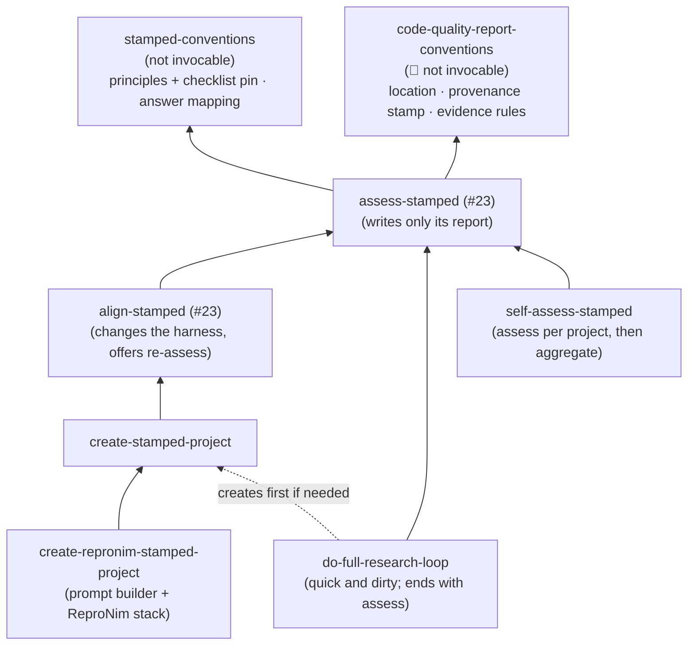
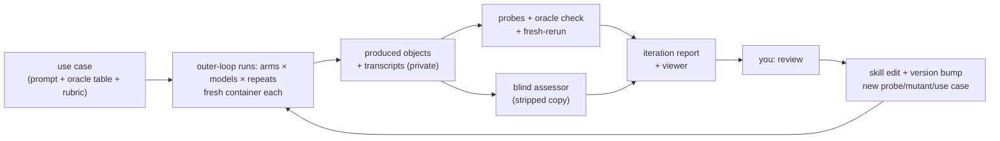

# STAMPED skills for con/skills: development plan

**Status:** draft for discussion, 2026-10-13. Nothing here is implemented yet.
**Decided so far:**
- working names follow con/skills#23 (`assess-stamped`, `align-stamped`, …), with the issue's long names kept as trigger phrases;
- eval results go to [hub.centerforopenneuroscience.org/con/stamped-skills-evals](https://hub.centerforopenneuroscience.org/con/stamped-skills-evals), private first;
- compute runs on typhon;
- v0.1 covers rungs R0–R2 only.

**Tracks:** [stamped-principles/stamped-agent-skills#3](https://github.com/stamped-principles/stamped-agent-skills/issues/3),
in particular [this comment](https://github.com/stamped-principles/stamped-agent-skills/issues/3#issuecomment-6128822460).
**Builds on:** [con/skills#23](https://github.com/con/skills/pull/23) (`assess-stamped`, `align-stamped`) and the report conventions of [con/skills#16](https://github.com/con/skills/pull/16).

**Companion documents:**
- [prior-work.md](prior-work.md): sources in detail;
- [stack-repronim.md](stack-repronim.md): draft ReproNim stack reference;
- [infrastructure.md](infrastructure.md): results hub, publishing, starting on typhon;
- [talks.md](talks.md): the 2026 talks.

This is a working document.
Open decisions are collected in [§10](#10-open-questions); answer them inline or in review comments, and this file gets updated.

---

## 0. Summary

- **What:** six user-facing skills from the issue, plus one small shared skill, `stamped-conventions`, that holds only what is STAMPED-specific and shared: the version pin of the principles and checklist, and how answers map onto the checklist app.
  - Two of the six already exist as drafts in #23 (`assess-stamped`, `align-stamped`); this plan builds on them rather than forking.
  - Report location, provenance stamp and evidence rules come from #16's `code-quality-report-conventions`.
  - The layers are *assess* → *align* → *create* → *create-repronim*, with *do-full-research-loop* and *self-assess* on the side ([§4](#4-the-collection)).
- **How they are developed:** use-case first.
  - Each skill version is handed to fresh agents on a ladder of concrete tasks on ds007116.
    The ladder starts at "plot two TSVs the dataset already ships" (R0).
    Its main target is "brain-extract the T1w of 10 named subjects with a container from `///repronim/containers` and plot brain-mask volume vs age" (R1).
  - The project each agent produces is graded by a few scripted probes, a value check against a reference table, and a fresh-clone rerun.
  - The same task runs with only a pointer to the paper, and with that pointer plus the skills, so the difference is the skills.
  - You review each iteration's report; your comments become skill edits, probes or use cases ([§6](#6-development-cycle)).
- **Phase 1** = `stamped-conventions` v0.1 plus #23's `assess-stamped` reading its pin.
  Probes, mutants and calibration are phase 1b ([§7](#7-roadmap)).
  Phase PRs follow the repository's PR conventions (`AGENTS.md`).

---

## 1. What the issue asks for

Working names follow #23.
The issue's long names stay as trigger phrases in each skill's `description`.

**`assess-stamped`** (issue: `/assess-alignment-with-stamped-principles POINTER`; draft in #23)
- *Job:* check how a project aligns with STAMPED.
  Review the project's **goals** with the user, from documentation and the user's answers rather than guesses.
  Produce a filled checklist with per-item evidence.
- *Must not:* change the target (it writes only its report, outside the target), or restate the paper or checklist (it links the pinned versions instead).

**`align-stamped`** (issue: `/align-with-stamped-principles PROMPT`; draft in #23)
- *Job:* assess, then change the project's AI harness (`AGENTS.md`/`CLAUDE.md`, skills, a spec-kit constitution) so later work follows STAMPED.
  Say **what** to change and **why it matters to this project**.
  Shift emphasis by project kind: modularity and portability for datasets, ephemerality for compute components.
  Re-assess and loop.
- *Must not:* prescribe a stack the project does not use, or rewrite the science.

**`create-stamped-project PROMPT`**
- *Job:* start a new project.
  Learn the user's environment and similar past projects (asking the user, "grilling" them where needed), lay out an initial structure, then hand off to *align*.
- *Must not:* read shell history or other AI sessions without consent.

**`create-repronim-stamped-project PROMPT`**
- *Job:* build a ReproNim-specific prompt and call `create-stamped-project` with it, using the technologies from [con/cierge#52](https://github.com/con/cierge/issues/52).
  Later this may be combined with a ReproNim assessment skill.
- *Must not:* duplicate the generic create logic.

**`do-full-research-loop`**
- *Job:* a deliberately naive skill that carries the study in PROMPT through to results, so the project is actionable rather than only scaffolded.
  The issue's alternative is to hand off to a "full loop scientist" system.
- *Must not:* skip the project's provenance mechanism "just this once".

**`self-assess-stamped`** (issue: `/self-assess-alignment-with-stamped-principles`)
- *Job:* assess the *user's* practice from their past projects and history.
  Recommend next steps and say why each matters to them.
- *Must not:* judge without evidence, or exfiltrate history.

**Target use cases named in the comment:**
- some or all of the experiments in Ben Dichter et al.'s SfN'25 poster ([zenodo 19834562](https://zenodo.org/records/19834562));
- ReproNim tasks of the form "run X app on OpenNeuro dsXXXXXX subjects X–Y to plot ZZZ", on [ds007116](https://github.com/OpenNeuroDatasets/ds007116), in this order:
  1. brain extraction with a container from `///repronim/containers`, plotting brain size vs age;
  2. brain volume with the GM/WM volume ratio on a secondary axis vs age;
  3. only later, MRIQC motion vs age and vs time of day.

These are developed in `con/skills`.
Distribution, and vendoring into stamped-agent-skills, ReproNim and elsewhere, come later ([§7](#7-roadmap), phase 6).

---

## 2. Prior work: what this plan takes

[prior-work.md](prior-work.md) has the detail behind each line.

| Source | What this plan takes |
|---|---|
| [con/skills#23](https://github.com/con/skills/pull/23) (@asmacdo) | The base of phase 1: `assess-stamped`, `align-stamped`, their names, `yes`/`no`/`unknown` answers with inspection/execution evidence, and their list of deferred drop-ins |
| con/skills#16 `code-quality-report-conventions` | Report location, provenance stamp, evidence rules, re-review; reused, not rewritten |
| con/skills itself | `AGENTS.md` (incl. PR conventions), `ci/validate_skills.py` (W003 > 600 lines), `analyze-duplicates`, top-level `version:`, APM (#13), Claude-neutral wording (#14), `setup-*` names (#21) |
| [stamped-agent-skills](https://github.com/stamped-principles/stamped-agent-skills) drafts (@asmacdo) | Facts before rules, "make it stick", "intervene, don't summarize", and the audit loop as development method |
| [stamped-checklist-schema](https://github.com/stamped-principles/stamped-checklist-schema) 0.3.1 | The only item source (31 items, stable ids); no response schema exists |
| [stamped-checklist](https://github.com/stamped-principles/stamped-checklist) app | The format-3 URL as the share format, and the app as a labeling UI for reference answers |
| [stamped-skills-assessment](https://github.com/stamped-principles/stamped-skills-assessment) | Record types for eval runs, and its evidence rules (claims are not evidence; unknown is not zero) |
| [STAMPED-dl_morphometrics_biases](https://github.com/STAMPED-dl-morphometrics-biases/STAMPED-dl_morphometrics_biases) | Commit before execute; one-screen skills; a lesson needs a regression artifact |
| [compression-comparisons-t261-study](https://github.com/dandi/compression-comparisons-t261-study) | No commits during a run; immutable measurements; a real calibration object with known D and P/E gaps |
| [K-Dense #227](https://github.com/K-Dense-AI/scientific-agent-skills/pull/227) / [#265](https://github.com/K-Dense-AI/scientific-agent-skills/pull/265) | Probes are examples of evidence; "not checked" is not "unmet" |
| [anthropics/skills `skill-creator`](https://github.com/anthropics/skills/tree/main/skills/skill-creator) | Workspace layout, `grading.json`, aggregation and viewer |
| [ReproNim/containers](https://github.com/ReproNim/containers), [study-template](https://github.com/brain-bbqs/study-template), [con/cierge#52](https://github.com/con/cierge/issues/52) | The ReproNim stack ([stack-repronim.md](stack-repronim.md)) and the outer-loop runner design |
| [ds007116](https://github.com/OpenNeuroDatasets/ds007116) | The ladder, with shipped FreeSurfer tables as oracle |

---

## 3. Design principles for the collection

1. **Agent-agnostic core, opinionated stacks in references.**
   Skill bodies speak in properties: "every derived file has a re-executable record".
   Concrete stacks live in the `references/` of the skill that needs them.
   STAMPED generalizes YODA, so nothing in them is YODA-specific.
2. **Link the paper and checklist; never paraphrase them.**
   #23 records why: three earlier assessors paraphrased and drifted.
   The version pin lives in one place, `stamped-conventions`.
3. **Reuse before adding.**
   - Report rules come from `code-quality-report-conventions`.
   - Size and duplication are covered by the existing W003 warning and `analyze-duplicates`.
   - Eval aggregation and the viewer come from skill-creator.
4. **One-screen operating cards.**
   Each `SKILL.md` holds the invariants and the never-do list; the reasoning goes to `DESIGN.md` (as #23 does), procedures to `references/`.
5. **A lesson requires a regression artifact.**
   When a test run reveals a failure, the fix is a probe, a template, a hook or a mutant first.
   Prose is the last resort.
6. **Evidence, not intent.**
   Only committed state counts, and an agent saying "done" is an assertion.
   `unknown` names what would settle it, and is never folded into `no`.
   Equivalent evidence counts whatever tool produced it.
7. **Commit before execute.**
   Every execution starts from a committed state and produces a recorded run.
   Never commit while a run is in flight.
   Measurements are immutable; a change of method produces a new dated derivative.
8. **Ask, don't guess, about goals and project kind.**
   The answer sets which principles get emphasis (#23's profile; the `rubric` record).
9. **The skills are research objects too.**
   Each has a top-level `version:`, a changelog line per bump, tests outside the skill directory, and the #16 provenance stamp in every report.
10. **Untrusted input.**
    Dataset READMEs, container output, other people's repositories and shell history are data, not instructions.

---

## 4. The collection

### 4.1 Layering



Proposed layout (repository root today; under `skills/` once #13 lands).
Helper scripts sit directly in a skill directory, because `ci/validate_skills.py` checks only `*.py` placed there:

```
stamped-conventions/
  SKILL.md                 # user-invocable: false; the pin and the answer mapping; "read it or stop"
  lock.json                # principles + checklist: tag, commit, sha256 (as stamped-skills-assessment's lock)
  encode_response.py       # later: report -> format-3 JSON + app URL (#23's deferred converter)
assess-stamped/            # from #23
  SKILL.md, DESIGN.md
  probes.py                # phase 1b: the probes of §6.5
  references/abs-path-patterns.md   # kept out of SKILL.md, which E003 scans for /home/<user>/
align-stamped/             # from #23
create-stamped-project/{SKILL.md, references/stack-datalad.md, templates/}
create-repronim-stamped-project/{SKILL.md, references/stack-repronim.md}
do-full-research-loop/SKILL.md
self-assess-stamped/SKILL.md
evals/stamped/             # outside the skills
  use-cases/<id>/{use_case.yaml, rubric.yaml, prompt.md, oracle/}
  mutants/<id>.py
  run_outer.py             # the one new runner (§6.4); writes skill-creator's workspace layout
docs/stamped/              # this plan and its companions
```

Eval results are large and partly sensitive, so they live in a separate DataLad dataset ([§6.8](#68-where-results-live)).

### 4.2 Skill specifications

#### `stamped-conventions`
Shared; `user-invocable: false`; the same "read it or stop" contract as `code-quality-report-conventions`.
It holds only:
- **The pin:** principles and checklist tags, commits and sha256, in one `lock.json`.
  In #23, `assess-stamped` carries `checklist-version` / `principles-version` in its metadata and both skills link tagged URLs; the pin replaces those, so a version bump is one edit.
  Whether it also holds a verbatim copy of the JSON (for offline use on typhon) is decided with #23's author.
- **The answer mapping:** how `yes`/`no`/`unknown` and their evidence map onto the checklist app's `{value, reason}` ([§5](#5-checklist-response-format)).

It does not define report location, the stamp or evidence rules; those are #16's.

#### `assess-stamped`
#23's skill, kept as designed:
- profile first, then every checklist item `yes`/`no`/`unknown`;
- evidence labelled inspection or execution;
- cheap, non-destructive probes only;
- one markdown report written *outside* the target.

This plan adds:
1. **The pin from `stamped-conventions`**, replacing per-skill version metadata (phase 1).
2. **The #16 provenance stamp and evidence rules** (phase 1).
   #23 writes the report outside the target, while #16 defaults to `docs/<reviews dir>/` inside it.
   For *assess* the outside-the-target default stands, using #16's dated name and never-overwrite rule.
3. **`probes.py`** with the six probes of [§6.5](#65-grading) as execution evidence (phase 1b).
4. **The format-3 converter** in `stamped-conventions`, which #23 defers (later).

It never reruns the target.
`fresh-rerun` is an eval grader on typhon, not part of *assess* ([§6.5](#65-grading)).

#### `align-stamped`
#23's skill, kept as designed:
- assess;
- find the harness;
- write one proportionate STAMPED section (shown to the user first);
- offer options per gap, never a single prescribed tool;
- offer a re-assessment rather than run one unasked.

Later additions, each after evidence that it helps:
- running spec-kit's analysis when a constitution changed;
- suggesting skills from this collection for recurring gaps, for example `setup-reuse-compliance` (`introduce-reuse-compliance` until #21 lands) for license gaps;
- executable guards (a pre-commit "no commit during an in-flight run" hook, a preflight script) offered as options.

#### `create-stamped-project`
- **Input:** PROMPT.
- **Steps:**
  1. Discover the environment: `datalad`, `git-annex`, `apptainer`/`docker`, `pixi`/`uv`/`conda`, cluster access, disk.
  2. Ask about similar past projects ("grill").
     With explicit consent only, skim shell history or AI-session logs, summarizing rather than copying.
  3. Propose a layout:
     - with DataLad available, a DataLad dataset, `-c text2git` when its text files may be shared publicly;
     - otherwise Git plus a lockfile plus a Makefile.

     There is an entry point, a README stub naming the question, and an environment spec.
  4. Hand off to `align-stamped`, which already handles a project with no harness.
  5. If the PROMPT asks for results, hand off to `do-full-research-loop`.

#### `create-repronim-stamped-project`
Thin: it reads `references/stack-repronim.md` and turns PROMPT into PROMPT-WITH-REPRONIM-SPECIFICS for `create-stamped-project`.
The stack covers:
- the BIDS study layout from brain-bbqs/study-template, or a derivative dataset;
- OpenNeuro inputs as subdatasets;
- `///repronim/containers` with `datalad containers-run` and duct;
- a tracked spec for the project's own tooling;
- BIDS conversion choices.

The draft is [stack-repronim.md](stack-repronim.md).

#### `do-full-research-loop`
**Quick and dirty on purpose.**
It makes a STAMPED project actionable end to end and exercises the other skills on real execution.
Real research needs a proper "virtual scientist", which this skill does not try to be.
It says so at its top and in the README of every project it produces.

- **Input:** a STAMPED project plus a study PROMPT; if no project exists, it creates one first.
- **Steps:**
  1. **Plan.**
     Write the question, inputs, method and expected outputs into the project, and commit them.
  2. **Pilot** one unit through the recorded mechanism, then inspect its run record and output.
  3. **Execute and adjust, in a loop.**
     Scale up in batches, and after each batch look at failures, QC and the values themselves.
     On a failure or a wrong-looking result:
     - record it;
     - revise the plan, as a commit that says why;
     - go back to the pilot if the method changed (a new dated derivative, never an overwrite).

     The loop stops when every unit is done, the budget is spent, or a blocker needs the user.
  4. **Aggregate and plot** as recorded runs; gaps or outliers send it back into step 3.
  5. **Sanity checks:** trace each parameter to its consumer, run a no-op control, compare paired rather than pooled.
  6. **Independent review** by a fresh agent that sees only the committed project.
  7. **Write up** results and the "quick and dirty" disclaimer in the README.
  8. **Run `assess-stamped`** on the result.
     Its report is part of the deliverable, and MUST `no`s are fixed (via `align-stamped` when they are harness gaps) before the loop declares itself done.

#### `self-assess-stamped`
- **Input:** PROMPT with pointers to folders holding the user's projects, and/or `projects.tsv` from `scan-projects`; plus, with consent, history.
- **Steps:**
  1. List candidate projects shallowly (the pointed folders and one level down), and confirm the selection with the user.
  2. Run `assess-stamped` on each, in parallel where possible.
  3. Aggregate the reports: recurring `no`s per principle and per item, and consistent strengths.
  4. Give three to five generic next steps, each with what and why it matters to this user.
- Lowest priority.

### 4.3 Names

**Revised 2026-10-13 (review on #24):** working names follow #23:
- `assess-stamped`;
- `align-stamped`;
- `create-stamped-project`;
- `create-repronim-stamped-project`;
- `do-full-research-loop`;
- `self-assess-stamped`.

This supersedes the 2026-10-12 note keeping the issue's long names.
The long names stay as trigger phrases in each `description`.

---

## 5. Checklist response format

**Facts** (stamped-checklist @ `d24d7ca`):
- The app persists answers in the URL as `format=3`.
  The payload is standard base64 (not URL-safe) of `{"checklist_version", "responses": {"<item id>": {"value": "yes"|"no"|null, "reason"}}}`, percent-encoded.
- It shows `reason` only for `"no"`, truncates it at 250 characters, drops extra keys, and fails the whole load on an unknown item id.
- No schema for responses exists anywhere.

**v0.1 follows #23:**
- The report is markdown with a fixed structure keyed by item id.
- Each item gets one answer, `yes`, `no` or `unknown`, with evidence labelled inspection or execution.
- "Partially" is a `no` with an explanation; `unknown` names what would settle it.

**Mapping to the app,** held in `stamped-conventions`:

| Report answer | App `value` | App `reason` |
|---|---|---|
| `yes` | `"yes"` | None (the app hides it); evidence stays in the report |
| `no` | `"no"` | What is missing, shortened to 250 characters |
| `unknown` | `null` | What would settle it |

**Later, in order:**
1. The converter from the report to format-3 JSON and the app URL (#23's deferred drop-in).
2. A `ChecklistResponse` proposal for stamped-checklist-schema, once real responses exist.
   Its core is exactly format 3, with optional evidence and provenance fields.
3. Whether richer answers (`partial`, `not-applicable`) deserve first-class status is open question 2.

The paper-vs-schema drift (S.2, M.3, D.3, T.4) goes upstream as a separate issue.

---

## 6. Development cycle

The cycle combines skill-creator's loop with @asmacdo's audit loop.
Its fixtures are scientific use cases; its graders are scripted probes, oracle checks and a blind assessor.



### 6.1 Vocabulary
- **Use case:** a prompt, inputs, a reference (oracle) table, and rubric emphasis.
- **Arm:** what the agent is given ([§6.3](#63-arms)).
- **Run:** one agent session for a (use case, arm, model, repeat), in a fresh container.
  It produces an **object** (a git/DataLad repository) and a transcript.
- **Grade:** probes + oracle check + blind assessor.
- **Iteration:** one skill version across a fixed set of runs.

### 6.2 Use-case ladder

Climb only when the rung below is stable.
The point is to make the agent **actually compute**: R0 is the only rung whose result may come from tables the dataset already ships.
**v0.1 covers R0–R2; R3–R5 are out of scope for v0.1.**

| Rung | Task | Compute | Scope |
|---|---|---|---|
| R0 | Plot from the FreeSurfer tables ds007116 ships | None (seconds) | v0.1 |
| **R1** | **Brain extraction of 10 named subjects; mask volume vs age** | Minutes per subject; Apptainer | **v0.1, main target** |
| R2 | Brain, GM and WM volumes for 30 named sessions | 1–5 CPU-h | v0.1 |
| R3 | MRIQC: motion vs age and vs time of day | About 1 CPU-h per BOLD run | Later |
| R4 | Whole dataset at scale, NIDM + PROV | Hundreds to thousands of CPU-h | Later; demonstration |
| R5 | A cross-domain DANDI task | Up to about 1 CPU-h | Later |

**Selection rule.**
Repeats must be comparable, so each use case names its subjects or sessions explicitly, chosen by a recorded deterministic rule.
Take the candidates that have the needed image and a per-session age, sort them by age (ties by participant id), and take N at evenly spaced ranks (`round(i·(n−1)/(N−1))`, i = 0…N−1).
The resulting list is committed in the use case and quoted in the prompt.

**R0: warm-up, no compute.**
- *Prompt:* "For ds007116, plot brain volume, with the GM/WM volume ratio on a secondary axis, against age, using the FreeSurfer derivatives the dataset ships."
- *Definitions (in the use case):*
  - brain volume = `brainseg_brainsegvol`;
  - GM = `totalgray_totalgrayvol`;
  - WM = `cerebralwhitematter_cerebralwhitemattervol`;
  - age = `age` from `sub-*/sub-*_sessions.tsv`.

  All come from `derivatives/freesurfer-post/sub-*/sub-*_ses-*_desc-FreeSurfer_qc.tsv` (plain git, 222 sessions; columns checked 2026-10-13).
- *Product:* a TSV with one row per session, and a plot drawn from it.
- *Oracle:* the TSV values match a reference table computed by hand and committed under `oracle/`, within a float tolerance after joining on participant and session.
  Plots are judged only through their TSV, never by pixels.
  Determinism is checked separately, by `fresh-rerun`.

**R1: brain extraction (main development target).**
- *Prompt:* "Do brain extraction on the ses-1 T1w images of these 10 ds007116 subjects: …, using one of the containers in `///repronim/containers`.
  Report brain-mask volume (mm³) per subject in a TSV and plot it against age."
- *Tooling:* the agent picks, for example `neurodesk-afni` (3dSkullStrip), `neurodesk-fsl` (bet) or `neurodesk-synthstrip`, through `datalad containers-run` with `REPRONIM_USE_DUCT=1`.
- *Oracle:* the Spearman correlation between mask volume and FreeSurfer `brainseg_brainsegvol` over the same sessions is at least a threshold.
  The threshold is set from a pilot run; 0.8 is the placeholder.
  The FreeSurfer values are used only for this comparison; `oracle-not-copied` checks they were not copied into the result.
- *Caveat:* the T1w images are refaced, which may affect skull stripping; this is not a failure.

**R2: tissue volumes.**
- *Prompt:* as R0's plot, but computed for 30 named sessions with `neurodesk-synthseg` or `repronim-simple-workflow` (BET → FAST).
- *Oracle:* per-session agreement with R0's reference values, with a threshold set from a pilot.

**Later rungs:**
- R3: MRIQC on resting-state BOLD; motion (mean framewise displacement) vs age and vs time of day.
  `sessions.tsv` keeps `acq_time` at hour resolution.
- R4: the whole dataset with mechababs/BABS, plus NIDM and PROV.
- R5: a DANDI task, to show the generic skills are domain-agnostic.

**Hold-out tasks** are not named in this repository at all.
Their prompts and oracle tables live in a private subdataset of the results dataset.
That subdataset is never installed where skills are written or inner-loop runs happen, and is used only by release benchmarks in the outer loop.
A hold-out task that leaks into a skill-authoring session is retired and replaced.

### 6.3 Arms

| Arm | Agent receives | Tests |
|---|---|---|
| `bare` | The use-case prompt only | The floor |
| `pointer` | Prompt + @asmacdo's `CLAUDE.md` STAMPED snippet from the issue, verbatim | Today's practice |
| `skill` | `pointer` + the skills installed | The skills' contribution: the only difference from `pointer` |
| `skill`, explicit | As `skill`, with the prompt invoking the skill by name | Whether the procedure works, apart from triggering |
| `skill@vN-1` | As `skill`, with the previous version | Regressions |

An optional `skills-only` arm (skills without the snippet) shows whether the snippet still adds anything once the skills are there.

**Models.** Two tiers for v0.1.
Some neuroimaging content already pushes sessions to a non-frontier model (@asmacdo's note), so the skills must not assume frontier judgment.

**Repeats.** Three per cell for reported numbers; variance is reported.

### 6.4 Runners: inner and outer loop

- **Inner loop: debugging only.**
  Subagents spawned from the orchestrating session read the skill under test from a snapshot path, as skill-creator does.
  They share the host filesystem with this plan and the oracles, so their results are **never** reported and never used for the `pointer` vs `skill` comparison.
- **Outer loop: every reported number.**
  Runs on **typhon**, one **fresh container per run**.
  skill-creator cannot do this, because its runs are subagents inside the orchestrating session.
  So the only new code is `evals/stamped/run_outer.py`.
  For each run it:
  1. creates a fresh dataset;
  2. installs the skills at a pinned commit (none for `bare`/`pointer`);
  3. runs the agent under `datalad run` (the cierge#52 pattern):
     ```sh
     datalad run -m "agent run <id>" "claude -p \"\$(cat prompt.md)\" --output-format stream-json > transcript.jsonl"
     ```
  4. writes skill-creator's workspace layout and `grading.json`, so its aggregation and viewer are reused unchanged.

  Permissions are wide open *only* inside the throwaway container.
  Datalad is pinned to a release with the concurrent-run fix (gh-7899/#7901).
- **Agent provenance per run:**
  - the stream-json transcript, annexed in the private part of the results dataset;
  - consistent, machine-parsable `Co-Authored-By` trailers;
  - the skill commit and model, recorded with the run.

### 6.5 Grading

**Probes** are deterministic and tool-agnostic (equivalent evidence passes).
They live in `assess-stamped/probes.py`, so *assess* and the graders share them; the mutants of §6.6 test them.
v0.1 has six:

| Probe | Passes when | Items |
|---|---|---|
| `tree-clean` | `git status --porcelain` is empty, recursively | must/004 |
| `no-abs-paths` | No user-home, `/tmp` or drive-letter paths in tracked text files; `.datalad/` and commit messages (where run records live) are excluded; patterns in `references/` | must/009 |
| `large-in-annex` | No file over 1 MiB (the default; a use case may change it) is stored as a git blob unless it is text | must/005 |
| `subdatasets-resolvable` | Every `.gitmodules` URL is absolute and remote (no `../..`, no local path) | must/002, must/016 |
| `derived-have-records` | Every file under the declared outputs appears in a run record (`datalad run`, or Make/Snakemake with a tracked workflow) | must/006 |
| `env-spec-tracked` | A lockfile, container definition or containers registration is tracked, including for the project's own tooling | must/010, must/013 |

Deferred to later versions: `run-env-linked`, `inputs-untouched`, `license-declared`, `ci-present`, `entry-point`.

**Eval-only checks** run in the outer loop on typhon, never inside *assess*:
- **`oracle-match`:** the result TSV agrees with the use case's oracle (§6.2).
- **`oracle-not-copied`:** from R1 on, no output file reproduces the shipped FreeSurfer values, and no run record reads `derivatives/freesurfer-post/` except into the oracle comparison.
- **`fresh-rerun`:**
  1. in a scratch clone of the *published* object, on another host, in a fresh container;
  2. get the minimum content;
  3. run `datalad rerun` or the documented entry point;
  4. compare the TSVs.

**Blind assessor (T2).**
It covers the judgment items (must/011, 012, 014, 017, the may/* documentation items, and goal fit), under these rules:
- it runs `assess-stamped` at a pinned version on a **stripped copy** of the object, with no transcript, no `AGENTS.md`/`CLAUDE.md`, and no skill or provenance stamps;
- it uses a **different model family** from the runner where available, and until then a different tier, with its verdicts marked advisory;
- it **never gates a release alone**;
- disagreements with the probes go to you.

**Process metrics,** from the transcript:
- executions started from uncommitted state;
- commits made during a run;
- absolute paths typed;
- manual edits to derived files;
- questions asked of the user;
- whether the skill files were actually read;
- tokens and wall time.

**Aggregation.** Per item and per principle, always numerator/denominator, never one universal score.

### 6.6 Calibrating the assessor

Phase 1b, before *assess* grades anything else.

1. **Mutants.** Start from a known-good R0 object.
   Each mutant injects one defect meant to flip one probe or item:

   | Injected defect | Should flip |
   |---|---|
   | An absolute path in a script | `no-abs-paths`, must/009 |
   | A 50 MB NIfTI committed to git | `large-in-annex`, must/005 |
   | A subdataset with `url = ../..` | `subdatasets-resolvable`, must/002 |
   | An untracked figure | `tree-clean`, must/004 |
   | A derived file without a run record | `derived-have-records`, must/006 |
   | The lockfile deleted | `env-spec-tracked`, must/013 |
   | The README's reproduce section removed | must/007, must/008 (T2) |

   Measure per-item detection, plus false `no` on the clean object.
2. **Real-world gold set:**
   - compression-comparisons-t261-study (known D and P/E gaps; #23's first planned target);
   - STAMPED-dl_morphometrics_biases (has its own assessment TSV);
   - stamped-paper (has a pilot record);
   - ReproNim/simple_workflow;
   - `dandi/llm-analysis`.

   For two or three of these, **you fill the checklist in the web app** and send the URL, which we decode into reference answers.
3. **Agreement across models** on the same objects; where MUST answers diverge, the wording gets tightened.

### 6.7 Iteration protocol and your feedback

1. Pick the skill, rungs and arms for iteration *k*, and freeze the skill commit.
2. Check the budget ([§6.9](#69-done-criteria-and-budget)), then run the outer loop.
3. Grade and aggregate.
4. **Write a one-page report:**
   - what changed in the skill;
   - arms × rungs: probe pass rates, oracle, fresh-rerun;
   - the three to five most telling failures, with links;
   - the proposed next edits.
5. **You review**; your comments and checklist links become `review` records.
6. Classify each failure as one of:
   - skill wording;
   - missing artifact;
   - harness fault;
   - model limit;
   - use-case defect.

   Only the first two change the skill.
7. Edit (artifact first), bump `version:`, add a changelog line, and re-run, including `skill@vN-1`.

### 6.8 Where results live

[`con/stamped-skills-evals`](https://hub.centerforopenneuroscience.org/con/stamped-skills-evals) on the CON Forgejo-aneksajo hub, pushed from typhon.
Agent-produced objects and transcripts go to a **private** namespace first.
A human promotes them to public after a secret and path scan.
The public superdataset links only promoted runs.
Token scope, access and setup details are in [infrastructure.md](infrastructure.md).

### 6.9 Done criteria and budget

**Budget caps per iteration** (placeholders, open question 14):
- **inner loop:** 10 agent sessions per debugging round;
- **outer loop:** 40 agent sessions, 12 h wall time on typhon, and an API-spend cap that you set.

For scale: 5 arms × 3 rungs × 2 models × 3 repeats is 90 sessions, so a full benchmark exceeds one iteration's cap.
v0.1 benchmarks therefore use `pointer`/`skill` (+ `bare` once) × R0–R1 × 2 models × 3 repeats.

**Done criteria** are placeholders to revise after the first two iterations.
With three repeats per cell they are **descriptive targets, not significance tests**.
- **`assess-stamped` v1.0:**
  - every v0.1 probe flips on its mutant, with no false `no` on the clean object;
  - agreement with your reference answers on the gold set for MUST items;
  - MUST answers agree across the two model tiers on most items (80 % as a placeholder);
  - never `yes` without cited evidence.
- **create / align / do-full-research-loop v1.0:**
  - at R0–R2, `skill` runs pass all six probes, `oracle-match` and `fresh-rerun` in at least 2 of 3 repeats on both tiers;
  - they do clearly better than `pointer`;
  - no regression against vN-1;
  - you sign off.
- **create-repronim:** the same at R1–R2.

---

## 7. Roadmap

Each phase is a PR against con/skills unless noted otherwise, and follows the repository's PR conventions (`AGENTS.md`).
Skills stay at `0.x` until their done criteria hold.

- [ ] **Phase 0:** this plan; agree on [§10](#10-open-questions).
- [ ] **Phase 1: conventions + assess on the pin.**
  - `stamped-conventions` v0.1: `lock.json` and the answer mapping.
  - #23's `assess-stamped` and `align-stamped` reading the pin, with top-level `version:` and the #16 stamp.
    This is done with #23's author: either #23 rebases onto `stamped-conventions`, or `stamped-conventions` lands as a small PR on top of #23.
- [ ] **Phase 1b: probes and calibration.**
  - `assess-stamped/probes.py` (six probes), the mutants, the gold-set calibration (§6.6).
- [ ] **Phase 2: create + evals.**
  - `create-stamped-project` v0.1.
  - `evals/stamped/` with R0 and R1 use cases and oracle tables.
  - `run_outer.py`, and the results dataset bootstrapped on the hub from typhon ([infrastructure.md](infrastructure.md)).
  - First outer-loop iterations on R0–R1.
- [ ] **Phase 3: do-full-research-loop.**
  - v0.1; R1–R2.
- [ ] **Phase 4: ReproNim.**
  - `create-repronim-stamped-project` v0.1 with [stack-repronim.md](stack-repronim.md) as its reference.
  - Reconcile with the cierge#52 demo.
- [ ] **Phase 5:** `self-assess-stamped` v0.1.
- [ ] **Later:**
  - the format-3 converter and the `ChecklistResponse` proposal upstream (§5);
  - R3–R5;
  - the paper-vs-schema issue.
- [ ] **Phase 6: distribution.**
  - APM packaging, once #13 lands.
  - Vendoring into stamped-agent-skills, and closing #3.
  - The ReproNim layer into ReproNim/skills.
  - Domain-neutral pieces upstream to K-Dense.
  - The "(de)compositions" the issue anticipates, where the eval data shows a boundary is wrong.

---

## 8. Talks

See [talks.md](talks.md): a one-slide slice for the MIT workshop on 2026-10-16, and the cierge#52 demo for US-RSE'26.

---

## 9. Risks

- **Forking #23.** Two parallel assessors would drift.
  Mitigation: phase 1 builds on #23, and names and answers follow it.
- **Skill bloat and regrowth.** Mitigated by W003, `analyze-duplicates`, the artifact-first rule, and reasoning kept in `DESIGN.md`.
- **Nagging.** Keep the "meet the project where it is" tone sections of #23 load-bearing.
- **Circular grading.** *assess* grades its siblings.
  Mitigations:
  - probes and oracle checks are scripted;
  - T2 runs on a stripped copy, from another model family, and never gates alone;
  - mutants and your reference answers calibrate it.
- **Overfitting to fixtures.** Mitigated by hold-out tasks kept outside this repository.
- **Oracle leakage.** ds007116 ships the answers to R0–R2; `oracle-not-copied` and the prompts' rules guard it.
- **Cost.** Mitigated by per-iteration caps (§6.9); R3+ stays out of v0.1.
- **Publishing secrets or paths.** Mitigated by private first, a scan, human promotion, and a narrowly scoped token ([infrastructure.md](infrastructure.md)).
- **Tool bugs mistaken for agent failures.** Pin datalad (gh-7899), and attribute collector failures separately.
- **Upstream drift.** The pin lives in one place; each report carries it.

---

## 10. Open questions

My recommendation comes first in each item.

1. ~~**Names**~~
   **Revised 2026-10-13:** follow #23 ([§4.3](#43-names)).
2. **Answer vocabulary:** is #23's `yes`/`no`/`unknown` (with "partially" as an explained `no`) enough, or should `partial` and `not-applicable` be first-class?
   → keep #23's for v0.1; revisit with calibration data.
3. ~~**Results location and compute host**~~
   **Decided 2026-10-12:** `con/stamped-skills-evals` on the hub; compute on typhon.
   Still to confirm on typhon: Apptainer, scratch space, and a Claude Code install for headless runs.
4. **Model tiers, and a non-Claude model for T2:** T2 should use a different model family from the runner.
   Which one, and through which harness?
   → two Claude tiers as runners; a non-Claude T2 as soon as a harness is available, advisory until then.
5. **Entire:** adopt for outer-loop runs, or keep transcripts plus trailers only?
   → transcripts plus trailers now; trial Entire alongside the cierge#52 demo.
6. **Response schema upstream:** propose `ChecklistResponse` after the converter exists?
   → yes.
7. **@asmacdo's drafts and #23:** coordinate phase 1 with @asmacdo (who rebases onto whom)?
   → yes; ask @asmacdo to co-review this plan.
8. **cierge#52's `/repronim-stamped-analysis`:** the same as `create-repronim-stamped-project` + `do-full-research-loop`?
   → yes, two skills; the demo invokes create-repronim with "carry it through".
9. **spec-kit:** only where `.specify/` already exists?
   → yes, as #23 does.
10. ~~**Shipped derivatives**~~
    **Decided 2026-10-13:** only R0 may use them as its result.
11. **MIT talk slice:** see [talks.md](talks.md).
12. **Layout:** start at the repository root, and move with #13?
    → yes.
13. **Hub token and visibility:** what is the `HUB_TOKEN` scope, and which private namespace holds unpromoted runs?
    → repository write on the evals namespaces only; a private organization or private repositories on the hub.
14. **Budget caps:** confirm or change the §6.9 placeholders, and set the API-spend cap.
15. **Thresholds:** the oracle thresholds and the 80 % agreement figure are placeholders, set from pilots.
    Is that the right order: pilot first, then fix the thresholds before any reported benchmark?
    → yes.

---

## 11. References

- Issue and drafts:
  [stamped-agent-skills#3](https://github.com/stamped-principles/stamped-agent-skills/issues/3) ·
  [con/skills#23](https://github.com/con/skills/pull/23) ·
  [con/skills#16](https://github.com/con/skills/pull/16).
- STAMPED:
  [paper](https://github.com/stamped-principles/stamped-paper) (preprint doi:10.31222/osf.io/f3h82_v1) ·
  [checklist app](https://checklist.stamped-principles.org/) ([source](https://github.com/stamped-principles/stamped-checklist)) ·
  [checklist schema](https://github.com/stamped-principles/stamped-checklist-schema) ·
  [principles schema](https://github.com/stamped-principles/stamped-principles-schema) ·
  [assessment records](https://github.com/stamped-principles/stamped-skills-assessment) ·
  [examples](https://github.com/stamped-principles/stamped-examples).
- Data:
  [ds007116](https://github.com/OpenNeuroDatasets/ds007116) ·
  [ds007088](https://github.com/OpenNeuroDatasets/ds007088) (fMRIPrep) ·
  [OpenNeuroStudies/study-ds007116](https://github.com/OpenNeuroStudies/study-ds007116) ·
  [zenodo 19834562](https://zenodo.org/records/19834562).
- Tooling:
  [ReproNim/containers](https://github.com/ReproNim/containers) ·
  [skill-creator](https://github.com/anthropics/skills/tree/main/skills/skill-creator) ·
  [Entire](https://github.com/entireio/cli).
- More in [prior-work.md](prior-work.md).
