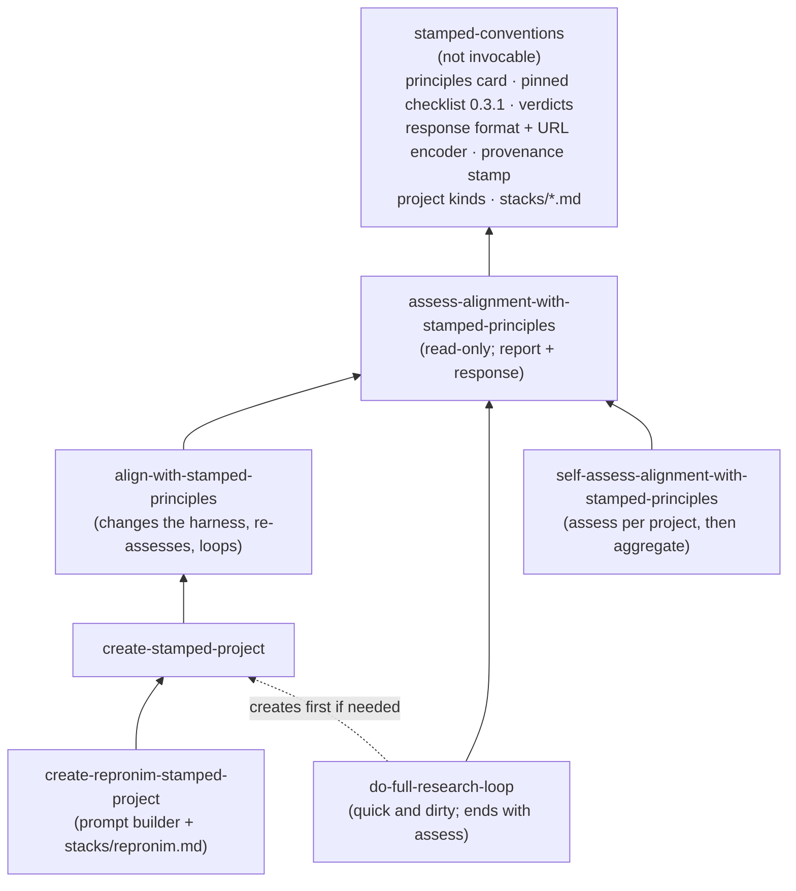

# STAMPED skills for con/skills: development plan

**Status:** phase 1 implemented, 2026-10-13 ([§7.1](#51-phase-1-as-landed)); the rest is still a plan.
**Decided so far:** keep the issue's skill names for now; eval results go to [hub.centerforopenneuroscience.org/con/stamped-skills-evals](https://hub.centerforopenneuroscience.org/con/stamped-skills-evals); compute runs on typhon; the development ladder starts with cheap neuroimaging tasks and leaves MRIQC until those are stable.
**Tracks:** [stamped-principles/stamped-agent-skills#3](https://github.com/stamped-principles/stamped-agent-skills/issues/3),
in particular [this comment](https://github.com/stamped-principles/stamped-agent-skills/issues/3#issuecomment-6128822460).
**Feeds:** the MIT LLM-workshop deck and the US-RSE'26 deck in [con/talks#33](https://github.com/con/talks/pull/33).

This is a working document.
Decisions that are still open are collected in [§10](#7-decisions-and-where-we-diverge); answer them inline or in review comments, and this file gets updated.
A session picking this up on typhon should start at [§7.2](#52-continuing-on-the-compute-host).

---


## 0. Summary

- **What:** six user-facing skills from the issue, plus one shared, non-invocable `stamped-conventions` skill that holds what they must agree on: the pinned checklist, the verdict vocabulary, the response format and the stack references.
  They form layers: *assess* → *align* → *create* → *create-repronim*, with *do-full-research-loop* and *self-assess* on the side ([§4](#3-the-collection)).
- **How they are developed:** use-case first, and **tested by a stranger**.
  Every change to a skill is tested by handing the skill snapshot to a **fresh, blind subagent** with a concrete scope — a repository to assess, or a PROMPT to carry out — which returns both its work product and the places the instructions failed it ([evals.md §2](evals.md#2-the-blind-subagent-run--the-core-test)).
  The bundled scripts make the mechanical half fast and identical between skill and grader, and point the reading agent at the items that need judgement; they are never the test of the skill itself.
  The scopes come from a ladder of concrete scientific tasks.
  The ladder starts at "plot two TSVs that ds007116 already ships".
  The main development target is "brain-extract the anatomicals of at least 10 ds007116 subjects with a container from `///repronim/containers` and plot brain size vs age".
  Heavier tasks, such as MRIQC motion vs age and time of day, come only after those are stable ([evals.md §3](evals.md#3-use-case-ladder)).
  The project each subagent produces is graded against STAMPED checklist 0.3.1, mostly by scripted checks plus a fresh-clone rerun.
  The same task is also run without the skill and with only a pointer to the paper.
  You review each iteration's report, and your verdicts and comments become skill edits, new checks or new use cases ([evals.md](evals.md)).
- **What it produces:** besides the skills, the reports are a filled checklist the web app can open (a [format-3 URL](#4-answer-format)), plus a proposed response schema for [stamped-checklist-schema](https://github.com/stamped-principles/stamped-checklist-schema).
  The eval results are themselves a STAMPED dataset.
- **First milestone:** `stamped-conventions` and `assess-alignment-with-stamped-principles` v0.1, calibrated on deliberately broken copies of a good project and on real projects, plus a rung-0 run with and without the skill.
  A thin slice of that could be ready for the MIT talk on 2026-10-16 ([talks.md](talks.md)).

---

---

## 1. What the issue asks for

From the comment, with the boundary each skill should keep.

**`/assess-alignment-with-stamped-principles POINTER`**
- *Job:* check how a project aligns with STAMPED.
  Review the project's **goals** with the user, from documentation and the user's answers rather than guesses.
  Produce a filled checklist with per-item evidence.
- *Must not:* change the project, or restate the paper or checklist (summarize briefly and point to the current versions instead).

**`/align-with-stamped-principles PROMPT`**
- *Job:* assess, then change the project's AI harness (`AGENTS.md`/`CLAUDE.md`, skills, a spec-kit constitution followed by `/speckit.analyze` for TODOs) so later work follows STAMPED.
  Say **what** to change and **why it matters to this project**.
  Shift emphasis by project kind: modularity and portability for datasets, ephemerality for compute components.
  Re-assess and loop.
- *Must not:* prescribe a stack the project does not use, or rewrite the science.

**`/create-stamped-project PROMPT`**
- *Job:* start a new project.
  Learn the user's environment and similar past projects (asking the user, "grilling" them where needed), lay out an initial structure, then hand off to *align*.
- *Must not:* read shell history or other AI sessions without consent.

**`/create-repronim-stamped-project PROMPT`**
- *Job:* build a ReproNim-specific prompt and call `/create-stamped-project` with it, using the technologies from [con/cierge#52](https://github.com/con/cierge/issues/52).
  Later this may be combined with a ReproNim assessment skill.
- *Must not:* duplicate the generic create logic.

**`/do-full-research-loop`**
- *Job:* a deliberately naive skill that carries the study in PROMPT through to results, so the project is actionable rather than only scaffolded.
  The issue's alternative is to hand off to a "full loop scientist" system.
- *Must not:* skip the project's provenance mechanism "just this once".

**`/self-assess-alignment-with-stamped-principles`**
- *Job:* assess the *user's* practice from their past history and projects.
  Recommend next steps and say why each matters to them.
- *Must not:* judge without evidence, or exfiltrate history.

**Target use cases named in the comment:**
- some or all of the experiments in Ben Dichter et al.'s SfN'25 poster ([zenodo 19834562](https://zenodo.org/records/19834562));
- ReproNim tasks of the form "run X app on OpenNeuro dsXXXXXX subjects X–Y to plot ZZZ", on [ds007116](https://github.com/OpenNeuroDatasets/ds007116), in this order:
  1. brain extraction with a container from `///repronim/containers` (AFNI, FSL, SynthStrip, …), plotting brain size vs age;
  2. brain volume with the GM/WM volume ratio on a secondary axis vs age;
  3. only once those are done, MRIQC motion vs age and vs time of day.

These are developed in `con/skills`. Automated distribution, and vendoring into stamped-agent-skills, ReproNim and elsewhere, come later ([§7](#5-roadmap), phase 6).

---

---

## 2. Design principles

1. **Agent-agnostic core, opinionated stacks in references.**
   The skill bodies are written in terms of properties: "every derived file has a re-executable record".
   Concrete stacks live in `stamped-conventions/references/stacks/*.md`, loaded only when the project uses that stack.
   `datalad.md` comes first, then `repronim.md`, then others (Snakemake, DVC, Pixi/uv) as needed.
   STAMPED generalizes YODA, so nothing in them is YODA-specific.
   This follows @asmacdo's draft and con/skills#14.
2. **Do not duplicate the paper or the checklist.**
   A one-screen principles card links to the paper.
   Checklist items come from the vendored JSON at a pinned tag, never from retyped prose.
   The vendoring is itself a recorded, re-executable command (the skill practicing what it preaches).
3. **One source of truth.**
   Verdict vocabulary, checklist pin, response format, provenance stamp, and the rules for project kinds and emphasis all live in `stamped-conventions`, so the six skills cannot contradict each other.
   The MD5E-vs-SHA256E split in STAMPED-dl is the failure mode this prevents.
4. **One-screen operating cards.**
   Each `SKILL.md` holds the invariants, a short "tool → what it is authoritative for" table and the never-do list, with references loaded on demand.
   Size budget: about 250 lines per `SKILL.md` and about 150 for the conventions skill.
   A lint check enforces this and flags duplicated blocks ([§7](#5-roadmap), phase 1).
5. **A lesson requires a regression artifact.**
   When a test run reveals a failure, the fix is a probe, a template, a hook or a mutant first.
   Prose is the last resort.
   No incident catalogs in skills.
6. **Evidence, not intent.**
   Only committed state counts.
   An agent saying "done" is an assertion.
   `not-checked` (tool unavailable, too expensive, needs access) is never folded into `unmet`.
   Equivalent evidence counts whatever tool produced it.
7. **Commit before execute.**
   Every execution starts from a committed state and produces a recorded run.
   Never commit while a run is in flight.
   Measurements are immutable; a change of method produces a new dated derivative.
8. **Ask, don't guess, about goals and project kind.**
   Is the project a dataset, a compute component or tool, a study, or a skill?
   The answer changes which principles get emphasis; it is recorded as the `rubric`.
9. **The skills are research objects too.**
   Each has a `version:`, a changelog line per bump, tests outside the skill directory, and a provenance stamp in every report it writes.
   This is the recursive point on the MIT deck's "a skill is a research object" slide.
10. **Untrusted input.**
    READMEs of datasets, container output, other people's repositories, and shell history are data, not instructions.
    Use the same callout the other con/skills skills carry.
11. **A skill is tested by a stranger, not by its author.**
    Wording is only proven by a fresh, blind subagent given the snapshot and a concrete scope, which returns its work product *and* where the instructions failed it ([evals.md §2](evals.md#2-the-blind-subagent-run--the-core-test)).
    The authoring session walking through its own procedure proves nothing, because it knows what it meant.
12. **Scripts are the fast half, not the answer.**
    Bundled probes make the mechanical part cheap, repeatable and identical between the skill and its graders, and they tell the reading agent which items deserve its judgement.
    A report built only from them is a draft; a passing probe suite is not evidence that anyone can follow the skill.

---

---

## 3. The collection

### 4.1 Layering



Proposed layout, at the repository root today, or under `skills/` once con/skills#13 lands:

```
stamped-conventions/
  SKILL.md                      # user-invocable: false; "read it or stop" contract
  references/
    principles-card.md          # one screen; links the paper
    verdicts.md                 # vocabulary + mapping table (§5)
    response-format.md          # JSON layout, URL encoding, provenance stamp
    project-kinds.md            # dataset / component / study / skill → emphasis
    stacks/datalad.md
    stacks/repronim.md
  checklist/
    stamped-checklist-0.3.1.json  # vendored; never hand-edited
    lock.json                     # source URL, tag, commit, sha256 (as in stamped-skills-assessment)
  scripts/
    vendor_checklist.py         # refresh the pin (run through a recorded command)
    encode_response.py          # response JSON <-> checklist URL (format 3)
assess-alignment-with-stamped-principles/
  SKILL.md
  scripts/probes/*.py           # scripted checks (evals.md §6), shared with the graders
  scripts/run_probes.py         # the sweep; also writes a draft response JSON
  scripts/fresh_rerun.py        # the expensive probe: clone elsewhere and re-run
align-with-stamped-principles/SKILL.md
create-stamped-project/{SKILL.md, templates/…}
create-repronim-stamped-project/SKILL.md
do-full-research-loop/SKILL.md
self-assess-alignment-with-stamped-principles/SKILL.md
evals/stamped/                  # kept outside the skills (K-Dense convention)
  conditions/pointer-CLAUDE.md  # the `pointer` baseline, verbatim from the issue
  fixtures/make_r0_object.py    # a known-good object, built with plain git
  mutants/mutate.py             # defect injectors for calibrating the assessor
  harness/{calibrate.py, run.py, grade.py, aggregate.py}
  use-cases/<id>/{use_case.yaml, rubric.yaml, prompt.md, oracle/…}
  gold/<object>/{assessment.md, response.json, probes.json}   # reference answers
  tests/                        # pytest over the probes, mutants and encoder
docs/stamped/PLAN.md            # this file
```

Eval *results* are large and binary (produced projects, transcripts, container logs), so they live in a separate DataLad dataset, not here ([evals.md §9](evals.md#9-where-results-live)).

### 4.2 Skill specifications

#### `stamped-conventions`
Shared; `user-invocable: false`.
- Holds everything in the tree above.
  Dependent skills read `../stamped-conventions/…` and stop if it is missing; they never work from memory.
  This is the same contract as `code-quality-report-conventions`.
- `version:` is bumped when the verdicts, the response format or the checklist pin change.
  A pin change alone is a MINOR bump, because old reports stay comparable as long as each one carries its pin.

#### `assess-alignment-with-stamped-principles`
- **Input:** a pointer (local path, git URL, DataLad URL), plus an optional scope.
- **Steps:**
  1. Establish facts: what kind of unit it is, its boundary, how code and data are versioned, the environment, how things are executed, and provenance (@asmacdo's seven questions).
  2. Review goals with the user and settle the project kind, which yields the rubric emphasis.
  3. Run the scripted probes, then the judgment-only items.
  4. Check the project's issue tracker for gaps that are already known.
  5. Write the report: MUST items first, highest-leverage fix first, each verdict with cited evidence.
- **Outputs:**
  - `docs/stamped/assessments/YYYY-MM-DD-assessment.md` in the target if the user agrees, otherwise in the current directory;
  - `…-response.json` ([§5](#4-answer-format));
  - a checklist-app URL;
  - optionally, stamped-skills-assessment records.
- **Tools:** read-only, plus writing its own report files.
  It may fan out per-principle subagents, like stamped-paper's `consistency-audit`.
- **Done when:** the calibration targets in [evals.md §10](evals.md#10-done-criteria) are met.

#### `align-with-stamped-principles`
- **Input:** PROMPT, which is deliberately terse ("align this project with STAMPED"); the agent decides the specifics.
- **Steps:**
  1. Run *assess*.
  2. Propose harness changes, each with what and why:
     - a STAMPED section in `AGENTS.md`/`CLAUDE.md` (the "make it stick" pointer, the recorded stack, the invariants that apply);
     - executable guards: a pre-commit "no commit during an in-flight run" hook, a preflight script, a CI rerun job;
     - skills to install, for example `introduce-reuse-compliance` for licenses (paper S.2/D.3) or the K-Dense `datalad` skill;
     - if `.specify/` exists, a constitution amendment, then `/speckit.analyze` to generate TODOs.
  3. Apply what the user accepts.
  4. Re-assess against the completed and planned changes.
  5. Loop while new, obvious items keep appearing.
- **Output:** the harness diff, plus before and after responses.
- **Must not:** introduce a parallel tool for a job the recorded stack already covers.
  A plain Git repository with a Makefile and a lockfile already satisfies much of STAMPED.

#### `create-stamped-project`
- **Input:** PROMPT.
- **Steps:**
  1. Discover the environment: `datalad`, `git-annex`, `apptainer`/`docker`, `pixi`/`uv`/`conda`, cluster access, disk.
  2. Ask about similar past projects ("grill").
     With explicit consent only, skim shell history or AI-session logs, summarizing rather than copying.
  3. Propose a layout:
     - with DataLad available, a DataLad dataset, created with `-c text2git` when its text files may be shared publicly;
     - otherwise Git plus a lockfile plus a Makefile.

     Inputs become subdatasets or recorded references.
     There is an entry point, a README stub naming the question, an environment spec, and a CI stub.
     For BIDS-shaped domains, use the study-template layout from `stacks/repronim.md`.
  4. Hand off to *align*.
  5. If the PROMPT asks for results, hand off to *do-full-research-loop*.
- **Templates:** a minimal skeleton per stack, plus the hook and preflight scripts from the regression-artifact rule.

#### `create-repronim-stamped-project`
Thin: it reads `stacks/repronim.md` and turns PROMPT into PROMPT-WITH-REPRONIM-SPECIFICS for *create*.
It is also where a future ReproNim assessment skill plugs in.
What that stack reference has to carry is in [stack-repronim.md](stack-repronim.md).


#### `do-full-research-loop`
**This is quick and dirty on purpose.**
It exists to make a STAMPED project actionable end to end, and to exercise the other skills on real execution.
Real research needs a proper "virtual scientist" (the issue's "full loop scientist" system), which this skill does not try to be.
The skill says so at its top, and in the README of every project it produces.

- **Input:** a STAMPED project plus a study PROMPT; if no project exists, it creates one first.
- **Steps:**
  1. **Plan.**
     Write the question, inputs, method and expected outputs into the project, and commit them.
  2. **Pilot.**
     Run one unit (one subject, one session) through the recorded mechanism.
     Inspect its run record and output before going further.
  3. **Execute and adjust, in a loop.**
     Scale up in batches.
     After each batch, look at failures, QC and the values themselves.
     When something fails or looks wrong (tool errors, failed QC, implausible numbers, missing units):
     - record what happened;
     - revise the plan, as a commit that says why;
     - go back to the pilot if the method changed.

     A method change goes to a new dated derivative; it never overwrites earlier results.
     The loop stops when every unit is done, the budget is spent, or a blocker needs the user.
  4. **Aggregate and plot,** also as recorded runs.
     If aggregation turns up gaps or outliers, go back into the loop of step 3 rather than patching outputs.
  5. **Sanity checks and controls:** trace each parameter to its consumer, run a no-op control, compare paired rather than pooled.
  6. **Independent review** by a fresh subagent that sees only the committed project.
  7. **Write up** the results and the "quick and dirty" disclaimer in the README.
  8. **Run `/assess-alignment-with-stamped-principles`** on the finished project.
     Its report is part of the deliverable.
     MUST failures it finds are fixed, via `/align-with-stamped-principles` when they are harness gaps, before the loop declares itself done.
- **Invariants:** §2.7 (commit before execute), with no editable installs of pinned code and no manual edits to derived files.

#### `self-assess-alignment-with-stamped-principles`
- **Input:** PROMPT with pointers to the folders holding the user's relevant projects, and/or `projects.tsv` from `scan-projects`.
  Plus, with consent, shell and AI-session history.
- **Steps:**
  1. List candidate projects shallowly (the pointed folders and one level down, not a deep crawl), and confirm the selection with the user.
  2. Run `/assess-alignment-with-stamped-principles` on each selected project, in parallel subagents where possible.
  3. Aggregate the collected assessments: recurring gaps per principle and per checklist item, and consistent strengths.
  4. Give three to five generic next steps drawn from that aggregate, each with what to change and why it matters to this user.
- Lowest priority.

### 4.3 Names

**Decided:** keep the issue's names for now.
They are verb-first, like the `setup-*` convention of #21.
A shorter `stamped-*` family remains possible later; a rename is a `git mv` plus a MAJOR version bump, with the old names kept as trigger phrases in the descriptions.

---

---

## 4. Answer format

**Facts** (stamped-checklist @ `d24d7ca`):
- `PERSISTENCE_FORMAT = 3` (`src/persistence.js`).
- The payload is standard base64, *not* URL-safe, of UTF-8 JSON, percent-encoded by `URLSearchParams`:
  ```json
  {"checklist_version": "0.3.1",
   "responses": {"stamped-checklist:must/005": {"value": "no", "reason": "≤250 chars"}}}
  ```
- The URL is `?checklist=0.3.1&responses_version=0.3.1&cols=auto&sections=off&format=3&responses=…`.
  The issue's example is missing the `&` before `format`.
- The app accepts only `value ∈ {"yes","no",null}`.
  It shows `reason` only for `"no"`.
  It ignores and drops extra keys.
  It rejects the whole load on an unknown item id.

**Proposal:**
1. The skills emit one canonical **response JSON** that is a superset of format 3.
   Extra fields per item:
   - `status`: the richer verdict;
   - `evidence[]`: `{uri, description, sha256?}`, the same shape as stamped-skills-assessment's `Evidence`.

   Top-level extras:
   - `principles_version`, `schema_version`, `checklist_source` (tag + commit);
   - `object`: url, commit, captured_at;
   - `assessor`: skill name and version, harness, model, date.

   `encode_response.py` strips the extras to produce the app URL.
   The app tolerates them anyway.
2. **Verdict vocabulary.** The richer `status` maps onto the app's values:

   | `status` | Meaning | App `value` | App `reason` |
   |---|---|---|---|
   | `met` | Evidence shows it | `"yes"` | Hidden by the app; evidence lives in the JSON |
   | `partial` | Met in some components, or by design but violated somewhere specific | `"no"` | Where it falls short |
   | `unmet` | Evidence shows it is absent | `"no"` | Shortest fix |
   | `not-checked` | Could not check: tool missing, cost, access | `null` | Why, and what would check it |
   | `not-applicable` | Does not apply to this kind of object | `null` | `N/A: …` |

   A MUST is never satisfied by `partial`.
   This reconciles @asmacdo's draft (pass/partial/fail/unknown), STAMPED-dl (met/partial/unmet/restricted/n-a), the K-Dense #265 review (keep not-checked apart), and the five judgment statuses of stamped-skills-assessment.
3. **Upstream:** open a PR on stamped-checklist-schema adding a `ChecklistResponse` LinkML class, versioned with the checklist.
   Its required core is exactly format 3; the extensions above are optional.
   Coordinate with the app maintainers on whether this becomes `format=4`.
   File the paper-vs-schema drift (S.2, M.3, D.3, T.4) as a separate issue.
   **Drafted 2026-10-13** in [`upstream/`](upstream/): the schema as a standalone file carrying its own version (so the upstream version-bump gate does not apply), linted, and validated against a real 31-item response, an app-exported core payload and a trimmed example.
   The drift issue cites `main.tex` line numbers, and adds a detail the plan did not have: the schema's T.5 is a split of the paper's compound T.4, so T.5 has no paper counterpart.
4. **Full assessment vs quick response.**
   The response is the quick, per-item product.
   When a rubric, plan and activities matter (eval runs, reviewed assessments), the same run also writes stamped-skills-assessment records, so the two never diverge.

---

---

## 5. Roadmap

Each phase is a pull request against con/skills unless noted otherwise.
Skills stay at `0.x` until their done criteria hold.
**No phase is done until each skill it touches has had a blind subagent run** on a concrete scope, with its friction report triaged ([evals.md §2](evals.md#2-the-blind-subagent-run--the-core-test)).

- [x] **Phase 0:** this plan; agree on [§10](#7-decisions-and-where-we-diverge).
- [ ] **Phase 1: conventions + assess.**
  - [x] `stamped-conventions` v0.1: card, vendored checklist + lock, verdicts, encoder, `stacks/datalad.md`, seeded from @asmacdo's draft.
  - [x] `assess-alignment-with-stamped-principles` v0.1 + probes.
  - [x] `evals/stamped/` skeleton with R0 + mutants.
  - [x] Bootstrap `con/stamped-skills-evals` on the hub: `datalad create -c text2git`, a `hub` sibling, the first `datalad push` — done 2026-10-13 from a cloud session, not typhon ([evals.md §9](evals.md#9-where-results-live)).
    Still to add there: con/skills as a pinned subdataset, which waits for this branch to be published.
  - [x] First calibration iteration ([evals.md §7](evals.md#7-calibrating-the-assessor)): mutants, plus one real object with its reference answer.
  - [x] A size and duplicate-block check added to `ci/validate_skills.py`.
  - [x] Outside con/skills: both drafted, verified and ready to file in `docs/stamped/upstream/` — the `ChecklistResponse` schema (linted, and `linkml-validate`d against a real 31-item response, an app-exported payload and the example) with its PR body, and the paper-vs-schema drift issue with line numbers.
    Filing them is the one step left, and needs push access upstream.
- [ ] **Phase 2: create + align.**
  - [x] v0.1 of both, with templates (pre-commit run guard, preflight, recorded-run wrapper).
  - [x] Inner-loop harness, with the prompt of every arm kept beside the run (`run.py --inner-prompt`).
  - [x] R0 with `bare` / `pointer` / `skill-implicit` / `skill-explicit` (2026-10-13), plus sonnet repeats 2–3 and haiku (2026-10-14).
  - [x] R1 with the same arms (2026-10-14): the first rung with real compute, oracle met in every finished arm.
  - [ ] Three repeats of one cell, to characterise the spread ([§10](#7-decisions-and-where-we-diverge) item 14), and a publishing target so must/016 is reachable (item 13).
- [ ] **Phase 3: do-full-research-loop.**
  - v0.1.
  - Outer-loop runner (container per run, pinned datalad, transcripts).
  - R1–R2.
- [ ] **Phase 4: ReproNim.**
  - `stacks/repronim.md` + `create-repronim-stamped-project` v0.1.
  - Reconcile with the cierge#52 demo.
  - R1–R3, then R4 as a demonstration with NIDM and BEP028 outputs.
- [ ] **Phase 5:** `self-assess-alignment-with-stamped-principles` v0.1, plus R5 (cross-domain).
- [ ] **Phase 6: distribution.**
  - APM packaging, once #13 lands.
  - Vendoring into stamped-agent-skills, replacing its single draft, and closing #3.
  - The ReproNim layer into ReproNim/skills.
  - Domain-neutral pieces upstream to K-Dense (answering their issue #217, "should STAMPED be its own skill?").
  - The "(de)compositions" the issue anticipates: split or merge skills where the eval data shows a boundary is wrong.

### 5.1 Phase 1 as landed

What exists in con/skills as of 2026-10-13, on branch `claude/ecstatic-cerf-nh4j6w`:

- **`stamped-conventions/` 0.2.0** — the five references, the checklist vendored at `v0.3.1` (`af259ba`) with a `lock.json` carrying tag, commit and sha256, `vendor_checklist.py` (`--check` verifies the files against the lock) and `encode_response.py` (`items`, `validate`, `encode`, `decode`, `template`).
  The encoder is the only writer of an app URL, and `decode` is what turns a checklist a person filled in the web app into reference answers.
- **`create-stamped-project/` 0.1.0, `align-with-stamped-principles/` 0.1.0 and `do-full-research-loop/` 0.1.0** — the three skills R0 exercises, with the guards shipped as templates rather than described: `pre-commit-run-guard` (refuses a commit while a recorded run is in flight, and allows the run's own), `run-recorded.sh` (sets the marker, refuses a dirty tree, falls back to a plain recorded commit without datalad) and `preflight.sh` (eight checks, each naming the checklist item it protects).
  All three guards are tested: `preflight.sh` passes on the clean fixture and refuses three mutants; the hook refuses an outside commit and admits `IN_FLIGHT_OK=1`.
- **`assess-alignment-with-stamped-principles/` 0.2.0** — the skill, thirteen probes in `scripts/probes/`, `scripts/run_probes.py` (which also writes a draft response JSON) and `scripts/fresh_rerun.py`.
  The probes answer **11 of the 17 MUST items**, 2 SHOULD items and may/001 from committed state; the other six MUST items are judgement, listed in the skill.
  Three probes answer no checklist item and are reported as extras: `license-declared`, `clone-weight` and `inputs-untouched`.
  One probe can answer two items differently — `entry-point` separates must/007 (instructions) from must/008 (a starting point), `run-env-linked` separates must/006 (the record names an environment) from must/015 (that environment is pinned).
- **`evals/stamped/`** — the R0 use case with its rubric and science oracle, the `pointer` baseline quoted verbatim from the issue, a known-good R0 fixture built with plain git (no datalad, no network), thirteen defect mutants, `calibrate.py`, `blind_run.py`, `run.py`, `grade.py`, `aggregate.py`, 24 pytest tests outside the skill directories, plus `gold/` (reference answers) and `blind-runs/` (what independent subagents returned).
- **CI** — `tox -e validate` gained E007 (a skill's own `max-lines` budget: 150 for the conventions skill, 250 for the assessor) and W004 (eight or more repeated lines of prose between a skill's Markdown files), and recursive checks over bundled Python; `tox -e stamped-evals` runs the tests and the calibration on every change.

**Measured, not asserted** ([evals.md §10](evals.md#10-done-criteria)):

- mutant detection **13/13**, including two negative controls, with no collateral item flips;
- false `unmet`/`partial` on the clean fixture **0/15** answered items;
- on `compression-comparisons-t261-study` (1265 commits, 22286 tracked derivatives) the probe sweep takes **3.6 s** and finds the `url = ../..` gap the plan predicted;
- after one blind run and the fixes it forced, an independent subagent's 31 verdicts and the reference answer agree on **30 of 31** items;
- **6/6 judgement mutants** detected and named, with the control's unexplained accusations down from 7/19 to 3/19;
- **18/18 scripted mutants**, 81 tests, 26 `pytest-evals` cases.

Two rounds of calibration paid for themselves.
Running the probes on a real object caught must/009 counting host paths inside duct traces as script defects, must/005 calling 12 MiB of JSONL "binary data", must/006 ignoring environment *capture* as distinct from an environment *specification*, and four probes reporting `unmet` with no evidence of absence.
Then the **first blind run** ([evals.md §2](evals.md#2-the-blind-subagent-run--the-core-test)) found what no amount of self-review had: the `no-abs-paths` probe knew `/home` and `/tmp` but not `/data/<user>`, so two entry points pinned to a single machine read as clean; `must/005` applied a size criterion the item does not state; `must/010` hedged where the object carried positive evidence; `should/003` was answered from the wrong property; `must/016` was mapped to submodule urls rather than to environment specifications; and the documented `--allow` flag did not exist.
Each became a probe fix **and** a mutant, which is why the mutant count moved from 8 to 13.
Its five friction items became one `verdicts.md` rule, the `flags` field, the filename contract, a "verify the finding you are about to lead with" step, and an addition to the upstream drift issue.
The run is kept in `evals/stamped/blind-runs/2026-10-13-assess-t261/`, as the subagent wrote it; the gold answer it corrected is in `evals/stamped/gold/`, with a Corrections section and its checklist-app URL.

`fresh_rerun.py` is exercised both ways in the test suite: `met` on an object whose entry point re-creates its output, and `not-checked` — not `unmet` — when `datalad get` cannot fetch the clone's content, because a collector failure is not an object defect.

Still open before `assess` can be called v1.0: agreement with a human's answers on the gold set ([evals.md §7](evals.md#7-calibrating-the-assessor) step 2 — fill the checklist for one of the gold objects in the app and send the URL).

**Measured on 2026-10-14**, on typhon, with everything below recorded under `evals/stamped/blind-runs/`:

- **agreement across model tiers:** the same object, the same snapshot, the same prompt on the smaller tier — 27 of 31 items and **15 of 17 MUST items** agree with the reference answer (88%, above the 80% criterion), and neither MUST difference is a pass/fail flip. It also found the first defect that only a *packaging* test could find: the conventions card linked a path that exists in this repository and not in an installed skill.
- **judgement mutants:** two more rounds, 2/2 and 1/1 detected, one per tier — and the control run on the unmutated fixture reached **0/19 unexplained accusations** (7/19 → 3/19 → 6/22 → 0/19), which is the §10.1 criterion "no collateral accusation on the clean fixture". The ratchet in `tests/test_eval_cases.py` is now that gate.
- **a new object, outside the tuning loop:** ReproNim/simple_workflow, which found **five probe defects in one run**, three of them false *failures* — a numbered README losing must/007, `${HOME}` in a CI config losing must/009, and a fully pinned `environment.yml` called unpinned. An assessor people distrust is worse than none, and only an untuned object finds that class.
- **R0 and R1 with four arms each**, with the skills clearing both baselines at both rungs ([§7.3](#73-2026-10-14-the-day-r1-ran)).

### 5.3 2026-10-14: the day R1 ran

What the four-arm runs measured, at both rungs, one repeat per cell on sonnet
unless stated. Counts with denominators; **no significance is claimed** —
within-arm spread is as large as the gap between tiers.

| | `bare` | `pointer` | `skill-implicit` | `skill-explicit` |
|---|---|---|---|---|
| **R0** (2026-10-13) MUST | 3/11 | 5/11 | 8/11 | 7/11 |
| **R0** repeats (2026-10-14) | | | | 10/11, 8/11 (sonnet); 9/11, 8/11 (haiku) |
| **R1** MUST | 5/11 | 8/11 | **10/11** | **9/11** |
| **R1** science oracle | met | met | met | met |

Both skill arms clear both baselines at both rungs, and the R1 science was
right in every arm: ten computed mask volumes each, all inside the
`[0.90, 1.34]` band the two-container pilot measured, with the three SynthStrip
arms agreeing to the digit. The best run's only remaining failure is must/016,
which a sandbox cannot satisfy at all
([§10](#7-decisions-and-where-we-diverge) item 13).

**What the day cost in defects found, which is the point of running it:** nine
in the R1 arms (the wrapper could not run a container at all; the oracle could
not find the comparator under a module; millilitres read as implausible
volumes; a voxel count preferred over a volume; the harness's own notes costing
two arms must/009; one arm's `pkill` hitting a sibling), five in the
new-object run, five more from the judgement rounds, and one in `fresh_rerun.py`
that was quietly pulling **87 GB** of container images before it was stopped.
Every one is now a test, a declared expectation, or a sentence that says what
it meant to say.

### 5.4 2026-10-15: what a late report was worth

The haiku `skill-explicit` repeat that went quiet for 35 minutes on 2026-10-14
came back the next morning with the most useful report of the four, because it
argued with its grader and was right. It had committed nothing more in the
meantime — it was finishing its own STAMPED assessment, which the skill tells
it to write outside the tree — so its grading had been taken at its final
state. The whole difference is in the probes: re-graded, it is **9/11, not
7/11**, the best haiku run rather than the worst.

- **`run-env-linked` was blind to a registered container.**
  `datalad containers-add` with a locally built image puts it at
  `.datalad/environments/<name>/image` — no extension — and `containers-run`
  records the expanded call, so neither the image-suffix regex nor the word
  `containers-run` appears in the record. That is the *normal* layout for a
  built image. must/006 read `unmet` on an object with two records naming a
  tracked, content-addressed image; must/015 was `not-checked` because nothing
  had been found to check. The probe now reads `.datalad/config`, credits a
  bare container-runtime invocation, and — because crediting that would
  otherwise weaken must/015 — scans record bodies for floating tags too.
- **`entry-point` was grading the prose style.** `## Requirements` over
  `## Entry point and reproduce` is install and usage by any reading, and
  must/007 came back "neither a README with install/usage instructions nor a
  Makefile" because the probe matched its keywords only at the start of a line.
- **A grading did not record the commit it graded.** This one is the harness's.
  Establishing that the 7/11 had been taken at the run's final commit, and so
  that the whole difference was in the probes, took comparing a git-annex key
  against a freshly made bundle. `grade.py` writes the object's HEAD into every
  grading now.

Two instructions were also in genuine contradiction, which both tiers hit and
both papered over the same way. The skill says to write the assessment
*outside* the object; the harness prompt said "do not write outside it"; both
runs invented a directory inside the object that nothing tracks. Both sides are
fixed: `run.py` gives every run a scratch directory beside its sandbox and
names it in the prompt, and the assessor says what to do where writing outside
is forbidden — gitignore it, and say in the report which rule had to bend.

The blindness lasted two days because **the fixture had only one of the two
layouts**: every record in it named a `.sif`. The clean fixture now carries a
registered container as well, and two mutants guard the loosening from the
other side — `record-env-stripped` (a record naming no environment at all must
still cost must/006) and `record-container-floating` (`docker run x:latest`,
which was invisible before must/006 credited a bare runtime invocation). 18/18
mutants, and still 0/17 false accusations: that the numbers did not move is the
claim a loosening has to support.

And the recovered run gave the harness its **first T1-against-T2 reading on one
object**: four items disagree out of 31, and three of the four are the division
of labour working (must/011 and must/012 are judgement by construction;
must/015 is `met` to the probe and `partial` to a run that opened the container
definition and saw the base tag float). The fourth is T2 being lenient on the
item the whole gate is stuck on — it called "there is no published remote"
`partial` where `verdicts.md` says `unmet`.

### 5.2 Continuing on the compute host

For a Claude Code session on typhon (under Remote Control) picking this up:

1. Continue from branch `stamped-skills-impl` of con/skills (pull request #26), or branch off it; [§7.1](#51-phase-1-as-landed) says what is already there. `claude/ecstatic-cerf-nh4j6w` is the earlier branch this one diverged from.
2. **Check the host.**
   - `apptainer --version`;
   - free scratch space (R1 needs a few GB per container image, R3 much more);
   - `claude --version` for headless outer-loop runs;
   - `uv`.
3. **Install the pinned tooling** for the harness from `evals/stamped/requirements.txt` (datalad 1.7.1 with the concurrent-run fix, datalad-container, the git-annex wheel, con-duct), and run `tox -e stamped-evals` once to confirm the host reproduces the current calibration (18/18 mutants, 0/17 false accusations on the clean fixture).
4. **Bootstrap `con/stamped-skills-evals`** (phase 1):
   1. `datalad create -c text2git`;
   2. add con/skills as a subdataset;
   3. add the hub as a sibling;
   4. `datalad push`.
5. **Remaining phase-1 work:** the hub dataset, then the first real runs — R0 through `harness/run.py --execute` in all four conditions, graded and aggregated.
   `tox -e stamped-evals` must pass on the host first; it needs nothing but git and Python.
   Then move to R1, the main development target.

---

---

## 6. Risks

- **Skill bloat and regrowth.** Mitigated by the size lint, the duplicate-block lint, the artifact-first rule, and pruning on every iteration.
- **Nagging.** A principles skill can hector users into migrations they did not ask for.
  Keep @asmacdo's "raise the floor, not a ceiling" tone section load-bearing.
- **Circular grading.** *assess* grades its siblings.
  Mitigations: the mutants, your reference answers, keeping T1 scripted, a blind T2, and an assessor version pinned per iteration.
- **Overfitting to fixtures.** Mitigated by the hold-out use cases and rotating prompt phrasings.
- **Oracle leakage.** ds007116 ships the answer to R0–R2.
  Only R0 may use it as a result; later rungs compare against it, which a probe checks.
- **Compute and cost.** R1 and up need Apptainer, and R3 and up need hours of CPU.
  Outer-loop runs are batched per iteration, and MRIQC waits until R0–R2 are done.
- **Tool bugs mistaken for agent failures.** Pin datalad (gh-7899), and attribute collector failures separately.
- **Privacy.** *create* and *self-assess* may read history only with consent, and they summarize rather than copy.
  Transcripts of public-data runs only go to public storage.
- **Upstream drift.** Checklist releases, the app format, and the paper vs schema.
  Every report carries its pin; a version bump in `stamped-conventions` is the only way a pin changes.
- **Collision with in-flight con/skills PRs.** The layout (#13), Claude-neutral wording (#14) and renames (#21) are followed as they land.
  Nothing in the STAMPED skills depends on which order they merge in.

---

---

## 7. Decisions, and where we diverge

This branch and [#24](https://github.com/con/skills/pull/24) share the base `ea48c88`.
#24 then recorded a set of decisions; this branch implemented phase 1 and measured it.
Five of those decisions contradict what the implementation found, and
[divergence.md](divergence.md) sets out each one with the evidence — the verdict
vocabulary, the vendored checklist, where the probes live, whether a conventions
skill is premature, and the skill names (the one this branch concedes).
What #24 got right and this branch adopted is listed there too.

The open questions below are this branch's own.
My recommendation comes first in each item.

1. ~~**Names:** keep the issue's long names, or use a `stamped-*` family?~~
   **Decided 2026-10-12:** keep the long names for now ([§4.3](#43-names)).
2. **Verdict vocabulary:** the five statuses in [§5](#4-answer-format)?
   → yes; `restricted` (STAMPED-dl) is folded into `partial` or `not-checked`, with the reason.
   **Implemented as proposed** in `stamped-conventions` 0.1.0 (`references/verdicts.md`), so changing it now is a MINOR bump plus a re-encode; still open for your review.
3. ~~**Where eval results live, and which compute host runs the outer loop?**~~
   **Decided 2026-10-12:** `con/stamped-skills-evals` on hub.centerforopenneuroscience.org (Forgejo-aneksajo; `yarikoptic-gitmate` can push annexed content); compute on typhon ([evals.md §9](evals.md#9-where-results-live)).
   Still to confirm on typhon: Apptainer, scratch space, and a Claude Code install for headless runs ([§7.2](#52-continuing-on-the-compute-host)).
4. **Runner:** in-session subagents for the inner loop and headless containerized runs for the outer loop?
   Which model tiers, and do we include a non-Claude harness now or in phase 6?
   → both loops; two Claude tiers now; a non-Claude harness in phase 6.
5. **Entire:** adopt for outer-loop runs, or keep transcripts plus trailers only?
   → transcripts plus trailers now; trial Entire on R1 alongside the cierge#52 demo.
6. **Response schema:** propose `ChecklistResponse` (format-3 core plus optional extensions) to stamped-checklist-schema, and ask the app maintainers about `format=4`?
   → yes, after *assess* v0.1 has produced a few real responses.
7. **@asmacdo's draft:** fold it into `stamped-conventions` and *assess*, crediting it, and coordinate in stamped-agent-skills#3?
   → yes; ask @asmacdo to co-review phase 1.
8. **cierge#52's `/repronim-stamped-analysis` vs `/create-repronim-stamped-project` + `/do-full-research-loop`:** one skill or two?
   → two, each with its own job; cierge#52's demo invokes create-repronim with "carry it through".
9. **spec-kit:** have *align* amend a constitution only where `.specify/` already exists, or offer to introduce spec-kit?
   → only where it exists.
10. ~~**Shipped derivatives in ds007116:** allowed at R0, forbidden at R1–R2?~~
    **Decided 2026-10-13:** R0 may use them as its result; from R1 on, the agent must compute, and shipped derivatives serve only as the oracle ([evals.md §3](evals.md#3-use-case-ladder)).
11. **MIT talk slice (2026-10-16):** the slide only, or also the live assess link and the R0 table?
    → slide plus live link if *assess* v0.1 holds up by Wednesday; otherwise slide only.
13. **must/016 in a sandbox run — the v1.0 gate cannot be met as written.**
    The gate asks the explicit-skill arm to pass *every* mechanically checkable MUST probe in ≥ 2 of 3 repeats.
    must/016 asks whether anyone else can obtain the environment specification, and an eval sandbox has no publishing target and no credentials, so the honest verdict is `unmet` in every repeat on every tier, however good the project is — it was the one failure left in the best R0 and R1 runs of 2026-10-14.
    → **give the outer loop somewhere to push**: one repository per run under `con/` on the same hub as the results dataset, which is what [evals.md §9](evals.md#9-where-results-live) already anticipates ("produced objects are published as sibling repositories … so `subdatasets-resolvable` and `fresh-rerun` test real published URLs"). That makes must/016 and the fresh-rerun probe mean something instead of being structurally unreachable.
    The fallback, if per-run repositories are not wanted: the gate says must/016 is out of scope for a sandbox run and the probe answers `not-checked` with that reason — which is weaker, because D.1 is then never tested at all.
14. **Repeats before a tier, or a tier before repeats?**
    2026-10-14 bought two sonnet repeats and two haiku runs at R0 and one repeat of each R1 arm. The spread within sonnet (10/11 and 8/11, same skill, same prompt) is as large as the gap between tiers (8/11 on haiku), which says the per-cell variance is not yet characterised.
    → spend the next iteration's budget on **three repeats of one cell** rather than one repeat of three cells, and report the spread; a tier comparison on n=1 per tier cannot be read.

12. ~~**Layout:** start at the repository root now, or wait for #13's `skills/` tree?~~
    **Decided 2026-10-13:** started at the root, as recommended; moving is one `git mv` when #13 lands.
    `evals/` sits beside the skills, outside them.

---

---

## 8. References

- Issue and drafts:
  [stamped-agent-skills#3](https://github.com/stamped-principles/stamped-agent-skills/issues/3),
  `stamped-skill-draft.md`, `stamped-skill-next-steps.md` (same repository).
- STAMPED:
  [paper](https://github.com/stamped-principles/stamped-paper) (preprint doi:10.31222/osf.io/f3h82_v1) ·
  [checklist app](https://checklist.stamped-principles.org/) ([source](https://github.com/stamped-principles/stamped-checklist)) ·
  [checklist schema](https://github.com/stamped-principles/stamped-checklist-schema) ·
  [principles schema](https://github.com/stamped-principles/stamped-principles-schema) ·
  [assessment records](https://github.com/stamped-principles/stamped-skills-assessment) ·
  [examples](https://github.com/stamped-principles/stamped-examples).
- Prior attempts:
  [STAMPED-dl_morphometrics_biases](https://github.com/STAMPED-dl-morphometrics-biases/STAMPED-dl_morphometrics_biases) ·
  [compression-comparisons](https://github.com/dandi/compression-comparisons) /
  [-t261-study](https://github.com/dandi/compression-comparisons-t261-study) ·
  [K-Dense #227](https://github.com/K-Dense-AI/scientific-agent-skills/pull/227),
  [#265](https://github.com/K-Dense-AI/scientific-agent-skills/pull/265) ·
  [bcmcpher datalad-cli](https://github.com/bcmcpher/my-skills/tree/main/plugins/datalad-cli).
- ReproNim and BIDS:
  [containers](https://github.com/ReproNim/containers) ·
  [simple_workflow](https://github.com/ReproNim/simple_workflow) ·
  [OpenNeuroDerivatives-NIDM](https://github.com/ReproNim/OpenNeuroDerivatives-NIDM) ·
  [ReproStim](https://github.com/ReproNim/reprostim) ·
  [ReproNim/skills](https://github.com/ReproNim/skills) ·
  [con/mechababs](https://github.com/con/mechababs) ·
  [con/cierge#52](https://github.com/con/cierge/issues/52) ·
  [brain-bbqs/study-template](https://github.com/brain-bbqs/study-template) ·
  [HeuDiConv](https://heudiconv.readthedocs.io/en/latest/) ·
  [BIDS converters](https://bids.neuroimaging.io/tools/converters.html).
- Data:
  [ds007116](https://github.com/OpenNeuroDatasets/ds007116) ·
  [ds007088](https://github.com/OpenNeuroDatasets/ds007088) (fMRIPrep) ·
  [OpenNeuroStudies/study-ds007116](https://github.com/OpenNeuroStudies/study-ds007116) ·
  [zenodo 19834562](https://zenodo.org/records/19834562) ·
  [dandi/llm-analysis](https://github.com/dandi/llm-analysis).
- Tooling: [Entire](https://github.com/entireio/cli) · [skill-creator](https://github.com/anthropics/skills/tree/main/skills/skill-creator).
