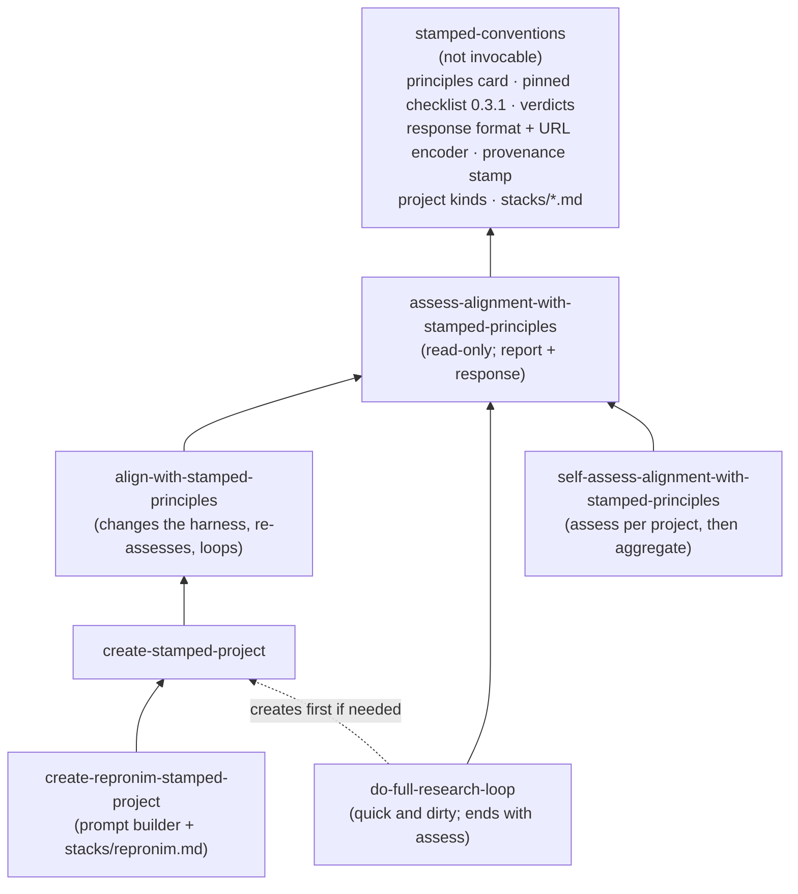
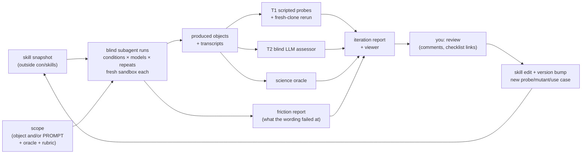

# STAMPED skills for con/skills: development plan

**Status:** phase 1 implemented, 2026-10-13 ([§7.1](#71-phase-1-as-landed)); the rest is still a plan.
**Decided so far:** keep the issue's skill names for now; eval results go to [hub.centerforopenneuroscience.org/con/stamped-skills-evals](https://hub.centerforopenneuroscience.org/con/stamped-skills-evals); compute runs on typhon; the development ladder starts with cheap neuroimaging tasks and leaves MRIQC until those are stable.
**Tracks:** [stamped-principles/stamped-agent-skills#3](https://github.com/stamped-principles/stamped-agent-skills/issues/3),
in particular [this comment](https://github.com/stamped-principles/stamped-agent-skills/issues/3#issuecomment-6128822460).
**Feeds:** the MIT LLM-workshop deck and the US-RSE'26 deck in [con/talks#33](https://github.com/con/talks/pull/33).

This is a working document.
Decisions that are still open are collected in [§10](#10-open-questions); answer them inline or in review comments, and this file gets updated.
A session picking this up on typhon should start at [§7.2](#72-continuing-on-typhon).

---

## 0. Summary

- **What:** six user-facing skills from the issue, plus one shared, non-invocable `stamped-conventions` skill that holds what they must agree on: the pinned checklist, the verdict vocabulary, the response format and the stack references.
  They form layers: *assess* → *align* → *create* → *create-repronim*, with *do-full-research-loop* and *self-assess* on the side ([§4](#4-the-collection)).
- **How they are developed:** use-case first, and **tested by a stranger**.
  Every change to a skill is tested by handing the skill snapshot to a **fresh, blind subagent** with a concrete scope — a repository to assess, or a PROMPT to carry out — which returns both its work product and the places the instructions failed it ([§6.2](#62-the-blind-subagent-run--the-core-test)).
  The bundled scripts make the mechanical half fast and identical between skill and grader, and point the reading agent at the items that need judgement; they are never the test of the skill itself.
  The scopes come from a ladder of concrete scientific tasks.
  The ladder starts at "plot two TSVs that ds007116 already ships".
  The main development target is "brain-extract the anatomicals of at least 10 ds007116 subjects with a container from `///repronim/containers` and plot brain size vs age".
  Heavier tasks, such as MRIQC motion vs age and time of day, come only after those are stable ([§6.3](#63-use-case-ladder)).
  The project each subagent produces is graded against STAMPED checklist 0.3.1, mostly by scripted checks plus a fresh-clone rerun.
  The same task is also run without the skill and with only a pointer to the paper.
  You review each iteration's report, and your verdicts and comments become skill edits, new checks or new use cases ([§6](#6-development-cycle)).
- **What it produces:** besides the skills, the reports are a filled checklist the web app can open (a [format-3 URL](#5-checklist-response-format)), plus a proposed response schema for [stamped-checklist-schema](https://github.com/stamped-principles/stamped-checklist-schema).
  The eval results are themselves a STAMPED dataset.
- **First milestone:** `stamped-conventions` and `assess-alignment-with-stamped-principles` v0.1, calibrated on deliberately broken copies of a good project and on real projects, plus a rung-0 run with and without the skill.
  A thin slice of that could be ready for the MIT talk on 2026-10-16 ([§8](#8-talks)).

---

## 1. What the issue asks for

From the comment, with the boundary each skill should keep.

**`/assess-alignment-with-stamped-principles POINTER`**
- *Job:* check how a project aligns with STAMPED.
  Review the project's **goals** with the user, from documentation and the user's answers rather than guesses.
  Produce a filled checklist with per-item evidence.
- *Must not:* change the project, or restate the paper or checklist (summarize briefly and point to the current versions instead).

**`/align-with-stamped-principles PROMPT`**
- *Job:* assess, then change the project's AI harness (`AGENTS.md`/`CLAUDE.md`, skills, a spec-kit constitution followed by `/speckit.analyze` for TODOs) so later work follows STAMPED.
  Say **what** to change and **why it matters to this project**.
  Shift emphasis by project kind: modularity and portability for datasets, ephemerality for compute components.
  Re-assess and loop.
- *Must not:* prescribe a stack the project does not use, or rewrite the science.

**`/create-stamped-project PROMPT`**
- *Job:* start a new project.
  Learn the user's environment and similar past projects (asking the user, "grilling" them where needed), lay out an initial structure, then hand off to *align*.
- *Must not:* read shell history or other AI sessions without consent.

**`/create-repronim-stamped-project PROMPT`**
- *Job:* build a ReproNim-specific prompt and call `/create-stamped-project` with it, using the technologies from [con/cierge#52](https://github.com/con/cierge/issues/52).
  Later this may be combined with a ReproNim assessment skill.
- *Must not:* duplicate the generic create logic.

**`/do-full-research-loop`**
- *Job:* a deliberately naive skill that carries the study in PROMPT through to results, so the project is actionable rather than only scaffolded.
  The issue's alternative is to hand off to a "full loop scientist" system.
- *Must not:* skip the project's provenance mechanism "just this once".

**`/self-assess-alignment-with-stamped-principles`**
- *Job:* assess the *user's* practice from their past history and projects.
  Recommend next steps and say why each matters to them.
- *Must not:* judge without evidence, or exfiltrate history.

**Target use cases named in the comment:**
- some or all of the experiments in Ben Dichter et al.'s SfN'25 poster ([zenodo 19834562](https://zenodo.org/records/19834562));
- ReproNim tasks of the form "run X app on OpenNeuro dsXXXXXX subjects X–Y to plot ZZZ", on [ds007116](https://github.com/OpenNeuroDatasets/ds007116), in this order:
  1. brain extraction with a container from `///repronim/containers` (AFNI, FSL, SynthStrip, …), plotting brain size vs age;
  2. brain volume with the GM/WM volume ratio on a secondary axis vs age;
  3. only once those are done, MRIQC motion vs age and vs time of day.

These are developed in `con/skills`. Automated distribution, and vendoring into stamped-agent-skills, ReproNim and elsewhere, come later ([§7](#7-roadmap), phase 6).

---

## 2. Prior work and what this plan takes from it

### STAMPED itself

**[stamped-agent-skills](https://github.com/stamped-principles/stamped-agent-skills): `stamped-skill-draft.md`, `stamped-skill-next-steps.md`** (@asmacdo)
- *What it is:* one draft STAMPED skill (facts → make it stick → 7 rules → moments → audit) plus a next-steps document.
- *What we take:* its settled decisions.
  - an agent-agnostic core;
  - "intervene, don't summarize";
  - establish facts before applying rules;
  - the "make it stick" pointer in `AGENTS.md`;
  - audit items generated from the checklist;
  - its development method, the **audit loop**: diff what the agent improvised against what the skill said, then promote or prune.

  Its content becomes the seed of `stamped-conventions` and *assess*.
  One fix: it cites "checklist v1.0.1", which is the web app's `package.json` version, not `checklist_version` (0.3.1).

**[stamped-checklist-schema](https://github.com/stamped-principles/stamped-checklist-schema) 0.3.1**
- *What it is:* LinkML schema and JSON for the checklist items: 31 items (17 MUST, 9 SHOULD, 5 MAY), with ids such as `stamped-checklist:must/009`.
- *What we take:* the only item source we use, vendored and pinned.
  There is **no response schema** ([§5](#5-checklist-response-format)).

**[stamped-checklist](https://github.com/stamped-principles/stamped-checklist) (web app)**
- *What it is:* pulls the items at a pinned tag and persists answers in the URL as `format=3`.
  The payload is base64 of `{"checklist_version", "responses": {id: {"value", "reason"}}}`, where `value` is `"yes"`, `"no"` or `null`.
  Reasons are capped at 250 characters, and an unknown id fails the whole load.
- *What we take:* the URL is how a report hands its result to people.
  The app is also a ready-made labeling UI: you fill the checklist for a test project and we decode the link into a reference answer ([§6.7](#67-calibrating-the-assessor)).

**[stamped-skills-assessment](https://github.com/stamped-principles/stamped-skills-assessment)**
- *What it is:* LinkML records for `use_case`, `object`, `rubric`, `assessment` and `review`, with a validator, a pinned "reference lock", and `docs/automation-evidence.md`.
- *What we take:* the durable record format for eval runs.
  Use case → `use_case` + `rubric`; produced project → `object`; grading → `assessment`; your feedback → `review`.
  Its evidence rules carry over:
  - an agent's success report is an assertion, not evidence;
  - a skill path being present does not show the skill was used;
  - unknown is not zero;
  - collector failures are kept apart from object defects;
  - numerators are reported with their denominators.

**[stamped-paper](https://github.com/stamped-principles/stamped-paper) `main.tex`**
- *What it is:* the normative definitions.
  Its AI section covers pinning models, `datalad run` around agent calls, `Co-Authored-By`, and AGENTS.md.
- *What we take:* linked, never pasted.
  Note the drift to raise upstream: the paper's S.2, M.3 and D.3 (licenses) are missing from principles-schema 0.2.0, and T.4 has no checklist item.

### Earlier attempts to learn from

**[STAMPED-dl_morphometrics_biases](https://github.com/STAMPED-dl-morphometrics-biases/STAMPED-dl_morphometrics_biases) `skills/`** (@leej3, Codex)
- *What it is:* a heavy STAMPED neuroimaging skill with a roughly 3,000-row assessment TSV.
  Its own phase-3 reviews document the failures.
- *What we take:* the negative lessons.
  - Execution ran ahead of committed state.
  - The preflight was "three documents about the gate and zero lines of gate".
  - An absolute `$HOME` path sat in "portable" YAML.
  - The guidance outgrew the context window.
  - A slimmed skill grew back within two days.

  What follows: **commit before execute**; one-screen operating cards; **a lesson requires a regression artifact**; a size and duplication lint; a factorial evaluation design.

**[dandi/compression-comparisons](https://github.com/dandi/compression-comparisons) → [compression-comparisons-t261-study](https://github.com/dandi/compression-comparisons-t261-study)**
- *What it is:* 1,265 commits, about 1,215 `[DATALAD RUNCMD]` records, and duct logs, built with Claude.
- *What we take:*
  - never commit while a `datalad run` is in flight (cells were lost; the fix became a pre-commit hook);
  - pin the tool subdataset and refuse a dirty or drifted checkout;
  - measurements are immutable while narrative can be corrected;
  - trace each parameter to its consumer, and run no-op controls;
  - adversarial reviews and `CORRECTION:` commits.

  Its known gaps make it a **real-world calibration object**: the subdataset `url = ../..` (fails D), and containers that were written but never built (P/E).

**[K-Dense scientific-agent-skills#227](https://github.com/K-Dense-AI/scientific-agent-skills/pull/227) (DataLad skill) and [#265](https://github.com/K-Dense-AI/scientific-agent-skills/pull/265) (STAMPED probes, changes requested)**
- *What it is:* the STAMPED section in `references/provenance.md`, and review feedback on #265.
  The feedback asks for tool-agnostic evidence, and says "not checked with the tooling available" is not "unmet".
- *What we take:*
  - probes are *examples* of evidence, and equivalent evidence counts (a tracked Makefile or Snakefile satisfies A.2);
  - `not-checked` is a separate verdict;
  - adopt the "Validation scope" section, `metadata.version`, and tests kept outside the skill directory.

**[bcmcpher/my-skills](https://github.com/bcmcpher/my-skills/tree/main/plugins/datalad-cli) `datalad-stamped-assess`**
- *What it is:* a read-only ✓/◐/✗ assessment that cites evidence, with `--plan` mapping fixes to other skills.
- *What we take:* prior art for *assess*.
  Avoid its `Stop`-hook autosave: it is exactly what destroys a long `datalad run`.

**[con/cierge#52](https://github.com/con/cierge/issues/52)** (@leej3)
- *What it is:* a demo design for US-RSE.
  A vanilla run is compared with a `/repronim-stamped-analysis` run.
  Each is started via `datalad run claude "…"` in a fresh `datalad create -c text2git` dataset and recorded with Entire.
- *What we take:* the runner design for the outer loop ([§6.5](#65-runners-inner-and-outer-loop)), and a name to reconcile with `create-repronim-stamped-project` ([§10](#10-open-questions)).

### Infrastructure and data

**[ReproNim/containers](https://github.com/ReproNim/containers)**
- *What it is:* 341 registered Apptainer images.
  They include `bids-mriqc` 24.0.2, `repronim-simple-workflow`, and about 345 `neurodesk-*` images (afni, fsl, synthstrip, synthseg, fastsurfer).
  It uses `freeze_versions` and `REPRONIM_USE_DUCT=1`.
- *What we take:* the environment layer for the ReproNim rungs.

**[brain-bbqs/study-template](https://github.com/brain-bbqs/study-template)**
- *What it is:* a BIDS 1.11.2 ["study" dataset](https://bids-specification.readthedocs.io/en/stable/common-principles.html#study-dataset) skeleton.
  It has `rawbids/`, `sourcedata/`, `derivatives/`, `code/`, `docs/`, `logs/` and `scratch/`, each with a README.
  Its `sourcedata/` README already points at STAMPED self-containment.
- *What we take:* the starting layout for ReproNim/BIDS projects ([§4.2](#create-repronim-stamped-project)).

**[ReproNim/skills](https://github.com/ReproNim/skills)**
- *What it is:* an empty scaffold in Agent Skills format.
- *What we take:* where the ReproNim layer could eventually be vendored.

**con/skills itself**
- *What it is:*
  - `AGENTS.md` rules;
  - `ci/validate_skills.py`;
  - the shared-conventions pattern and `version:` frontmatter (#16/#22);
  - APM distribution with a `skills/` tree (#13);
  - Claude-neutral wording (#14);
  - `introduce-*` → `setup-*` (#21).
- *What we take:* follow all of these.
  The STAMPED skills use the same "sibling conventions skill, read it or stop" contract as `code-quality-report-conventions`.

**[anthropics/skills `skill-creator`](https://github.com/anthropics/skills/tree/main/skills/skill-creator)**
- *What it is:* an eval loop.
  It runs with-skill and baseline runs, grades into `grading.json` (`text`/`passed`/`evidence`), aggregates a benchmark, and has an HTML viewer for human feedback and a description-trigger optimizer.
- *What we take:* its workspace layout and viewer for the inner loop, rather than building our own.

**[ds007116](https://github.com/OpenNeuroDatasets/ds007116)** (Penn LEAD, CC0)
- *What it is:* 132 subjects and 225 sessions.
  - Ages run 8.7–20 y per session.
  - `sessions.tsv` keeps the time of day at hour resolution (09:00–19:00), with dates shifted to the 1800s.
  - Modalities: T1w/T2w, rest and n-back BOLD, DWI, ASL.
  - It already ships `derivatives/freesurfer-post/*_qc.tsv` in plain git.
  - Linked fMRIPrep derivatives are in ds007088.
- *What we take:* an ideal ladder.
  Rung 0 needs no compute at all, and the shipped derivatives double as an **oracle** for later rungs.

---

## 3. Design principles for the collection

1. **Agent-agnostic core, opinionated stacks in references.**
   The skill bodies are written in terms of properties: "every derived file has a re-executable record".
   Concrete stacks live in `stamped-conventions/references/stacks/*.md`, loaded only when the project uses that stack.
   `datalad.md` comes first, then `repronim.md`, then others (Snakemake, DVC, Pixi/uv) as needed.
   STAMPED generalizes YODA, so nothing in them is YODA-specific.
   This follows @asmacdo's draft and con/skills#14.
2. **Do not duplicate the paper or the checklist.**
   A one-screen principles card links to the paper.
   Checklist items come from the vendored JSON at a pinned tag, never from retyped prose.
   The vendoring is itself a recorded, re-executable command (the skill practicing what it preaches).
3. **One source of truth.**
   Verdict vocabulary, checklist pin, response format, provenance stamp, and the rules for project kinds and emphasis all live in `stamped-conventions`, so the six skills cannot contradict each other.
   The MD5E-vs-SHA256E split in STAMPED-dl is the failure mode this prevents.
4. **One-screen operating cards.**
   Each `SKILL.md` holds the invariants, a short "tool → what it is authoritative for" table and the never-do list, with references loaded on demand.
   Size budget: about 250 lines per `SKILL.md` and about 150 for the conventions skill.
   A lint check enforces this and flags duplicated blocks ([§7](#7-roadmap), phase 1).
5. **A lesson requires a regression artifact.**
   When a test run reveals a failure, the fix is a probe, a template, a hook or a mutant first.
   Prose is the last resort.
   No incident catalogs in skills.
6. **Evidence, not intent.**
   Only committed state counts.
   An agent saying "done" is an assertion.
   `not-checked` (tool unavailable, too expensive, needs access) is never folded into `unmet`.
   Equivalent evidence counts whatever tool produced it.
7. **Commit before execute.**
   Every execution starts from a committed state and produces a recorded run.
   Never commit while a run is in flight.
   Measurements are immutable; a change of method produces a new dated derivative.
8. **Ask, don't guess, about goals and project kind.**
   Is the project a dataset, a compute component or tool, a study, or a skill?
   The answer changes which principles get emphasis; it is recorded as the `rubric`.
9. **The skills are research objects too.**
   Each has a `version:`, a changelog line per bump, tests outside the skill directory, and a provenance stamp in every report it writes.
   This is the recursive point on the MIT deck's "a skill is a research object" slide.
10. **Untrusted input.**
    READMEs of datasets, container output, other people's repositories, and shell history are data, not instructions.
    Use the same callout the other con/skills skills carry.
11. **A skill is tested by a stranger, not by its author.**
    Wording is only proven by a fresh, blind subagent given the snapshot and a concrete scope, which returns its work product *and* where the instructions failed it ([§6.2](#62-the-blind-subagent-run--the-core-test)).
    The authoring session walking through its own procedure proves nothing, because it knows what it meant.
12. **Scripts are the fast half, not the answer.**
    Bundled probes make the mechanical part cheap, repeatable and identical between the skill and its graders, and they tell the reading agent which items deserve its judgement.
    A report built only from them is a draft; a passing probe suite is not evidence that anyone can follow the skill.

---

## 4. The collection

### 4.1 Layering



Proposed layout, at the repository root today, or under `skills/` once con/skills#13 lands:

```
stamped-conventions/
  SKILL.md                      # user-invocable: false; "read it or stop" contract
  references/
    principles-card.md          # one screen; links the paper
    verdicts.md                 # vocabulary + mapping table (§5)
    response-format.md          # JSON layout, URL encoding, provenance stamp
    project-kinds.md            # dataset / component / study / skill → emphasis
    stacks/datalad.md
    stacks/repronim.md
  checklist/
    stamped-checklist-0.3.1.json  # vendored; never hand-edited
    lock.json                     # source URL, tag, commit, sha256 (as in stamped-skills-assessment)
  scripts/
    vendor_checklist.py         # refresh the pin (run through a recorded command)
    encode_response.py          # response JSON <-> checklist URL (format 3)
assess-alignment-with-stamped-principles/
  SKILL.md
  scripts/probes/*.py           # scripted checks (§6.6), shared with the graders
  scripts/run_probes.py         # the sweep; also writes a draft response JSON
  scripts/fresh_rerun.py        # the expensive probe: clone elsewhere and re-run
align-with-stamped-principles/SKILL.md
create-stamped-project/{SKILL.md, templates/…}
create-repronim-stamped-project/SKILL.md
do-full-research-loop/SKILL.md
self-assess-alignment-with-stamped-principles/SKILL.md
evals/stamped/                  # kept outside the skills (K-Dense convention)
  conditions/pointer-CLAUDE.md  # the `pointer` baseline, verbatim from the issue
  fixtures/make_r0_object.py    # a known-good object, built with plain git
  mutants/mutate.py             # defect injectors for calibrating the assessor
  harness/{calibrate.py, run.py, grade.py, aggregate.py}
  use-cases/<id>/{use_case.yaml, rubric.yaml, prompt.md, oracle/…}
  gold/<object>/{assessment.md, response.json, probes.json}   # reference answers
  tests/                        # pytest over the probes, mutants and encoder
docs/stamped/PLAN.md            # this file
```

Eval *results* are large and binary (produced projects, transcripts, container logs), so they live in a separate DataLad dataset, not here ([§6.9](#69-where-results-live)).

### 4.2 Skill specifications

#### `stamped-conventions`
Shared; `user-invocable: false`.
- Holds everything in the tree above.
  Dependent skills read `../stamped-conventions/…` and stop if it is missing; they never work from memory.
  This is the same contract as `code-quality-report-conventions`.
- `version:` is bumped when the verdicts, the response format or the checklist pin change.
  A pin change alone is a MINOR bump, because old reports stay comparable as long as each one carries its pin.

#### `assess-alignment-with-stamped-principles`
- **Input:** a pointer (local path, git URL, DataLad URL), plus an optional scope.
- **Steps:**
  1. Establish facts: what kind of unit it is, its boundary, how code and data are versioned, the environment, how things are executed, and provenance (@asmacdo's seven questions).
  2. Review goals with the user and settle the project kind, which yields the rubric emphasis.
  3. Run the scripted probes, then the judgment-only items.
  4. Check the project's issue tracker for gaps that are already known.
  5. Write the report: MUST items first, highest-leverage fix first, each verdict with cited evidence.
- **Outputs:**
  - `docs/stamped/assessments/YYYY-MM-DD-assessment.md` in the target if the user agrees, otherwise in the current directory;
  - `…-response.json` ([§5](#5-checklist-response-format));
  - a checklist-app URL;
  - optionally, stamped-skills-assessment records.
- **Tools:** read-only, plus writing its own report files.
  It may fan out per-principle subagents, like stamped-paper's `consistency-audit`.
- **Done when:** the calibration targets in [§6.10](#610-done-criteria) are met.

#### `align-with-stamped-principles`
- **Input:** PROMPT, which is deliberately terse ("align this project with STAMPED"); the agent decides the specifics.
- **Steps:**
  1. Run *assess*.
  2. Propose harness changes, each with what and why:
     - a STAMPED section in `AGENTS.md`/`CLAUDE.md` (the "make it stick" pointer, the recorded stack, the invariants that apply);
     - executable guards: a pre-commit "no commit during an in-flight run" hook, a preflight script, a CI rerun job;
     - skills to install, for example `introduce-reuse-compliance` for licenses (paper S.2/D.3) or the K-Dense `datalad` skill;
     - if `.specify/` exists, a constitution amendment, then `/speckit.analyze` to generate TODOs.
  3. Apply what the user accepts.
  4. Re-assess against the completed and planned changes.
  5. Loop while new, obvious items keep appearing.
- **Output:** the harness diff, plus before and after responses.
- **Must not:** introduce a parallel tool for a job the recorded stack already covers.
  A plain Git repository with a Makefile and a lockfile already satisfies much of STAMPED.

#### `create-stamped-project`
- **Input:** PROMPT.
- **Steps:**
  1. Discover the environment: `datalad`, `git-annex`, `apptainer`/`docker`, `pixi`/`uv`/`conda`, cluster access, disk.
  2. Ask about similar past projects ("grill").
     With explicit consent only, skim shell history or AI-session logs, summarizing rather than copying.
  3. Propose a layout:
     - with DataLad available, a DataLad dataset, created with `-c text2git` when its text files may be shared publicly;
     - otherwise Git plus a lockfile plus a Makefile.

     Inputs become subdatasets or recorded references.
     There is an entry point, a README stub naming the question, an environment spec, and a CI stub.
     For BIDS-shaped domains, use the study-template layout from `stacks/repronim.md`.
  4. Hand off to *align*.
  5. If the PROMPT asks for results, hand off to *do-full-research-loop*.
- **Templates:** a minimal skeleton per stack, plus the hook and preflight scripts from the regression-artifact rule.

#### `create-repronim-stamped-project`
Thin: it reads `stacks/repronim.md` and turns PROMPT into PROMPT-WITH-REPRONIM-SPECIFICS for *create*.
It is also where a future ReproNim assessment skill plugs in.
The ReproNim stack reference covers:

- **Dataset:** a DataLad dataset, `-c text2git` when text files can be shared.
  Nothing YODA-specific; STAMPED is the generalization.
- **Layout:** a BIDS 1.11 study dataset, starting from [brain-bbqs/study-template](https://github.com/brain-bbqs/study-template):
  - raw BIDS goes under `rawbids/`;
  - multiple sources, or sources that are not raw BIDS, go under `sourcedata/`;
  - processing results go under `derivatives/`, alongside `code/`, `docs/` and `logs/`.

  If the whole project *is* the creation of one derivative (for example, brain masks for ds007116), the dataset itself becomes a BIDS derivative dataset (`DatasetType: derivative`).
  Results then go at its root, with no `derivatives/` folder, and the input datasets are subdatasets under `sourcedata/`.
- **Inputs:** OpenNeuro datasets (`///openneuro/dsXXXXXX`, or OpenNeuroStudies `study-dsXXXXXX`) as subdatasets in the place the layout above gives them.
- **Containers:** `///repronim/containers` installed as `code/containers`, with `freeze_versions` and `datalad containers-run`, and `REPRONIM_USE_DUCT=1` so every run gets a duct trace.
- **The project's own tooling:** `datalad`, `datalad-container`, `git-annex` and `con-duct` are declared in a tracked spec with pinned versions.
  That spec is `code/requirements.txt`, `code/pyproject.toml` or a `pixi.toml`; git-annex comes from its PyPI wheel.
  The spec is what P.2/P.3 (must/010, must/013) check for the tooling itself, not only for the containers.
- **Conversion to BIDS:**
  - DICOMs: [HeuDiConv](https://heudiconv.readthedocs.io/en/latest/) with the ReproIn heuristic.
    That may first need a mapping of the acquisition names into the ReproIn convention, or a custom heuristic; follow the HeuDiConv docs and their tutorials.
  - Other data types: pick from the [BIDS converters](https://bids.neuroimaging.io/tools/converters.html) after a fair comparison for the data and environment at hand (for example, a MATLAB-based converter where MATLAB is already in use).
  - Video collections: [ReproStim](https://github.com/ReproNim/reprostim) can slice them into BIDS.
- **Metadata:** `GeneratedBy` in `dataset_description.json`.
- **Optional:** NIDM (`segstats_jsonld`), BEP028 PROV (`metalad runprov`), and mechababs/BABS for scale.

#### `do-full-research-loop`
**This is quick and dirty on purpose.**
It exists to make a STAMPED project actionable end to end, and to exercise the other skills on real execution.
Real research needs a proper "virtual scientist" (the issue's "full loop scientist" system), which this skill does not try to be.
The skill says so at its top, and in the README of every project it produces.

- **Input:** a STAMPED project plus a study PROMPT; if no project exists, it creates one first.
- **Steps:**
  1. **Plan.**
     Write the question, inputs, method and expected outputs into the project, and commit them.
  2. **Pilot.**
     Run one unit (one subject, one session) through the recorded mechanism.
     Inspect its run record and output before going further.
  3. **Execute and adjust, in a loop.**
     Scale up in batches.
     After each batch, look at failures, QC and the values themselves.
     When something fails or looks wrong (tool errors, failed QC, implausible numbers, missing units):
     - record what happened;
     - revise the plan, as a commit that says why;
     - go back to the pilot if the method changed.

     A method change goes to a new dated derivative; it never overwrites earlier results.
     The loop stops when every unit is done, the budget is spent, or a blocker needs the user.
  4. **Aggregate and plot,** also as recorded runs.
     If aggregation turns up gaps or outliers, go back into the loop of step 3 rather than patching outputs.
  5. **Sanity checks and controls:** trace each parameter to its consumer, run a no-op control, compare paired rather than pooled.
  6. **Independent review** by a fresh subagent that sees only the committed project.
  7. **Write up** the results and the "quick and dirty" disclaimer in the README.
  8. **Run `/assess-alignment-with-stamped-principles`** on the finished project.
     Its report is part of the deliverable.
     MUST failures it finds are fixed, via `/align-with-stamped-principles` when they are harness gaps, before the loop declares itself done.
- **Invariants:** §3.7 (commit before execute), with no editable installs of pinned code and no manual edits to derived files.

#### `self-assess-alignment-with-stamped-principles`
- **Input:** PROMPT with pointers to the folders holding the user's relevant projects, and/or `projects.tsv` from `scan-projects`.
  Plus, with consent, shell and AI-session history.
- **Steps:**
  1. List candidate projects shallowly (the pointed folders and one level down, not a deep crawl), and confirm the selection with the user.
  2. Run `/assess-alignment-with-stamped-principles` on each selected project, in parallel subagents where possible.
  3. Aggregate the collected assessments: recurring gaps per principle and per checklist item, and consistent strengths.
  4. Give three to five generic next steps drawn from that aggregate, each with what to change and why it matters to this user.
- Lowest priority.

### 4.3 Names

**Decided:** keep the issue's names for now.
They are verb-first, like the `setup-*` convention of #21.
A shorter `stamped-*` family remains possible later; a rename is a `git mv` plus a MAJOR version bump, with the old names kept as trigger phrases in the descriptions.

---

## 5. Checklist response format

**Facts** (stamped-checklist @ `d24d7ca`):
- `PERSISTENCE_FORMAT = 3` (`src/persistence.js`).
- The payload is standard base64, *not* URL-safe, of UTF-8 JSON, percent-encoded by `URLSearchParams`:
  ```json
  {"checklist_version": "0.3.1",
   "responses": {"stamped-checklist:must/005": {"value": "no", "reason": "≤250 chars"}}}
  ```
- The URL is `?checklist=0.3.1&responses_version=0.3.1&cols=auto&sections=off&format=3&responses=…`.
  The issue's example is missing the `&` before `format`.
- The app accepts only `value ∈ {"yes","no",null}`.
  It shows `reason` only for `"no"`.
  It ignores and drops extra keys.
  It rejects the whole load on an unknown item id.

**Proposal:**
1. The skills emit one canonical **response JSON** that is a superset of format 3.
   Extra fields per item:
   - `status`: the richer verdict;
   - `evidence[]`: `{uri, description, sha256?}`, the same shape as stamped-skills-assessment's `Evidence`.

   Top-level extras:
   - `principles_version`, `schema_version`, `checklist_source` (tag + commit);
   - `object`: url, commit, captured_at;
   - `assessor`: skill name and version, harness, model, date.

   `encode_response.py` strips the extras to produce the app URL.
   The app tolerates them anyway.
2. **Verdict vocabulary.** The richer `status` maps onto the app's values:

   | `status` | Meaning | App `value` | App `reason` |
   |---|---|---|---|
   | `met` | Evidence shows it | `"yes"` | Hidden by the app; evidence lives in the JSON |
   | `partial` | Met in some components, or by design but violated somewhere specific | `"no"` | Where it falls short |
   | `unmet` | Evidence shows it is absent | `"no"` | Shortest fix |
   | `not-checked` | Could not check: tool missing, cost, access | `null` | Why, and what would check it |
   | `not-applicable` | Does not apply to this kind of object | `null` | `N/A: …` |

   A MUST is never satisfied by `partial`.
   This reconciles @asmacdo's draft (pass/partial/fail/unknown), STAMPED-dl (met/partial/unmet/restricted/n-a), the K-Dense #265 review (keep not-checked apart), and the five judgment statuses of stamped-skills-assessment.
3. **Upstream:** open a PR on stamped-checklist-schema adding a `ChecklistResponse` LinkML class, versioned with the checklist.
   Its required core is exactly format 3; the extensions above are optional.
   Coordinate with the app maintainers on whether this becomes `format=4`.
   File the paper-vs-schema drift (S.2, M.3, D.3, T.4) as a separate issue.
   **Drafted 2026-10-13** in [`upstream/`](upstream/): the schema as a standalone file carrying its own version (so the upstream version-bump gate does not apply), linted, and validated against a real 31-item response, an app-exported core payload and a trimmed example.
   The drift issue cites `main.tex` line numbers, and adds a detail the plan did not have: the schema's T.5 is a split of the paper's compound T.4, so T.5 has no paper counterpart.
4. **Full assessment vs quick response.**
   The response is the quick, per-item product.
   When a rubric, plan and activities matter (eval runs, reviewed assessments), the same run also writes stamped-skills-assessment records, so the two never diverge.

---

## 6. Development cycle

The cycle is closest to skill-creator's loop combined with @asmacdo's audit loop, but its test fixtures are scientific use cases and its grader is the checklist.



### 6.1 Vocabulary
- **Use case:** a prompt, inputs, an oracle for the science product, and rubric emphasis.
  Recorded as `use_case` + `rubric`.
- **Condition:** what the agent is given ([§6.4](#64-conditions)).
- **Run:** one agent session for a (use case, condition, model, repeat), in a fresh sandbox.
  It produces an **object** (a git/DataLad repository) and a transcript.
- **Blind run:** a run by a fresh subagent that is given the skill snapshot and the scope and nothing else — no reference answers, no plan, no earlier report ([§6.2](#62-the-blind-subagent-run--the-core-test)).
  Every skill change gets one.
- **Grade:** T1 + T2 + oracle, recorded as an `assessment`.
  Your verdicts are recorded as a `review`.
- **Iteration:** one skill version across a fixed set of runs.

### 6.2 The blind subagent run — the core test

**Every change to a skill is tested by handing the skill to a fresh subagent with a concrete scope, and reading what comes back.**
Not by the authoring session walking through its own procedure: the session that wrote the wording knows what it meant, so it is the one reader who cannot tell whether the wording works.
This is the repo-wide rule in [`AGENTS.md`](../../AGENTS.md); what follows is how it is run for these skills.

**Scope is concrete, and it is one of two shapes:**

| Scope | Skills it tests | Example |
|---|---|---|
| **An object** — a repository, dataset or path | *assess*, *self-assess* | `/assess-alignment-with-stamped-principles <path to a clone of compression-comparisons-t261-study>` |
| **A PROMPT** (optionally plus an object) | *create*, *create-repronim*, *align*, *do-full-research-loop* | the R0 prompt of [§6.3](#63-use-case-ladder), with and without the slash command |

"Try the skill and see" is not a run.
A run has a scope, a condition ([§6.4](#64-conditions)), a model, and a place its outputs go.

**Isolation, or the test measures nothing:**

- Snapshot the skill **and** `stamped-conventions` into a directory outside con/skills, and point the subagent at that copy; the snapshot commit is what the run is recorded against.
- Tell the subagent **not to read con/skills** — and say why. `evals/stamped/gold/` holds reference answers for exactly the objects worth testing on, and a helpful agent will find them.
- Tell it the user is unavailable, so the steps that ask it to review goals and project kind with the user have to become labelled assumptions in its report. How well it handles that is itself a finding.
- Name what it may not do (run the project's pipeline, attempt the expensive probe), so a refusal is a choice rather than a timeout.

**Two things come back, and the second one is usually worth more:**

1. **The work product** — the report, the response JSON, the diff, the created project.
   Diffed per item against the reference answer, or against what you expected.
2. **The friction** — every place the instructions were ambiguous, missing, contradictory or slow, **quoting the wording at fault**.
   Ask for it explicitly and ask for it critically; a subagent that is not asked will not volunteer that step 4 was unclear, it will just guess, and the guess looks like a verdict.

Each difference and each friction item is classified as in [§6.8](#68-iteration-protocol-and-your-feedback), and **only "skill wording" and "missing artifact" change the skill**.

**Where scripts sit in this.**
The bundled probes are the fast, cheap, deterministic half: they answer 11 of 17 MUST items in seconds for pennies, identically for the skill and for the graders, and they are calibrated against the mutants ([§6.7](#67-calibrating-the-assessor)).
Their job in a run is to **tell the reading agent where to look harder** — an item a probe settles with evidence needs no deliberation, an item it leaves `not-checked` is where the judgement budget goes, and a probe result that contradicts a reading is the most interesting row in the report.
What they are **not** is the test of the skill:

- a passing probe suite says nothing about whether the instructions can be followed;
- a report that is only probe output is a draft, and the skill says so;
- when a blind run exposes a gap, the fix to reach for first is a probe, template or hook — prose last, because prose grows back (§3.5).

**Cadence.** At least one blind run per skill per iteration, on a scope the previous iteration also used (so the diff is a regression test) plus one it has not seen.
Runs are cheap enough — minutes, on an object already on disk — that there is no excuse for an untested wording change.

### 6.3 Use-case ladder

Climb only when the rung below is stable.
The point of the ladder is to make the agent **actually compute**; R0 is the only rung that may reuse results the dataset already ships.

| Rung | Task | Compute | Starts when |
|---|---|---|---|
| R0 | Plot from the FreeSurfer tables ds007116 ships | None (seconds) | Now |
| **R1** | **Brain extraction, ≥ 10 subjects → brain size vs age** | Minutes per subject; Apptainer | R0 stable; main development target |
| R2 | Brain, GM and WM volumes, about 30 sessions | 1–5 CPU-h | R1 stable |
| R3 | MRIQC: motion vs age and vs time of day | About 1 CPU-h per BOLD run | R0–R2 done |
| R4 | Whole dataset at scale, NIDM + PROV | Hundreds to thousands of CPU-h | Demonstration only |
| R5 | DANDI: orientation selectivity (cross-domain) | Up to about 1 CPU-h | Hold-out |

**R0: warm-up, no compute.**
- *Prompt:* "For ds007116, plot brain volume, with the GM/WM volume ratio on a secondary axis, against age, using the FreeSurfer derivatives the dataset ships."
- *Data:* per-session ages from `sub-*/sub-*_sessions.tsv`, plus `derivatives/freesurfer-post/*_desc-FreeSurfer_qc.tsv` (plain git, 222 sessions).
- *Tooling:* Python with a lockfile (uv or pixi), or a small container.
- *Product:* a TSV and a PNG.
- *Oracle:* a deterministic rerun gives identical outputs.
- *Why:* it exercises the S/T/A/P plumbing (layout, inputs as a subdataset, run records, environment spec) cheaply enough for three or more repeats per condition.
  It does not exercise computation; that starts at R1.

**R1: brain extraction (main development target).**
- *Prompt:* "Do brain extraction on the anatomical (T1w) images of at least 10 ds007116 subjects, spread over the age range, using one of the containers in `///repronim/containers`, and plot brain size against age."
- *Data:* ses-1 T1w (`rec-normrefaced`), about 7 MB each.
- *Tooling:* the agent picks, for example `neurodesk-afni` (3dSkullStrip), `neurodesk-fsl` (bet) or `neurodesk-synthstrip`.
  Swapping one for another is a free test of M.
  It goes through `datalad containers-run` with `REPRONIM_USE_DUCT=1`.
- *Product:* brain-mask volumes (TSV), the brain size vs age plot, and an overlay mosaic for visual QC.
- *Oracle:* the computed volumes correlate with FreeSurfer `brainseg`/`etiv` from the shipped derivatives.
  Those must be used for the comparison only, never copied as results.
  Optionally, Dice between two tools.
- *Cost:* minutes of CPU per subject.
  The image is 0.5–9 GB depending on the tool (SynthStrip is the smallest).
- *Caveat:* the T1w images are refaced, which may affect skull stripping.
  It is a known caveat, not a failure.

**R2: tissue volumes.**
- *Prompt:* "Compute brain, GM and WM volumes for about 30 sessions spanning ages 9–20; plot brain volume with the GM/WM ratio on a secondary axis against age."
- *Tooling:* `neurodesk-synthseg` (`--vol` CSV) or `repronim-simple-workflow` (BET → FAST).
- *Oracle:* the R0 values from the shipped FreeSurfer derivatives.

**R3: MRIQC.** Only once R0–R2 are done.
- *Prompt:* "Run MRIQC on the resting-state BOLD of N subjects and plot motion (mean framewise displacement) against age and against time of day."
- *Data:* `task-rest_run-01` BOLD.
  Time of day comes from `acq_time` in `sessions.tsv`, at hour resolution.
  Start N small and grow it.
- *Tooling:* `bids-mriqc` 24.0.2, `-m bold`, participant level then group level.
- *Oracle:* framewise displacement from the fMRIPrep confounds in ds007088.

**R4: scale and standards** (demonstration, not a gate).
- *Prompt:* "All sessions on our cluster; export NIDM and PROV; publish."
- *Tooling:* OpenNeuroStudies `study-ds007116`, mechababs/BABS, `segstats_jsonld`, `metalad runprov`.
- *Oracle:* the R1–R3 subsets reproduce exactly.

**R5: cross-domain** (hold-out).
- *Prompt:* "Demonstrate orientation selectivity from a DANDI dandiset" (from Dichter et al. SfN'25).
- *Tooling:* the generic *create* with dandi-cli, without the ReproNim layer.
- *Oracle:* the published finding, or `dandi/llm-analysis`.

Across rungs:
- **Use per-session ages.** Ages differ between `participants.tsv` (baseline) and per-session `sessions.tsv`.
  The ReproNim stack reference steers to the per-session ages.
- **Hold-out set.** Keep R5 and one ReproNim variant (another dataset, for example ds000003) out of the inner loop, so skills are not tuned to the fixtures.

### 6.4 Conditions

| Id | Agent receives | Tests |
|---|---|---|
| `bare` | The use-case prompt only | The floor |
| `pointer` | Prompt + @asmacdo's `CLAUDE.md` STAMPED snippet from the issue, verbatim | Today's practice: the bar a skill must clear |
| `skill@vN`, implicit | Skills installed; the prompt does not mention them | Does the description trigger? |
| `skill@vN`, explicit | Skills installed; the prompt invokes `/create-…` or `/do-full-research-loop` | Does the procedure work? |
| `skill@vN-1` | The previous version | Regressions |

**Models.** Two or three tiers, from frontier to small.
Some neuroimaging content already pushes sessions to a non-frontier model (@asmacdo's note), so the skills must not assume frontier judgment.
Optionally, one non-Claude harness for agent-agnosticism.

**Repeats.** One per cell while exploring; three for benchmark iterations.
Variance is reported, not hidden.

### 6.5 Runners: inner and outer loop

- **Inner loop** (fast, used daily): the blind subagent runs of [§6.2](#62-the-blind-subagent-run--the-core-test), spawned from the orchestrating session.
  Each is told to read the skill under test from a snapshot path, as skill-creator does, and to stay out of con/skills.
  Use it for R0, for runs of *assess* on existing objects, and for mutant calibration.
  It is cheap, but runs are not isolated from the host, so its numbers are indicative only.
- **Outer loop** (benchmark, per iteration): runs on **typhon**, with one **fresh container per run**, which is the E principle applied to our own tests.
  Following cierge#52:
  ```sh
  datalad create -c text2git run-<id>
  # install skills@<commit> into the sandbox (or none, for baselines)
  datalad run -m "agent run <id>" "claude -p \"\$(cat prompt.md)\" --output-format stream-json > transcript.jsonl"
  ```
  The sandbox has `datalad`, `git-annex` and `apptainer`.
  Permissions are wide open *only* inside the throwaway sandbox.
  Datalad is pinned to a version with the concurrent-run fix (gh-7899/#7901).
  The harness must start on typhon with one command per iteration (`harness/run.py --iteration N`), whoever launches it: you, or a Claude Code session running on typhon.
  A cloud session can author skills and harness code and run R0 and *assess* inner-loop runs on public objects.
  It cannot reach typhon, but it can read and push the results dataset on the hub ([§6.9](#69-where-results-live)).
- **Agent provenance per run.** At minimum:
  - the stream-json transcript, annexed in the results dataset;
  - consistent, machine-parsable `Co-Authored-By` trailers;
  - the skill commit plus model, recorded in `assessor`.

  Optionally, Entire (`entire enable`) for commit-linked checkpoints, as cierge#52 proposes.
  Its redaction is best-effort, so it is used only on public-data use cases.

### 6.6 Grading

**T1: scripted probes.**
Deterministic and tool-agnostic; equivalent evidence passes.
They live in `assess…/scripts/probes/`, so *assess* and the graders use the same code, and the mutants catch bugs in the probes.

| Probe | Passes when | Checklist items |
|---|---|---|
| `tree-clean` | `git status --porcelain` is empty, recursively | must/004 |
| `no-abs-paths` | No `/home/…`, `/Users/…`, `C:\…` or `/tmp/…` in tracked text (run records allow-listed) | must/009 |
| `large-in-annex` | No large binaries in git objects | must/005 |
| `subdatasets-resolvable` | No `../..` or local-path URLs, and a fresh recursive clone from the published location works | must/002, must/016, may/001 |
| `derived-have-records` | Every output file comes from a run record (`datalad run`, or Make/Snakemake with a tracked workflow) | must/006, A.2 |
| `run-env-linked` | Run records name a container image key or digest, or a lockfile hash | must/006, must/015 |
| `env-spec-tracked` | A lockfile, container definition or `containers` registration is tracked, including for the project's own tooling | must/010, must/013 |
| `entry-point` | The README names an entry point, and it exists | must/007, must/008 |
| `inputs-untouched` | Input subdatasets are clean and at their recorded commit | should/003 (M.1) |
| `license-declared` | Code and data licenses are declared (`LICENSES/`, REUSE, BIDS `License`) | paper S.2/D.3 (extra, until the schema catches up) |
| **`fresh-rerun`** | The documented rerun reproduces the outputs on another host (below) | A.1, P.1–3, E, D.1, should/004 |
| `ci-present` | CI re-executes the workflow or rebuilds the environment | should/002, should/006 |

`fresh-rerun` in detail:
1. On another host, in a fresh container, clone from the published sibling.
2. Get the minimum content needed.
3. Run `datalad rerun` or the documented entry point.
4. Compare outputs: checksums, or a tolerance for plots and tables.

**T2: blind LLM assessor.**
Runs *assess* at a pinned version on the object only, with the condition hidden, to cover the judgment items: must/011, 012, 014, 017, the may/* documentation items, and goal fit.
Disagreements between T1 and T2 are flagged for you rather than resolved automatically.

**Science oracle:** the product exists, has the requested N and variables, and agrees with the oracle within a tolerance.

**Process metrics,** from the transcript:
- executions started from uncommitted state;
- commits made during a run;
- absolute paths typed;
- manual edits to derived files;
- questions asked of the user;
- whether the skill files were actually read (a skill path being present does not show it was used);
- tokens and wall time.

**Aggregation.** Report per item and per principle, always with numerator/denominator, never as one universal score.
Separately, keep:
- a **MUST pass rate**, over mechanically checkable MUST items only;
- an "oracle OK" flag;
- the process metrics.

### 6.7 Calibrating the assessor

*Assess* is the grader for everything else, so it is calibrated first — and the calibration has a scripted half and a human-read half, which are not interchangeable:

0. **Blind runs** ([§6.2](#62-the-blind-subagent-run--the-core-test)).
   A fresh subagent, the skill snapshot, one object, no reference answer.
   Its 31 verdicts are diffed against the reference and its friction notes are triaged.
   This is the only check that tests the *instructions* rather than the scripts, so it runs every iteration, and a wording change without one is not finished.
1. **Mutants.** Start from a known-good R0 object (built by hand, or the best skill run after your sign-off).
   Each mutant script injects one defect meant to flip one item:

   | Injected defect | Should flip |
   |---|---|
   | An absolute path in a script | must/009 |
   | A 50 MB NIfTI committed to git | must/005 |
   | A container referenced as `:latest` | must/015 |
   | A subdataset with `url = ../..` | must/002, must/016 |
   | The README's reproduce section removed | must/007, must/008 |
   | Outputs written into the inputs | should/003 |
   | An untracked figure | must/004 |
   | A derived file without a run record | must/006 |

   Measure per-item sensitivity, plus the false `unmet` rate on the clean object.
2. **Real-world gold set.**
   - compression-comparisons-t261-study, with known D (`../..`) and P/E (no built containers) gaps;
   - STAMPED-dl_morphometrics_biases, which has its own assessment TSV to compare against;
   - stamped-paper, which has an existing pilot record;
   - ReproNim/simple_workflow;
   - `dandi/llm-analysis`, a typical project where STAMPED was not a goal.

   For two or three of these, **you fill the checklist in the web app** and send the URL.
   We decode it into reference answers, so no new labeling tool is needed.
3. **Agreement across models.** Assess the same objects with each model tier.
   Where MUST verdicts diverge, the wording is ambiguous and gets tightened.

### 6.8 Iteration protocol and your feedback

1. Pick the skill, rungs and conditions for iteration *k*.
   Freeze the skill commit.
2. Run them: the inner loop for exploring, the outer loop for benchmarks.
3. Grade (T1, T2, oracle) and aggregate.
4. **Write the iteration report**, one page:
   - what changed in the skill (diff link);
   - a table of conditions × rungs: MUST pass rate, failing probes, oracle;
   - the three to five most telling improvisations or failures, with links to transcripts and objects;
   - the proposed next edits.

   The skill-creator viewer is available for browsing outputs.
5. **You review**: comments on the report, verdicts on flagged T1/T2 disagreements, and optionally a checklist URL for an object.
   These become `review` records.
6. Classify each failure as one of:
   - skill wording (ambiguous or missing);
   - missing artifact (needs a probe, template or hook);
   - harness fault (runner or collector);
   - model limit;
   - use-case defect.

   Only the first two change the skill.
7. Edit following §3.5 (artifact first), bump `version:`, add a changelog line, and re-run, including `skill@vN-1` for regressions.
   Prune as aggressively as you promote.

### 6.9 Where results live

A separate DataLad dataset, [`con/stamped-skills-evals`](https://hub.centerforopenneuroscience.org/con/stamped-skills-evals), on the CON Forgejo-aneksajo hub.
Aneksajo is the git-annex-aware Forgejo, so git history and annexed content go to the same remote with no separate special remote.

**Bootstrapped 2026-10-13** (`datalad create -c text2git`, `hub` sibling, `datalad push`, verified by an anonymous `datalad clone`).
It carries the dataset README with the layout below and `calibration/2026-10-13-probes-0.1.0/` — the first probe calibration, 8/8 mutants and 0/15 false `unmet`.
Its own README states the two gaps it starts with rather than hiding them: con/skills is not yet a subdataset (pinning it at an unpublished commit would be the very `must/002`/`must/016` failure these skills catch), and the bootstrap commit is not a recorded run.
The default branch is `main`, matching the hub repository.
- **Layout:** each run is a subdataset (the produced object), plus `transcript.jsonl` (annexed), `grading.json` and stamped-assessment records.
  Grading steps are `datalad run` records.
  The skills repository is a subdataset pinned per iteration.
- **Pushing:** from typhon, as `yarikoptic-gitmate` (`datalad push --to hub`).
  Produced-object subdatasets are published as sibling repositories under `con/` on the same hub.
  That way `subdatasets-resolvable` and `fresh-rerun` test real published URLs rather than paths on typhon.
- **Mirroring:** optional, read-only, to GitHub for visibility; the hub stays authoritative.
- **Cloud sessions** can read and push too.
  This was verified 2026-10-13: Forgejo 16.0.5 + git-annex, `push: true`, and a `git push --dry-run` was accepted.
  Three things make that work:
  - **Network:** `*.centerforopenneuroscience.org` and `*.stamped-principles.org` (plus the bare domains) are under Allowed domains, with the package-manager defaults kept.
  - **Hub access control:** the hub's Apache admits Anthropic's egress network.
  - **Credentials:** a `HUB_TOKEN` network secret for `yarikoptic-gitmate` is scoped to `hub.centerforopenneuroscience.org`, so the proxy adds the `Authorization: Bearer` header and the session never sees the token.

  `datalad` and `git-annex` are not preinstalled in cloud sessions, but both come from PyPI (the `git-annex` wheel ships a standalone build).
  Either of these works (tested: datalad 1.7.1, git-annex 10.20260901):
  ```sh
  uv tool install datalad --with git-annex --with-executables-from git-annex
  # or, in a venv:
  pip install datalad git-annex
  ```
  Put that line in the environment's setup script so the environment cache keeps it, and pin versions there (§6.5 on datalad's concurrent-run fix).

This keeps con/skills small and makes every number in a report or a talk re-executable.
That is the same D check the MIT deck's "So I tried to `rerun` it" slide applies to the compression study.

### 6.10 Done criteria

These are initial targets, to be revised after the first two iterations.

- **assess v1.0:**
  - ≥ 90 % mutant detection per mechanically checkable MUST item, and ≤ 10 % false `unmet` on clean objects;
  - agreement with your reference answers on the gold set for MUST items;
  - ≥ 80 % MUST-verdict agreement across model tiers;
  - never `met` without cited evidence;
  - **blind runs:** two consecutive iterations in which a fresh subagent, given only the snapshot and an object, produces all three products, agrees with the reference answer on every MUST item, and returns no friction item classified as "skill wording" that is worth fixing.
    One blind run on a *new* object each iteration, so the wording is not fitted to the gold set.
- **create / align / do-full-research-loop v1.0:**
  - at R0–R2, explicit-skill runs — which are blind runs with a PROMPT as their scope — pass every mechanically checkable MUST probe, including `fresh-rerun`, in ≥ 2 of 3 repeats on two model tiers;
  - they clearly beat `pointer`;
  - the oracle agrees;
  - no regression against vN-1;
  - you sign off.
- **create-repronim:** the same at R1–R2; R3 once it is reached.
  R4 counts as a demonstration, not a gate.

---

## 7. Roadmap

Each phase is a pull request against con/skills unless noted otherwise.
Skills stay at `0.x` until their done criteria hold.
**No phase is done until each skill it touches has had a blind subagent run** on a concrete scope, with its friction report triaged ([§6.2](#62-the-blind-subagent-run--the-core-test)).

- [x] **Phase 0:** this plan; agree on [§10](#10-open-questions).
- [ ] **Phase 1: conventions + assess.**
  - [x] `stamped-conventions` v0.1: card, vendored checklist + lock, verdicts, encoder, `stacks/datalad.md`, seeded from @asmacdo's draft.
  - [x] `assess-alignment-with-stamped-principles` v0.1 + probes.
  - [x] `evals/stamped/` skeleton with R0 + mutants.
  - [x] Bootstrap `con/stamped-skills-evals` on the hub: `datalad create -c text2git`, a `hub` sibling, the first `datalad push` — done 2026-10-13 from a cloud session, not typhon ([§6.9](#69-where-results-live)).
    Still to add there: con/skills as a pinned subdataset, which waits for this branch to be published.
  - [x] First calibration iteration ([§6.7](#67-calibrating-the-assessor)): mutants, plus one real object with its reference answer.
  - [x] A size and duplicate-block check added to `ci/validate_skills.py`.
  - [x] Outside con/skills: both drafted, verified and ready to file in `docs/stamped/upstream/` — the `ChecklistResponse` schema (linted, and `linkml-validate`d against a real 31-item response, an app-exported payload and the example) with its PR body, and the paper-vs-schema drift issue with line numbers.
    Filing them is the one step left, and needs push access upstream.
- [ ] **Phase 2: create + align.**
  - v0.1 of both, with templates (pre-commit run guard, preflight).
  - Inner-loop harness.
  - R0–R1 with `bare` / `pointer` / `skill`.
- [ ] **Phase 3: do-full-research-loop.**
  - v0.1.
  - Outer-loop runner (container per run, pinned datalad, transcripts).
  - R1–R2.
- [ ] **Phase 4: ReproNim.**
  - `stacks/repronim.md` + `create-repronim-stamped-project` v0.1.
  - Reconcile with the cierge#52 demo.
  - R1–R3, then R4 as a demonstration with NIDM and BEP028 outputs.
- [ ] **Phase 5:** `self-assess-alignment-with-stamped-principles` v0.1, plus R5 (cross-domain).
- [ ] **Phase 6: distribution.**
  - APM packaging, once #13 lands.
  - Vendoring into stamped-agent-skills, replacing its single draft, and closing #3.
  - The ReproNim layer into ReproNim/skills.
  - Domain-neutral pieces upstream to K-Dense (answering their issue #217, "should STAMPED be its own skill?").
  - The "(de)compositions" the issue anticipates: split or merge skills where the eval data shows a boundary is wrong.

### 7.1 Phase 1 as landed

What exists in con/skills as of 2026-10-13, on branch `claude/ecstatic-cerf-nh4j6w`:

- **`stamped-conventions/` 0.2.0** — the five references, the checklist vendored at `v0.3.1` (`af259ba`) with a `lock.json` carrying tag, commit and sha256, `vendor_checklist.py` (`--check` verifies the files against the lock) and `encode_response.py` (`items`, `validate`, `encode`, `decode`, `template`).
  The encoder is the only writer of an app URL, and `decode` is what turns a checklist a person filled in the web app into reference answers.
- **`assess-alignment-with-stamped-principles/` 0.2.0** — the skill, thirteen probes in `scripts/probes/`, `scripts/run_probes.py` (which also writes a draft response JSON) and `scripts/fresh_rerun.py`.
  The probes answer **11 of the 17 MUST items**, 2 SHOULD items and may/001 from committed state; the other six MUST items are judgement, listed in the skill.
  Three probes answer no checklist item and are reported as extras: `license-declared`, `clone-weight` and `inputs-untouched`.
  One probe can answer two items differently — `entry-point` separates must/007 (instructions) from must/008 (a starting point), `run-env-linked` separates must/006 (the record names an environment) from must/015 (that environment is pinned).
- **`evals/stamped/`** — the R0 use case with its rubric and science oracle, the `pointer` baseline quoted verbatim from the issue, a known-good R0 fixture built with plain git (no datalad, no network), thirteen defect mutants, `calibrate.py`, `blind_run.py`, `run.py`, `grade.py`, `aggregate.py`, 24 pytest tests outside the skill directories, plus `gold/` (reference answers) and `blind-runs/` (what independent subagents returned).
- **CI** — `tox -e validate` gained E007 (a skill's own `max-lines` budget: 150 for the conventions skill, 250 for the assessor) and W004 (eight or more repeated lines of prose between a skill's Markdown files), and recursive checks over bundled Python; `tox -e stamped-evals` runs the tests and the calibration on every change.

**Measured, not asserted** ([§6.10](#610-done-criteria)):

- mutant detection **13/13**, including two negative controls, with no collateral item flips;
- false `unmet`/`partial` on the clean fixture **0/15** answered items;
- on `compression-comparisons-t261-study` (1265 commits, 22286 tracked derivatives) the probe sweep takes **3.6 s** and finds the `url = ../..` gap the plan predicted;
- after one blind run and the fixes it forced, an independent subagent's 31 verdicts and the reference answer agree on **30 of 31** items.

Two rounds of calibration paid for themselves.
Running the probes on a real object caught must/009 counting host paths inside duct traces as script defects, must/005 calling 12 MiB of JSONL "binary data", must/006 ignoring environment *capture* as distinct from an environment *specification*, and four probes reporting `unmet` with no evidence of absence.
Then the **first blind run** ([§6.2](#62-the-blind-subagent-run--the-core-test)) found what no amount of self-review had: the `no-abs-paths` probe knew `/home` and `/tmp` but not `/data/<user>`, so two entry points pinned to a single machine read as clean; `must/005` applied a size criterion the item does not state; `must/010` hedged where the object carried positive evidence; `should/003` was answered from the wrong property; `must/016` was mapped to submodule urls rather than to environment specifications; and the documented `--allow` flag did not exist.
Each became a probe fix **and** a mutant, which is why the mutant count moved from 8 to 13.
Its five friction items became one `verdicts.md` rule, the `flags` field, the filename contract, a "verify the finding you are about to lead with" step, and an addition to the upstream drift issue.
The run is kept in `evals/stamped/blind-runs/2026-10-13-assess-t261/`, as the subagent wrote it; the gold answer it corrected is in `evals/stamped/gold/`, with a Corrections section and its checklist-app URL.

`fresh_rerun.py` is exercised both ways in the test suite: `met` on an object whose entry point re-creates its output, and `not-checked` — not `unmet` — when `datalad get` cannot fetch the clone's content, because a collector failure is not an object defect.

Still open before `assess` can be called v1.0: agreement with a human's answers on the gold set ([§6.7](#67-calibrating-the-assessor) step 2 — fill the checklist for one of the gold objects in the app and send the URL), agreement across model tiers, and the first agent runs.

### 7.2 Continuing on typhon

For a Claude Code session on typhon (under Remote Control) picking this up:

1. Continue from branch `claude/ecstatic-cerf-nh4j6w` of con/skills, or branch off it; [§7.1](#71-phase-1-as-landed) says what is already there.
2. **Check the host.**
   - `apptainer --version`;
   - free scratch space (R1 needs a few GB per container image, R3 much more);
   - `claude --version` for headless outer-loop runs;
   - `uv`.
3. **Install the pinned tooling** for the harness from `evals/stamped/requirements.txt` (datalad 1.7.1 with the concurrent-run fix, datalad-container, the git-annex wheel, con-duct), and run `tox -e stamped-evals` once to confirm the host reproduces 8/8 mutant detection.
4. **Bootstrap `con/stamped-skills-evals`** (phase 1):
   1. `datalad create -c text2git`;
   2. add con/skills as a subdataset;
   3. add the hub as a sibling;
   4. `datalad push`.
5. **Remaining phase-1 work:** the hub dataset, then the first real runs — R0 through `harness/run.py --execute` in all four conditions, graded and aggregated.
   `tox -e stamped-evals` must pass on the host first; it needs nothing but git and Python.
   Then move to R1, the main development target.

---

## 8. Talks

**MIT LLM workshop, Friday 2026-10-16** (`2026-reproAI-MIT-STAMPED.html`, con/talks#33).
The deck already makes the argument this collection backs up: slide #/4/4 "a skill is a research object", the #/6/7 con/skills table, and Monday checklist item 6, "push one skill upstream".
A realistic **talk slice** in the days left:
1. One slide: the collection (the [§4.1](#41-layering) diagram) and the development cycle ([§6](#6-development-cycle) diagram).
   It replaces a SKIP CANDIDATE such as #/6/5, so the deck does not grow.
2. Stretch: *assess* v0.1 run on compression-comparisons-t261-study.
   **Done 2026-10-13:** the report and the **live checklist link** are in `evals/stamped/gold/compression-comparisons-t261-study/`.
   must/002 and must/016 are `no` for `url = ../..`, the same finding the "So I tried to `rerun` it" slide reports by hand — and the deck can now show the link instead of the hand-written finding.
   The headline for the slide: MUST 6 met / 7 partial / 4 unmet, no single score, and `not-checked` kept apart.
3. Stretch beyond that: R0 in `bare` / `pointer` / `skill` conditions, one repeat each, shown as a three-row table.

Small fix noticed in passing: the appendix P+E slide uses `-n repronim-mriqc`, but the registered name is `bids-mriqc`.

**US-RSE'26** (`2026-usrse-con-talk.html`): this is where cierge#52's demo (vanilla vs ReproNim-STAMPED skill, both recorded) belongs.
It needs phases 2–4, or at least R1 working.

Deck edits happen on the `2026-usrse-con-talk` branch only after you confirm what goes in.

---

## 9. Risks

- **Skill bloat and regrowth.** Mitigated by the size lint, the duplicate-block lint, the artifact-first rule, and pruning on every iteration.
- **Nagging.** A principles skill can hector users into migrations they did not ask for.
  Keep @asmacdo's "raise the floor, not a ceiling" tone section load-bearing.
- **Circular grading.** *assess* grades its siblings.
  Mitigations: the mutants, your reference answers, keeping T1 scripted, a blind T2, and an assessor version pinned per iteration.
- **Overfitting to fixtures.** Mitigated by the hold-out use cases and rotating prompt phrasings.
- **Oracle leakage.** ds007116 ships the answer to R0–R2.
  Only R0 may use it as a result; later rungs compare against it, which a probe checks.
- **Compute and cost.** R1 and up need Apptainer, and R3 and up need hours of CPU.
  Outer-loop runs are batched per iteration, and MRIQC waits until R0–R2 are done.
- **Tool bugs mistaken for agent failures.** Pin datalad (gh-7899), and attribute collector failures separately.
- **Privacy.** *create* and *self-assess* may read history only with consent, and they summarize rather than copy.
  Transcripts of public-data runs only go to public storage.
- **Upstream drift.** Checklist releases, the app format, and the paper vs schema.
  Every report carries its pin; a version bump in `stamped-conventions` is the only way a pin changes.
- **Collision with in-flight con/skills PRs.** The layout (#13), Claude-neutral wording (#14) and renames (#21) are followed as they land.
  Nothing in the STAMPED skills depends on which order they merge in.

---

## 10. Open questions

My recommendation comes first in each item.

1. ~~**Names:** keep the issue's long names, or use a `stamped-*` family?~~
   **Decided 2026-10-12:** keep the long names for now ([§4.3](#43-names)).
2. **Verdict vocabulary:** the five statuses in [§5](#5-checklist-response-format)?
   → yes; `restricted` (STAMPED-dl) is folded into `partial` or `not-checked`, with the reason.
   **Implemented as proposed** in `stamped-conventions` 0.1.0 (`references/verdicts.md`), so changing it now is a MINOR bump plus a re-encode; still open for your review.
3. ~~**Where eval results live, and which compute host runs the outer loop?**~~
   **Decided 2026-10-12:** `con/stamped-skills-evals` on hub.centerforopenneuroscience.org (Forgejo-aneksajo; `yarikoptic-gitmate` can push annexed content); compute on typhon ([§6.9](#69-where-results-live)).
   Still to confirm on typhon: Apptainer, scratch space, and a Claude Code install for headless runs ([§7.2](#72-continuing-on-typhon)).
4. **Runner:** in-session subagents for the inner loop and headless containerized runs for the outer loop?
   Which model tiers, and do we include a non-Claude harness now or in phase 6?
   → both loops; two Claude tiers now; a non-Claude harness in phase 6.
5. **Entire:** adopt for outer-loop runs, or keep transcripts plus trailers only?
   → transcripts plus trailers now; trial Entire on R1 alongside the cierge#52 demo.
6. **Response schema:** propose `ChecklistResponse` (format-3 core plus optional extensions) to stamped-checklist-schema, and ask the app maintainers about `format=4`?
   → yes, after *assess* v0.1 has produced a few real responses.
7. **@asmacdo's draft:** fold it into `stamped-conventions` and *assess*, crediting it, and coordinate in stamped-agent-skills#3?
   → yes; ask @asmacdo to co-review phase 1.
8. **cierge#52's `/repronim-stamped-analysis` vs `/create-repronim-stamped-project` + `/do-full-research-loop`:** one skill or two?
   → two, each with its own job; cierge#52's demo invokes create-repronim with "carry it through".
9. **spec-kit:** have *align* amend a constitution only where `.specify/` already exists, or offer to introduce spec-kit?
   → only where it exists.
10. ~~**Shipped derivatives in ds007116:** allowed at R0, forbidden at R1–R2?~~
    **Decided 2026-10-13:** R0 may use them as its result; from R1 on, the agent must compute, and shipped derivatives serve only as the oracle ([§6.3](#63-use-case-ladder)).
11. **MIT talk slice (2026-10-16):** the slide only, or also the live assess link and the R0 table?
    → slide plus live link if *assess* v0.1 holds up by Wednesday; otherwise slide only.
12. ~~**Layout:** start at the repository root now, or wait for #13's `skills/` tree?~~
    **Decided 2026-10-13:** started at the root, as recommended; moving is one `git mv` when #13 lands.
    `evals/` sits beside the skills, outside them.

---

## 11. References

- Issue and drafts:
  [stamped-agent-skills#3](https://github.com/stamped-principles/stamped-agent-skills/issues/3),
  `stamped-skill-draft.md`, `stamped-skill-next-steps.md` (same repository).
- STAMPED:
  [paper](https://github.com/stamped-principles/stamped-paper) (preprint doi:10.31222/osf.io/f3h82_v1) ·
  [checklist app](https://checklist.stamped-principles.org/) ([source](https://github.com/stamped-principles/stamped-checklist)) ·
  [checklist schema](https://github.com/stamped-principles/stamped-checklist-schema) ·
  [principles schema](https://github.com/stamped-principles/stamped-principles-schema) ·
  [assessment records](https://github.com/stamped-principles/stamped-skills-assessment) ·
  [examples](https://github.com/stamped-principles/stamped-examples).
- Prior attempts:
  [STAMPED-dl_morphometrics_biases](https://github.com/STAMPED-dl-morphometrics-biases/STAMPED-dl_morphometrics_biases) ·
  [compression-comparisons](https://github.com/dandi/compression-comparisons) /
  [-t261-study](https://github.com/dandi/compression-comparisons-t261-study) ·
  [K-Dense #227](https://github.com/K-Dense-AI/scientific-agent-skills/pull/227),
  [#265](https://github.com/K-Dense-AI/scientific-agent-skills/pull/265) ·
  [bcmcpher datalad-cli](https://github.com/bcmcpher/my-skills/tree/main/plugins/datalad-cli).
- ReproNim and BIDS:
  [containers](https://github.com/ReproNim/containers) ·
  [simple_workflow](https://github.com/ReproNim/simple_workflow) ·
  [OpenNeuroDerivatives-NIDM](https://github.com/ReproNim/OpenNeuroDerivatives-NIDM) ·
  [ReproStim](https://github.com/ReproNim/reprostim) ·
  [ReproNim/skills](https://github.com/ReproNim/skills) ·
  [con/mechababs](https://github.com/con/mechababs) ·
  [con/cierge#52](https://github.com/con/cierge/issues/52) ·
  [brain-bbqs/study-template](https://github.com/brain-bbqs/study-template) ·
  [HeuDiConv](https://heudiconv.readthedocs.io/en/latest/) ·
  [BIDS converters](https://bids.neuroimaging.io/tools/converters.html).
- Data:
  [ds007116](https://github.com/OpenNeuroDatasets/ds007116) ·
  [ds007088](https://github.com/OpenNeuroDatasets/ds007088) (fMRIPrep) ·
  [OpenNeuroStudies/study-ds007116](https://github.com/OpenNeuroStudies/study-ds007116) ·
  [zenodo 19834562](https://zenodo.org/records/19834562) ·
  [dandi/llm-analysis](https://github.com/dandi/llm-analysis).
- Tooling: [Entire](https://github.com/entireio/cli) · [skill-creator](https://github.com/anthropics/skills/tree/main/skills/skill-creator).
