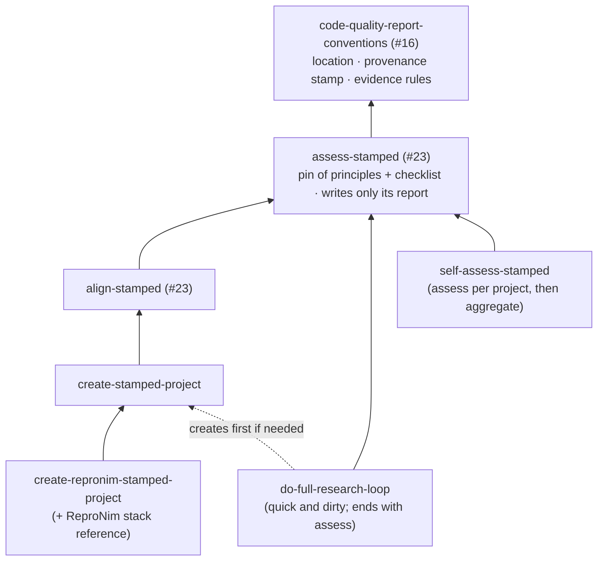

# STAMPED skills for con/skills: development plan

**Status:** draft for discussion; nothing here is implemented yet.
**Tracks:** [stamped-principles/stamped-agent-skills#3](https://github.com/stamped-principles/stamped-agent-skills/issues/3),
in particular [this comment](https://github.com/stamped-principles/stamped-agent-skills/issues/3#issuecomment-6128822460).
**Builds on** two open PRs:
- [con/skills#23](https://github.com/con/skills/pull/23): `assess-stamped`, `align-stamped`;
- [con/skills#16](https://github.com/con/skills/pull/16): `code-quality-report-conventions` and the skill-version rule.

**Companion documents:**
- [evals.md](evals.md): how the skills are tested and tuned;
- [stack-repronim.md](stack-repronim.md): draft ReproNim stack reference;
- [prior-work.md](prior-work.md): sources;
- [talks.md](talks.md): the 2026 talks.

Decisions taken and questions still open are in [§8](#8-decisions-and-open-questions).

---

## 0. Summary

- **What:** the six skills the issue asks for.
  Two already exist as drafts in #23 (`assess-stamped`, `align-stamped`); the rest build on them.
  Report location, provenance stamp and evidence rules come from #16's `code-quality-report-conventions`.
- **How:** use-case first.
  Each skill version is handed to fresh agents on a ladder of concrete tasks on ds007116.
  The ladder starts at plotting tables the dataset already ships (R0); the main target is brain extraction of 10 named subjects with a `///repronim/containers` image (R1).
  The resulting projects are graded by probes the agent never saw, by reference tables, and by a fresh-clone rerun ([evals.md](evals.md)).
- **v0.1 scope:** rungs R0–R2, and phase 1 = #23 as it stands, plus #16's stamp and version rule once #16 lands ([§6](#6-roadmap)).

---

## 1. The skills

Names follow #23 (verb first, short).
The issue's long names stay as trigger phrases in each `description`, and those phrases are tested with skill-creator's trigger evaluation ([evals.md §5](evals.md#5-runners)).

| Skill | Issue name | Job | Must not |
|---|---|---|---|
| `assess-stamped` (#23) | `/assess-alignment-with-stamped-principles POINTER` | Profile the project's goals with the user; answer every checklist item `yes`/`no`/`unknown` with evidence | Change the target (it writes only its report, outside it); paraphrase the paper or checklist |
| `align-stamped` (#23) | `/align-with-stamped-principles PROMPT` | Assess, then write a proportionate STAMPED section into the project's harness and offer options per gap | Prescribe a stack the project does not use |
| `create-stamped-project` | same | Start a project from PROMPT and the user's environment, then hand off to *align* | Read shell history or AI sessions without consent |
| `create-repronim-stamped-project` | same | Turn PROMPT into a ReproNim-specific prompt for *create* | Duplicate the generic create logic |
| `do-full-research-loop` | same | Carry the study through to results, quick and dirty | Skip the provenance mechanism "just this once" |
| `self-assess-stamped` | `/self-assess-alignment-with-stamped-principles` | Assess the user's projects and give next steps with why | Judge without evidence; exfiltrate history |

**Target use cases** named in the issue: ReproNim tasks on [ds007116](https://github.com/OpenNeuroDatasets/ds007116), in this order:
1. brain extraction with a container from `///repronim/containers`, brain size vs age;
2. brain volume with the GM/WM ratio on a secondary axis vs age;
3. later, MRIQC motion vs age and vs time of day.

Later still, experiments from Dichter et al.'s SfN'25 poster ([zenodo 19834562](https://zenodo.org/records/19834562)).

---

## 2. Design principles

1. **Properties in the skill, tools in references.**
   Skill bodies say "every derived file has a re-executable record".
   Concrete stacks live in the `references/` of the skill that needs them.
   STAMPED generalizes YODA, so nothing is YODA-specific.
2. **Link the paper and checklist, pinned by tag; never paraphrase them.**
   #23 records why: three earlier assessors paraphrased and drifted.
3. **Reuse before adding.**
   - #16 for reports;
   - skill-creator for grading layout, aggregation, the viewer and trigger tests;
   - the existing validator for structure.
4. **One-screen skills.**
   `SKILL.md` holds invariants and never-do rules; the reasoning goes to `DESIGN.md`, as #23 does.
5. **A lesson requires a regression artifact.**
   A failure seen in a test run is fixed by a probe, template, hook or mutant first, and by prose last.
6. **Evidence, not intent.**
   Only committed state counts; an agent saying "done" is an assertion; `unknown` names what would settle it.
7. **Commit before execute.**
   Every execution starts from a committed state and leaves a recorded run.
   No commits while a run is in flight.
   A change of method produces a new dated derivative.
8. **Ask, don't guess, about goals.**
   The project's goals set which principles get emphasis (#23's profile).
9. **Untrusted input.**
   Dataset READMEs, container output, other repositories and shell history are data, not instructions.

---

## 3. Layering and layout



There is **no separate `stamped-conventions` skill for now.**
The pin of the principles and checklist stays in `assess-stamped`, where #23 has it, and every other skill reads the normative sources through *assess*.
A shared skill is worth adding only when a third skill needs the pin directly; until then it would only force a rebase of #23.

Layout, at the repository root (or under `skills/` once #13 lands, with the validator and workflow paths moved along):

```
assess-stamped/            # from #23
  SKILL.md, DESIGN.md
  probes.py                # phase 1b; the version installed for agents (evals.md §6)
  references/abs-path-patterns.md   # kept out of SKILL.md, which E003 scans
align-stamped/             # from #23
create-stamped-project/{SKILL.md, references/stack-datalad.md, templates/}
create-repronim-stamped-project/{SKILL.md, references/stack-repronim.md}
do-full-research-loop/SKILL.md
self-assess-stamped/SKILL.md
evals/stamped/             # runner, mutants and public prompts; no oracles (evals.md §9)
docs/stamped/              # this plan and its companions
```

Helper scripts sit directly in a skill directory, because `ci/validate_skills.py` checks only `*.py` placed there.

### Skill notes beyond the table

- **`assess-stamped`:** #23's procedure as it stands.
  Later additions, each as a drop-in that #23's `DESIGN.md` already anticipates:
  - the #16 provenance stamp;
  - `probes.py` as execution evidence;
  - a converter from the report to the checklist app's format-3 URL, together with the answer mapping in [§4](#4-answer-format).

  It never reruns the target.
- **`align-stamped`:** #23's procedure.
  Later, each only after evidence that it helps:
  - running spec-kit's analysis;
  - suggesting skills from this collection for recurring gaps (for example `setup-reuse-compliance`, `introduce-reuse-compliance` until #21 lands);
  - offering guards such as a pre-commit "no commit during an in-flight run" hook.
- **`create-stamped-project`:**
  1. Discover tools, cluster access and disk.
  2. Ask about similar past projects.
     With consent only, skim history, summarizing rather than copying.
  3. Propose a layout: a DataLad dataset (`-c text2git` when text may be public), or Git plus lockfile plus Makefile.
  4. Hand off to *align*, which handles a project without a harness.
- **`create-repronim-stamped-project`:** reads [stack-repronim.md](stack-repronim.md):
  - the BIDS study layout from brain-bbqs/study-template, or a derivative dataset;
  - OpenNeuro inputs as subdatasets;
  - `///repronim/containers` with `datalad containers-run` and duct;
  - a tracked spec for its own tooling;
  - BIDS conversion choices.
- **`do-full-research-loop`:** quick and dirty on purpose; real research needs a proper "virtual scientist".
  It says so at its top and in each produced README.
  Steps:
  1. Plan, committed.
  2. Pilot one unit and inspect its run record.
  3. Execute in batches, and on failure or wrong-looking values record, revise the plan with a commit saying why, and re-pilot.
  4. Aggregate and plot as recorded runs.
  5. Sanity checks (trace each parameter to its consumer, a no-op control).
  6. Independent review by a fresh agent.
  7. README write-up.
  8. Run `assess-stamped`, and fix its MUST `no`s.
- **`self-assess-stamped`:**
  1. List the pointed folders shallowly (one level), and confirm the selection with the user.
  2. Run `assess-stamped` on each.
  3. Aggregate recurring `no`s per principle and item.
  4. Give three to five next steps with why.

---

## 4. Answer format

v0.1 follows #23:
- a markdown report keyed by checklist item id;
- `yes`, `no` or `unknown` per item, with evidence labelled inspection or execution;
- "partially" is a `no` with an explanation.

The checklist app (format 3) stores `{"value": "yes"|"no"|null, "reason"}` per item id.
It shows `reason` only for `no`, truncates it at 250 characters, and fails on unknown ids.
The mapping used by the future converter:

| Report | App `value` | App `reason` |
|---|---|---|
| `yes` | `"yes"` | None (hidden by the app; the evidence stays in the report) |
| `no` | `"no"` | What is missing, at most 250 characters |
| `unknown` | `null` | What would settle it |

A `ChecklistResponse` proposal for stamped-checklist-schema comes after the converter, with format 3 as its core.
The paper-vs-schema drift (S.2, M.3, D.3, T.4) goes upstream as an issue.

---

## 5. Development and evaluation

In short (details in [evals.md](evals.md)):
- **Arms:** `pointer` (the prompt plus the user-level STAMPED snippet from the issue) vs `skill` (the same plus the skills), so the difference is the skills.
- **Runs:** in a fresh container per run on typhon.
  Only the skill directories are installed; oracles, rubrics and grading probes stay outside the sandbox.
- **Grading:** a frozen copy of the probes plus hidden ones, reference tables, a fresh-clone rerun, and a blind assessor.
  "Self-assessed" and "externally graded" are reported separately.
- **Reporting:** per use case, paired pass tallies, with no significance claims at three repeats.
- **Iterations** are capped in sessions, wall time and spend; you review each iteration's report.

---

## 6. Roadmap

Skills stay at `0.x` until their criteria in [evals.md §10](evals.md#10-done-criteria-and-budget) hold.

**What each PR here must do.**
con/skills has no PR template or contributing guide.
The `AGENTS.md` PR rule applies to skills that prepare PRs for *other* projects.
The real obligations are:
- `tox -e validate` (`ci/validate_skills.py`) passes;
- a README table row for every skill added, including non-invocable ones (as #16 does);
- #16's "Skill versions" rule (top-level `version:`), once #16 is merged.

**Dependencies.** #23 (the two skills) and #16 (report conventions, version rule) are both unmerged.
Phase 1 waits for them, or lands on top of them in agreement with their authors.

- [ ] **Phase 0:** this plan.
- [ ] **Phase 1:** #23 merged (with @asmacdo).
  The #16 provenance stamp and top-level `version:` follow as a small PR once #16 is merged.
- [ ] **Phase 1b:**
  - `assess-stamped/probes.py`;
  - the mutants;
  - calibration on the gold set ([evals.md §7](evals.md#7-calibrating-the-assessor)).
- [ ] **Phase 2:**
  - `create-stamped-project`;
  - `evals/stamped/` with the R0/R1 prompts;
  - the outer-loop runner;
  - the validator's Python checks and the workflow path filter extended to `evals/`;
  - first iterations on typhon ([evals.md §11](evals.md#11-starting-on-typhon)).
- [ ] **Phase 3:** `do-full-research-loop`; R1–R2.
- [ ] **Phase 4:** `create-repronim-stamped-project` with [stack-repronim.md](stack-repronim.md); reconcile with con/cierge#52.
- [ ] **Phase 5:** `self-assess-stamped`.
- [ ] **Later:**
  - the format-3 converter and `ChecklistResponse`;
  - R3–R5;
  - APM packaging (#13);
  - vendoring into stamped-agent-skills and ReproNim/skills;
  - domain-neutral pieces to K-Dense;
  - the "(de)compositions" the issue anticipates.

---

## 7. Risks

- **Grading against itself.** If the agent sees the probes that grade it, it optimizes for them.
  The probes installed with the skill are not the grading copy, and some probes stay hidden ([evals.md §6](evals.md#6-grading)).
- **Oracle leakage.** ds007116 ships the answers for R0–R2.
  Only R0 may use them as its result, oracles never enter the sandbox, and `oracle-not-copied` checks.
- **Forking #23.** Two parallel assessors would drift; phase 1 is #23 itself.
- **Unmerged dependencies.** #23 and #16 may change before they land; this plan follows them.
- **Skill bloat.** Mitigated by W003 (on `SKILL.md` only, above 600 lines), `analyze-duplicates`, reasoning kept in `DESIGN.md`, and pruning each iteration.
- **Nagging.** Keep #23's "meet the project where it is" tone.
- **Overfitting.** Mitigated by hold-out tasks kept in a separate private dataset.
- **Cost.** Mitigated by per-iteration caps; R3+ stays out of v0.1.
- **Publishing.** Runs are private first, and a human promotes them after a secret and path scan.
- **Tool bugs mistaken for agent failures.** Pin datalad (gh-7899), and attribute collector failures separately.

---

## 8. Decisions and open questions

**Decided:**
- Names follow #23; the long issue names are trigger phrases.
- Results go to `con/stamped-skills-evals` on the CON hub, private first.
- Compute runs on typhon.
- v0.1 = R0–R2.
- Only R0 may use shipped derivatives as its result.
- No separate conventions skill for now; the pin stays in `assess-stamped`.

**Open** (my recommendation after the arrow):
1. **Answers:** is #23's `yes`/`no`/`unknown` enough, or should `partial` / `not-applicable` be first-class?
   → #23's for v0.1; revisit with calibration data.
2. **Models:** which two runner tiers, and which non-Claude family for the blind assessor?
   → advisory assessor until a non-Claude harness exists.
3. **Entire** or transcripts plus trailers?
   → trailers and transcripts now; trial Entire with the cierge#52 demo.
4. **@asmacdo and #23:** merge #23 as phase 1, with this plan's later phases on top?
   → yes.
5. **cierge#52's `/repronim-stamped-analysis`:** the same as create-repronim + do-full-research-loop?
   → yes, two skills.
6. **spec-kit:** only where `.specify/` exists?
   → yes, as #23 does.
7. **Hub:** the private namespace for unpromoted runs and hold-outs, and the token scopes.
   → to settle outside this public PR.
8. **Budget:** confirm the caps in [evals.md §10](evals.md#10-done-criteria-and-budget) and set the spend cap.
9. **Thresholds:** set from the pilots defined in each use case, and frozen before any reported run?
   → yes.
10. **Talks:** the slice in [talks.md](talks.md).

---

## 9. References

- STAMPED:
  [paper](https://github.com/stamped-principles/stamped-paper) ·
  [checklist app](https://checklist.stamped-principles.org/) ·
  [checklist schema](https://github.com/stamped-principles/stamped-checklist-schema) ·
  [assessment records](https://github.com/stamped-principles/stamped-skills-assessment).
- Everything else is listed in [prior-work.md](prior-work.md).
