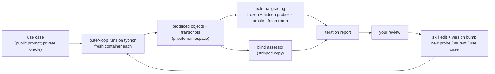

# STAMPED skills: evaluation design

Companion to [PLAN.md](PLAN.md): how each skill version is tested on concrete use cases and tuned with your review.
The loop combines skill-creator's evaluation loop with @asmacdo's audit loop: diff what the agent improvised against what the skill said, then promote or prune.

## 1. Loop



## 2. Vocabulary

- **Use case:** a prompt (public), plus an oracle table and rubric (private).
- **Arm:** what the agent is given (§4).
- **Run:** one agent session for a (use case, arm, model, repeat) in a fresh container.
  It produces an **object** (a git/DataLad repository) and a transcript.
- **Iteration:** one frozen skill version across a fixed set of runs.

## 3. Use cases

v0.1 covers R0–R2.
The aim is to make the agent **actually compute**: only R0 may take its result from tables ds007116 already ships.

| Rung | Task | Compute | Scope |
|---|---|---|---|
| R0 | Plot from the shipped FreeSurfer tables | None | v0.1 |
| **R1** | **Brain extraction of 10 named subjects; mask volume vs age** | Minutes per subject; Apptainer | **v0.1, main target** |
| R2 | Brain, GM and WM volumes for 30 named sessions | 1–5 CPU-h | v0.1 |
| R3 | MRIQC: motion vs age and vs time of day | About 1 CPU-h per BOLD run | Later |
| R4 | Whole dataset with BABS, NIDM + PROV | Hundreds+ CPU-h | Later |
| R5 | A cross-domain DANDI task | Up to about 1 CPU-h | Later |

**Selection rule.** Each use case names its subjects or sessions, chosen deterministically.
Take the candidates with the needed image and a per-session age, sort by age (ties by participant id), and take N at ranks `round(i·(n−1)/(N−1))`.

**R0: warm-up.**
- *Prompt:* "For ds007116, plot brain volume, with the GM/WM volume ratio on a secondary axis, against age, using the FreeSurfer derivatives the dataset ships."
- *Definitions:*
  - brain volume = `brainseg_brainsegvol`;
  - GM = `totalgray_totalgrayvol`;
  - WM = `cerebralwhitematter_cerebralwhitemattervol`;
  - age = `age` in `sub-*/sub-*_sessions.tsv`.

  All come from the per-session `derivatives/freesurfer-post/sub-*/sub-*_ses-*_desc-FreeSurfer_qc.tsv` (plain git, 222 sessions; columns checked 2026-10-13).
- *Oracle:* the result TSV matches a hand-computed reference table within float tolerance.
  Plots are judged only through their TSV.

**R1: brain extraction.**
- *Prompt:* "Do brain extraction on the ses-1 T1w of these 10 ds007116 subjects: …, with one of the containers in `///repronim/containers`.
  Report brain-mask volume in mm³ per subject in a TSV and plot it against age."
- *Oracle:* two checks against FreeSurfer `brainseg_brainsegvol` for the same sessions:
  - **magnitude:** each mask volume divided by `brainseg_brainsegvol` falls within a band, which catches voxel counts or wrong units;
  - **ordering:** the Spearman correlation is at least a threshold.
- *Pilot protocol,* fixed in the use case: before any reported run, we hand-run one reference tool (SynthStrip) on the 10 subjects, with a recorded run.
  The band is the observed ratio range ±10 %, and the threshold is the observed Spearman minus 0.1.
  Both are frozen in the use case together with that run record.
- *Caveat:* the T1w images are refaced; that may affect skull stripping, and it is not a failure.

**R2: tissue volumes.**
- *Prompt:* R0's plot, computed for 30 named sessions with `neurodesk-synthseg` or `repronim-simple-workflow`.
- *Oracle:* per-session ratios to the R0 values within a band, set by the same pilot protocol.

**Later rungs.**
- R3: `acq_time` in `sessions.tsv` keeps the hour (dates are shifted), so motion vs time of day is possible.
- R4 and R5: demonstrations, not gates.

**Hold-out tasks** live in a separate private dataset.
It is not referenced from any public `.gitmodules`, so its existence does not leak.
They are used only for release benchmarks.

## 4. Arms

| Arm | Agent receives | When |
|---|---|---|
| `pointer` | Prompt + the user-level STAMPED snippet from the issue, verbatim | Every iteration |
| `skill` | `pointer` + the skills, prompt invoking the skill by name | Every iteration |
| `skill@vN-1` | As `skill`, with the previous version | Every iteration from the second |
| `bare` | Prompt only | Release benchmark |
| `skill`, implicit | `pointer` + skills, no skill named | Release benchmark |

**Triggering** of the skill descriptions, including the issue's long names as trigger phrases, is tested separately and cheaply with skill-creator's trigger evaluation (§5).

## 5. Runners

- **Inner loop: debugging only.**
  In-session subagents read the skill from a snapshot path, as skill-creator does.
  They share a filesystem with this plan and the oracles, so their results are never reported.
- **Trigger tests:** skill-creator's `run_eval.py` / `run_loop.py`, unchanged.
  They already call `claude -p` with a query and check whether the skill is read.
- **Outer loop: every reported number.**
  It runs on typhon, one fresh container per run.
  The new code is a thin runner that adds what skill-creator lacks for full task runs: the container, and `datalad run` around the agent (the con/cierge#52 pattern).
  Per run it:
  1. creates a fresh dataset;
  2. copies **only the skill directories** at a pinned commit into the sandbox (none for `pointer`/`bare`);
     no `evals/`, no `docs/`, no `.git` of con/skills;
  3. runs `claude -p --output-format stream-json` under `datalad run`;
  4. writes skill-creator's workspace layout, so its aggregation and viewer are reused.

  Oracles, rubrics and grading probes are mounted only into the grader, after the agent has finished.
  The sandbox needs network access for data, so oracles are also kept out of public repositories (§9).
- **Recorded with every run:**
  - the Claude CLI version and model;
  - the container image digest;
  - the con/skills commit;
  - the produced dataset's commit;
  - the transcript.

## 6. Grading

**Externally graded** (what gets reported):
- **Frozen probes:** a copy of `probes.py` pinned at the evaluation harness's commit, not the copy installed with the skill under test.
  v0.1 has six probes:

  | Probe | Passes when | Items |
  |---|---|---|
  | `tree-clean` | `git status --porcelain` is empty, recursively | must/004 |
  | `no-abs-paths` | No user-home, `/tmp` or drive-letter paths in tracked text files; `.datalad/` and commit messages are excluded | must/009 |
  | `large-in-annex` | No file over 1 MiB (the default) is a git blob unless it is text | must/005 |
  | `subdatasets-resolvable` | Every `.gitmodules` URL is absolute and remote | must/002, must/016 |
  | `derived-have-records` | Every declared output appears in a run record | must/006 |
  | `env-spec-tracked` | A lockfile, container definition or containers registration is tracked | must/010, must/013 |

- **Hidden probes:** a few more, stored with the private oracles and never shipped in a skill.
- **`oracle-match`:** the use case's oracle checks (§3).
- **`oracle-not-copied`:** from R1 on, no output reproduces the shipped FreeSurfer values, and no run record reads `derivatives/freesurfer-post/`.
- **`fresh-rerun`:**
  1. clone the object from the **private** namespace with a read-only token, on another host, in a fresh container;
  2. `datalad rerun` or the documented entry point;
  3. compare the TSVs.

**Self-assessed** (reported separately): what `assess-stamped`, run inside the run, said about its own object.
The gap between self-assessed and externally graded is itself a result.

**Blind assessor:**
- it runs `assess-stamped` at a pinned version on a stripped copy (no transcript, no `AGENTS.md`/`CLAUDE.md`, no skill or provenance stamps);
- it covers the judgment items (must/011, 012, 014, 017, the may/* documentation items);
- it uses a different model family from the runner where one is available; until then it is advisory;
- it never gates a release alone, and disagreements with the probes go to you.

**Process metrics** from the transcript:
- executions from uncommitted state;
- commits during a run;
- absolute paths typed;
- manual edits to derived files;
- questions asked;
- whether the skill files were read;
- tokens and wall time.

## 7. Calibrating the assessor

Phase 1b, before *assess* grades anything.

1. **Mutants** of a known-good R0 object, one defect each:

   | Defect | Should flip |
   |---|---|
   | An absolute path in a script | `no-abs-paths` |
   | A 50 MB NIfTI in git | `large-in-annex` |
   | A subdataset with `url = ../..` | `subdatasets-resolvable` |
   | An untracked figure | `tree-clean` |
   | A derived file without a run record | `derived-have-records` |
   | The lockfile deleted | `env-spec-tracked` |
   | The README's reproduce section removed | must/007, must/008 (assessor) |

2. **Gold set:**
   - compression-comparisons-t261-study;
   - STAMPED-dl_morphometrics_biases;
   - stamped-paper;
   - ReproNim/simple_workflow;
   - dandi/llm-analysis.

   For two or three of these, you fill the checklist in the web app and send the link; it decodes into reference answers.
3. **Two model tiers** on the same objects; where MUST answers differ, the wording is tightened.

## 8. Iteration protocol

1. Freeze the skill commit; pick rungs and arms; check the budget (§10).
2. Run the outer loop; grade.
3. Write a one-page report:
   - what changed;
   - per use case and arm, the raw pass tallies (externally graded and self-assessed);
   - three to five telling failures, with links;
   - the proposed edits.
4. You review; your comments become `review` records.
5. Classify each failure as:
   - skill wording;
   - missing artifact;
   - harness fault;
   - model limit;
   - use-case defect.

   Only the first two change the skill.
6. Edit (artifact first), bump the version, and re-run with `skill@vN-1`.

## 9. Results and publishing

Results go to `con/stamped-skills-evals` on the CON hub, pushed from typhon, **private first**:
- Produced objects and transcripts go to a private namespace.
- A human promotes a run to public after a secret and path scan.
- No run is pushed to the public repository until the private namespace exists.
- Oracles, rubrics, hidden probes and hold-out tasks stay private.
- Operational details (accounts, tokens, network access) are kept out of this public repository.

## 10. Done criteria and budget

**Budget per iteration** (placeholders; the spend cap is yours to set):
- **inner loop:** 10 sessions per debugging round;
- **outer loop:** 40 sessions in total, counting runners, assessors and pilots, and 12 h of wall time.

A v0.1 iteration fits:
- 3 arms (`pointer`, `skill`, `skill@vN-1`) × 2 rungs (R0, R1) × 1 model tier × 3 repeats = 18 runner sessions;
- plus 18 assessor sessions;
- plus up to 4 pilot sessions;
- the first iteration has no `skill@vN-1`, so 12 + 12.

Release benchmarks add `bare`, `skill` implicit and the second model tier; they are budgeted separately, with your agreement.

**Done criteria** (placeholders, revised after two iterations):
- Results are reported **per use case as paired pass tallies**, for example `skill` 3/3 vs `pointer` 1/3 on R1.
  The raw counts are shown, with no pooled significance claims at three repeats.
- **`assess-stamped` v1.0:**
  - every probe flips on its mutant;
  - no false `no` on the clean object;
  - MUST answers agree with your reference answers on the gold set;
  - never `yes` without cited evidence.
- **create / align / do-full-research-loop v1.0:**
  - on each v0.1 use case, `skill` passes all externally graded checks in at least 2 of 3 repeats;
  - its tally is never below `pointer`'s;
  - no regression against vN-1;
  - you sign off.

## 11. Starting on typhon

For a Claude Code session on typhon picking this up:

1. Continue from branch `claude/ecstatic-cerf-nh4j6w` of con/skills ([#24](https://github.com/con/skills/pull/24)), or branch off it.
2. **Check the host:**
   - `apptainer --version`;
   - free scratch space (R1 needs a few GB per image);
   - `claude --version`;
   - `uv`.
3. **Install pinned tooling** for the runner, recorded in `evals/stamped/`:
   ```sh
   uv tool install datalad --with git-annex --with-executables-from git-annex
   # plus datalad-container and con-duct; or: pip install datalad git-annex datalad-container con-duct
   ```
   Pin datalad to a release with the concurrent-run fix (gh-7899/#7901).
4. **Bootstrap the results dataset:**
   1. `datalad create -c text2git`;
   2. add con/skills as a subdataset;
   3. add the hub siblings, private first.
5. Then follow [PLAN §6](PLAN.md#6-roadmap) from the current phase.
