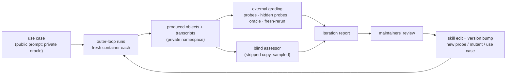

# STAMPED skills: evaluation design

Companion to [PLAN.md](PLAN.md): how each skill version is tested on concrete use cases and tuned with the maintainers' review.
The loop combines skill-creator's evaluation loop with @asmacdo's audit loop: diff what the agent improvised against what the skill said, then promote or prune.

## 1. Loop

## 2. Vocabulary and records

- **Use case:** a prompt (public), plus an oracle table, rubric and hidden probes (private).
- **Arm:** what the agent is given (§4).
- **Run:** one agent session for a (use case, arm, model, repeat) in a fresh container.
  It produces an **object** (a git/DataLad repository) and a transcript.
- **Iteration:** one frozen skill version across a fixed set of runs.

No new schema is introduced.
Gradings use skill-creator's `grading.json`.
Use cases, objects, assessments and reviews use the stamped-skills-assessment record types.

## 3. Use cases

v0.1 covers R0–R2.
The aim is to make the agent **actually compute**: only R0 may take its result from tables ds007116 already ships.

| Rung | Task | Compute | Scope |
|---|---|---|---|
| R0 | Plot from the shipped FreeSurfer tables | None | v0.1 |
| **R1** | **Brain extraction of 10 named subjects; mask volume vs age** | Minutes per subject; Apptainer | **v0.1, main target** |
| R2 | Brain, GM and WM volumes for 30 named sessions | 1–5 CPU-h | v0.1, its own iterations |
| R3 | MRIQC: motion vs age and vs time of day | About 1 CPU-h per BOLD run | Later |
| R4 | Whole dataset with BABS, NIDM + PROV | Hundreds+ CPU-h | Later |
| R5 | A cross-domain DANDI task | Up to about 1 CPU-h | Later |

**Selection rule.** Each use case names its subjects or sessions, chosen deterministically.
Take the candidates with the needed image and a per-session age, sort by age (ties by participant id), and take N at ranks `round(i·(n−1)/(N−1))`.

**Pilot protocol** (public; the resulting values are frozen in the private oracle before any reported run).
Two different containers are hand-run on the use case's subjects, with recorded runs.
Each band is the union of their ranges, widened by 10 %, so a legitimate tool with a different mask definition still passes.

**R0: warm-up.**
- *Prompt:* "For ds007116, plot brain volume, with the GM/WM volume ratio on a secondary axis, against age, using the FreeSurfer derivatives the dataset ships."
- *Definitions:*
  - brain volume = `brainseg_brainsegvol`;
  - GM = `totalgray_totalgrayvol`;
  - WM = `cerebralwhitematter_cerebralwhitemattervol`;
  - age = `age` in `sub-*/sub-*_sessions.tsv`.

  All come from the per-session `derivatives/freesurfer-post/sub-*/sub-*_ses-*_desc-FreeSurfer_qc.tsv` (plain git, 222 sessions; columns checked 2026-10-13).
- *Oracle:* the result TSV matches a hand-computed reference table within float tolerance.
  Plots are judged only through their TSV.

**R1: brain extraction.**
- *Prompt:* "Do brain extraction on the ses-1 T1w of these 10 ds007116 subjects: …, with one of the containers in `///repronim/containers`.
  Report brain-mask volume in mm³ per subject in a TSV and plot it against age."
- *Oracle:* checked against FreeSurfer `brainseg_brainsegvol` for the same sessions:
  - **magnitude:** each mask volume / `brainseg_brainsegvol` falls within the pilot band, which catches voxel counts and wrong units;
  - **ordering:** the Spearman correlation is at least the pilot threshold.

  The pilot runs SynthStrip and FSL `bet`.
- *Caveat:* the T1w images are refaced; that may affect skull stripping, and it is not a failure.

**R2: tissue volumes.**
- *Prompt:* R0's plot, computed for 30 named sessions with `neurodesk-synthseg` or `repronim-simple-workflow`.
- *Oracle:* per-session ratios to the R0 values within the pilot band.
- R2 is CPU-heavy, so it is not in the per-iteration budget of §10; it gets its own iterations once R0–R1 are stable.

**Later rungs.**
- R3: `acq_time` in `sessions.tsv` keeps the hour (dates are shifted), so motion vs time of day is possible.
- R4 and R5: demonstrations, not gates.

**Hold-out tasks** live in a separate private dataset.
It is not referenced from any public `.gitmodules`, so its existence does not leak.
They are used only for release benchmarks.

## 4. Arms

| Arm | Agent receives | When |
|---|---|---|
| `pointer` | Prompt + the user-level STAMPED snippet from the issue, verbatim | Every iteration |
| `skill` | `pointer` + the skills, prompt invoking the skill by name | Every iteration |
| `skill@vN-1` | As `skill`, with the previous version | Every iteration from the second |
| `bare` | Prompt only | Release benchmark |
| `skill`, implicit | `pointer` + skills, no skill named | Release benchmark |

**Triggering** of the skill descriptions, including the issue's long names as trigger phrases, is tested separately and cheaply with skill-creator's `run_eval.py` / `run_loop.py`.
These scripts already call `claude -p` and check whether the skill is read.

## 5. Runners

- **Inner loop: debugging only.**
  In-session subagents read the skill from a snapshot path, as skill-creator does.
  They share a filesystem with this plan, so their results are never reported.
- **Outer loop: every reported number.**
  It runs on the lab's compute host, one fresh container per run.
  The new code is a thin runner that adds what skill-creator lacks for full task runs: the container, and `datalad run` around the agent (the con/cierge#52 pattern).
  Per run it:
  1. creates a fresh dataset;
  2. copies **only the skill directories** at a pinned commit into the sandbox (none for `pointer`/`bare`);
  3. runs `claude -p --output-format stream-json` under `datalad run`;
  4. writes skill-creator's workspace layout, so its aggregation and viewer are reused.
- **What the sandbox can see.**
  - The sandbox needs the network for data.
    GitHub hosts both the datasets and the public con/skills repository, so a domain allow-list cannot hide the repository.
  - **Public grader material is therefore assumed readable** by the agent: the prompts, this plan and the probes.
    Only oracle values and hidden probes are secret, and they are mounted into the grader after the agent has finished.
  - Any fetch of con/skills or of the evals repository during a run is a process metric, and it marks the run as contaminated.
- **Host tooling,** pinned and recorded under `evals/stamped/`:
  - Apptainer;
  - `datalad` (a release with the concurrent-run fix, gh-7899/#7901);
  - `datalad-container`;
  - `git-annex` (the PyPI wheel works);
  - `con-duct`;
  - the Claude CLI.
- **Recorded with every run:**
  - the Claude CLI version and model;
  - the container image digest;
  - the con/skills commit;
  - the produced dataset's commit;
  - the transcript.

## 6. Grading

**Externally graded** (what gets reported).
Everything here comes from `evals/stamped/`, pinned at the harness commit, and none of it is installed in the sandbox.
- **Probes,** six for v0.1:

  | Probe | Passes when | Items |
  |---|---|---|
  | `tree-clean` | `git status --porcelain` is empty, recursively | must/004 |
  | `no-abs-paths` | No user-home, `/tmp` or drive-letter paths in tracked text files; `.datalad/` and commit messages are excluded | must/009 |
  | `large-in-annex` | No binary file over 1 MiB, and no text file over 5 MiB, is a git blob | must/005 |
  | `subdatasets-resolvable` | Every `.gitmodules` URL is absolute and remote | must/002, must/016 |
  | `derived-have-records` | Every declared output is produced by a run record | must/006 |
  | `env-spec-tracked` | A lockfile, container definition or containers registration is tracked | must/010, must/013 |

  For `derived-have-records`, the declared outputs are the paths the use case names: by default every tracked file under `results/` or `derivatives/`, or the root of a derivative dataset.
- **Hidden probes:** a few more, with their own private mutants, stored with the oracles.
- **`oracle-match`:** the use case's oracle checks (§3).
- **`oracle-not-copied`** (from R1 on):
  - no output reproduces the shipped FreeSurfer values, or a constant multiple of them;
  - no output depends, through its run records, on `derivatives/freesurfer-post/` as an input.

  Read-only inspection of that directory is allowed, and is logged as a process metric.
- **`fresh-rerun`:**
  1. The grader host clones the object from the private namespace, with a token scoped to the runs namespace that never enters the container.
  2. The clone is mounted read-only into a fresh container whose network reaches only data and container hosts.
  3. `datalad rerun`, or the documented entry point, runs there; it executes agent-authored code.
  4. The TSVs are compared.

**Self-assessed** (reported separately): what `assess-stamped`, run by the agent inside the run, said about its own object.
The gap between self-assessed and externally graded is itself a result.

**Blind assessor:**
- it runs `assess-stamped` at level 1 (inspection only) at a pinned version, on a stripped copy (no transcript, no `AGENTS.md`/`CLAUDE.md`, no skill or provenance stamps);
- it covers the judgment items (must/011, 012, 014, 017, the may/* documentation items);
- until the calibration of §7 passes, it runs on a sample of about three objects per iteration and is advisory;
- it uses a different model family from the runner where one is available, and never gates a release alone.

**Process metrics** from the transcript:
- executions from uncommitted state;
- commits during a run;
- absolute paths typed;
- manual edits to derived files;
- questions asked;
- whether the skill files were read;
- reads of `derivatives/freesurfer-post/`;
- fetches of con/skills or the evals repository;
- tokens and wall time.

## 7. Calibration

Phase 1b, before the probes or the assessor grade anything.

1. **Mutants** of a known-good R0 object, one defect each.
   Public mutants cover the public probes; hidden probes get private mutants.

   | Defect | Should flip |
   |---|---|
   | An absolute path in a script | `no-abs-paths` |
   | A 50 MB NIfTI in git | `large-in-annex` |
   | A subdataset with `url = ../..` | `subdatasets-resolvable` |
   | An untracked figure | `tree-clean` |
   | A derived file without a run record | `derived-have-records` |
   | The lockfile deleted | `env-spec-tracked` |
   | The README's reproduce section removed | must/007, must/008 (assessor) |

2. **Gold set** for #23's level-1 assessment:
   - compression-comparisons-t261-study;
   - STAMPED-dl_morphometrics_biases;
   - stamped-paper;
   - ReproNim/simple_workflow;
   - dandi/llm-analysis.

   For two or three of these, a maintainer fills the checklist in the web app and shares the link; it decodes into reference answers.
3. **Two model tiers** on the same objects; where MUST answers differ, the wording is tightened.

## 8. Iteration protocol

1. Freeze the skill commit; pick rungs and arms; check the budget (§10).
2. Run the outer loop; grade.
3. Write a one-page report:
   - what changed;
   - per use case and arm, the raw pass counts (externally graded and self-assessed);
   - three to five telling failures, with links;
   - the proposed edits.
4. The maintainers review; their comments become `review` records.
5. Classify each failure as:
   - skill wording;
   - missing artifact;
   - harness fault;
   - model limit;
   - use-case defect.

   Only the first two change the skill.
6. Edit (artifact first), bump the version, and re-run with `skill@vN-1`.

## 9. Results and publishing

Results go to `con/stamped-skills-evals` on the CON hub, **private first**:
- Produced objects and transcripts go to a private namespace.
- A maintainer promotes a run to public after a secret and path scan.
- No run is pushed to the public repository until the private namespace exists.
- Oracle values, rubrics, hidden probes and hold-out tasks stay private.
- Operational details (accounts, tokens, network access) are kept out of this public repository.

## 10. Budget and done criteria

**Budget per iteration** (placeholders; the spend cap is the maintainers' to set):
- **inner loop:** 10 sessions per debugging round;
- **outer loop:** 40 sessions, counting runners, assessors, pilots and reruns, and 12 h of wall time.

A v0.1 iteration fits with headroom:
- 3 arms (`pointer`, `skill`, `skill@vN-1`) × 2 rungs (R0, R1) × 1 model tier × 3 repeats = 18 runner sessions;
- plus about 3 sampled assessor sessions;
- plus up to 4 pilot sessions;
- that is 25, which leaves about 15 for reruns after harness faults.
- The first iteration has no `skill@vN-1`.

R2 and release benchmarks are budgeted separately, with the maintainers' agreement.

**How results are read.**
- Each use case gets **side-by-side pass counts** (k of 3 per arm), for example `skill` 3/3 vs `pointer` 1/3 on R1.
  Raw counts only, with no significance claims.
  Repeats are independent per arm, not paired, and even 3/3 vs 0/3 is only p ≈ 0.1 (two-sided Fisher).
- **Per-iteration gates are smoke thresholds.**
- **v1.0 gates** use a release benchmark with about 10 repeats per arm on R1.

**Done criteria** (placeholders, revised after two iterations):
- **Probes and `assess-stamped` level 1:**
  - every probe flips on its mutant;
  - no false `no` on the clean object;
  - MUST answers agree with the maintainers' reference answers on the gold set;
  - never `yes` without cited evidence.
- **create / align / do-full-research-loop:**
  - **smoke:** `skill` passes all externally graded checks in at least 2 of 3 repeats on R0 and R1;
  - **v1.0:** on the release benchmark, `skill`'s pass count is at least `pointer`'s on every v0.1 use case, with no regression against vN-1;
  - the maintainers sign off.
