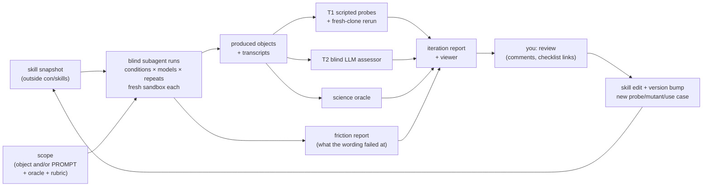

# STAMPED skills: development and evaluation

Companion to [PLAN.md](PLAN.md): how each skill version is tested, calibrated
and reviewed. The platform question — what to adopt rather than grow — is in
[eval-platforms.md](eval-platforms.md).
The cycle is closest to skill-creator's loop combined with @asmacdo's audit loop, but its test fixtures are scientific use cases and its grader is the checklist.



## 1 Vocabulary
- **Use case:** a prompt, inputs, an oracle for the science product, and rubric emphasis.
  Recorded as `use_case` + `rubric`.
- **Condition:** what the agent is given ([§4](#4-conditions)).
- **Run:** one agent session for a (use case, condition, model, repeat), in a fresh sandbox.
  It produces an **object** (a git/DataLad repository) and a transcript.
- **Blind run:** a run by a fresh subagent that is given the skill snapshot and the scope and nothing else — no reference answers, no plan, no earlier report ([§2](#2-the-blind-subagent-run--the-core-test)).
  Every skill change gets one.
- **Grade:** T1 + T2 + oracle, recorded as an `assessment`.
  Your verdicts are recorded as a `review`.
- **Iteration:** one skill version across a fixed set of runs.

## 2 The blind subagent run — the core test

**Every change to a skill is tested by handing the skill to a fresh subagent with a concrete scope, and reading what comes back.**
Not by the authoring session walking through its own procedure: the session that wrote the wording knows what it meant, so it is the one reader who cannot tell whether the wording works.
This is the repo-wide rule in [`AGENTS.md`](../../AGENTS.md); what follows is how it is run for these skills.

**Scope is concrete, and it is one of two shapes:**

| Scope | Skills it tests | Example |
|---|---|---|
| **An object** — a repository, dataset or path | *assess*, *self-assess* | `/assess-alignment-with-stamped-principles <path to a clone of compression-comparisons-t261-study>` |
| **A PROMPT** (optionally plus an object) | *create*, *create-repronim*, *align*, *do-full-research-loop* | the R0 prompt of [§3](#3-use-case-ladder), with and without the slash command |

"Try the skill and see" is not a run.
A run has a scope, a condition ([§4](#4-conditions)), a model, and a place its outputs go.

**Isolation, or the test measures nothing:**

- Snapshot the skill **and** `stamped-conventions` into a directory outside con/skills, and point the subagent at that copy; the snapshot commit is what the run is recorded against.
- Tell the subagent **not to read con/skills** — and say why. `evals/stamped/gold/` holds reference answers for exactly the objects worth testing on, and a helpful agent will find them.
- Tell it the user is unavailable, so the steps that ask it to review goals and project kind with the user have to become labelled assumptions in its report. How well it handles that is itself a finding.
- Name what it may not do (run the project's pipeline, attempt the expensive probe), so a refusal is a choice rather than a timeout.

**Two things come back, and the second one is usually worth more:**

1. **The work product** — the report, the response JSON, the diff, the created project.
   Diffed per item against the reference answer, or against what you expected.
2. **The friction** — every place the instructions were ambiguous, missing, contradictory or slow, **quoting the wording at fault**.
   Ask for it explicitly and ask for it critically; a subagent that is not asked will not volunteer that step 4 was unclear, it will just guess, and the guess looks like a verdict.

Each difference and each friction item is classified as in [§8](#8-iteration-protocol-and-your-feedback), and **only "skill wording" and "missing artifact" change the skill**.

**Where scripts sit in this.**
The bundled probes are the fast, cheap, deterministic half: they answer 11 of 17 MUST items in seconds for pennies, identically for the skill and for the graders, and they are calibrated against the mutants ([§7](#7-calibrating-the-assessor)).
Their job in a run is to **tell the reading agent where to look harder** — an item a probe settles with evidence needs no deliberation, an item it leaves `not-checked` is where the judgement budget goes, and a probe result that contradicts a reading is the most interesting row in the report.
What they are **not** is the test of the skill:

- a passing probe suite says nothing about whether the instructions can be followed;
- a report that is only probe output is a draft, and the skill says so;
- when a blind run exposes a gap, the fix to reach for first is a probe, template or hook — prose last, because prose grows back (§3.5).

**Judgement mutants** make this measurable rather than anecdotal.
A blind run on a real object tells you what the skill missed *this time*; a judgement mutant pins one prose defect that **no probe can see** and asks every later version to catch it again:

- the defect goes into a copy of the known-good fixture — a README naming a `make` target that does not exist, install steps that only work on one operating system, `pixi run` instructions in a `uv` project, reproduce steps in an impossible order, prose promising a container nobody registered, a documented route through `/mnt/labshare`, metadata describing a different project;
- `harness/judgement_calibrate.py prepare` **refuses the mutant if it changes what the probes say** — a judgement mutant that a script catches is not testing judgement, and that gate caught a real false positive on its first run (`///openneuro/…` registry shortcuts read as host paths);
- the grader is a blind subagent, and scoring has three parts: did it flag *any* of the items the defect could land on, did the report **name the specific thing** (the bogus target, `brew`, `pixi`), and did it stay `met` everywhere it should have — because an assessor that gets suspicious of everything is not detecting anything.

Which of two related items a reader pins a prose defect on is not under test; naming the defect is.

**Cadence.** At least one blind run per skill per iteration, on a scope the previous iteration also used (so the diff is a regression test) plus one it has not seen, and the judgement mutants whenever the prose of a skill changes.
Runs are cheap enough — minutes, on an object already on disk — that there is no excuse for an untested wording change.
The harness this grows into is surveyed in [`eval-platforms.md`](eval-platforms.md): keep our object generators and structured scorer, adopt `pytest-evals` for aggregation now, and Inspect AI at phase 3 for containers per run and local models.

## 3 Use-case ladder

Climb only when the rung below is stable.
The point of the ladder is to make the agent **actually compute**; R0 is the only rung that may reuse results the dataset already ships.

| Rung | Task | Compute | Starts when |
|---|---|---|---|
| R0 | Plot from the FreeSurfer tables ds007116 ships | None (seconds) | Now |
| **R1** | **Brain extraction, ≥ 10 subjects → brain size vs age** | Minutes per subject; Apptainer | R0 stable; main development target |
| R2 | Brain, GM and WM volumes, about 30 sessions | 1–5 CPU-h | R1 stable |
| R3 | MRIQC: motion vs age and vs time of day | About 1 CPU-h per BOLD run | R0–R2 done |
| R4 | Whole dataset at scale, NIDM + PROV | Hundreds to thousands of CPU-h | Demonstration only |
| R5 | DANDI: orientation selectivity (cross-domain) | Up to about 1 CPU-h | Hold-out |

**R0: warm-up, no compute.**
- *Prompt:* "For ds007116, plot brain volume, with the GM/WM volume ratio on a secondary axis, against age, using the FreeSurfer derivatives the dataset ships."
- *Data:* per-session ages from `sub-*/sub-*_sessions.tsv`, plus `derivatives/freesurfer-post/*_desc-FreeSurfer_qc.tsv` (plain git, 222 sessions).
- *Tooling:* Python with a lockfile (uv or pixi), or a small container.
- *Product:* a TSV and a PNG.
- *Oracle:* a deterministic rerun gives identical outputs.
- *Why:* it exercises the S/T/A/P plumbing (layout, inputs as a subdataset, run records, environment spec) cheaply enough for three or more repeats per condition.
  It does not exercise computation; that starts at R1.

**R1: brain extraction (main development target).**
- *Prompt:* "Do brain extraction on the anatomical (T1w) images of at least 10 ds007116 subjects, spread over the age range, using one of the containers in `///repronim/containers`, and plot brain size against age."
- *Data:* ses-1 T1w (`rec-normrefaced`), about 7 MB each.
- *Tooling:* the agent picks, for example `neurodesk-afni` (3dSkullStrip), `neurodesk-fsl` (bet) or `neurodesk-synthstrip`.
  Swapping one for another is a free test of M.
  It goes through `datalad containers-run` with `REPRONIM_USE_DUCT=1`.
- *Product:* brain-mask volumes (TSV), the brain size vs age plot, and an overlay mosaic for visual QC.
- *Oracle:* the computed volumes correlate with FreeSurfer `brainseg`/`etiv` from the shipped derivatives.
  Those must be used for the comparison only, never copied as results.
  Optionally, Dice between two tools.
- *Cost:* minutes of CPU per subject.
  The image is 0.5–9 GB depending on the tool (SynthStrip is the smallest).
- *Caveat:* the T1w images are refaced, which may affect skull stripping.
  It is a known caveat, not a failure.

**R2: tissue volumes.**
- *Prompt:* "Compute brain, GM and WM volumes for about 30 sessions spanning ages 9–20; plot brain volume with the GM/WM ratio on a secondary axis against age."
- *Tooling:* `neurodesk-synthseg` (`--vol` CSV) or `repronim-simple-workflow` (BET → FAST).
- *Oracle:* the R0 values from the shipped FreeSurfer derivatives.

**R3: MRIQC.** Only once R0–R2 are done.
- *Prompt:* "Run MRIQC on the resting-state BOLD of N subjects and plot motion (mean framewise displacement) against age and against time of day."
- *Data:* `task-rest_run-01` BOLD.
  Time of day comes from `acq_time` in `sessions.tsv`, at hour resolution.
  Start N small and grow it.
- *Tooling:* `bids-mriqc` 24.0.2, `-m bold`, participant level then group level.
- *Oracle:* framewise displacement from the fMRIPrep confounds in ds007088.

**R4: scale and standards** (demonstration, not a gate).
- *Prompt:* "All sessions on our cluster; export NIDM and PROV; publish."
- *Tooling:* OpenNeuroStudies `study-ds007116`, mechababs/BABS, `segstats_jsonld`, `metalad runprov`.
- *Oracle:* the R1–R3 subsets reproduce exactly.

**R5: cross-domain** (hold-out).
- *Prompt:* "Demonstrate orientation selectivity from a DANDI dandiset" (from Dichter et al. SfN'25).
- *Tooling:* the generic *create* with dandi-cli, without the ReproNim layer.
- *Oracle:* the published finding, or `dandi/llm-analysis`.

Across rungs:
- **Use per-session ages.** Ages differ between `participants.tsv` (baseline) and per-session `sessions.tsv`.
  The ReproNim stack reference steers to the per-session ages.
- **Hold-out set.** Keep R5 and one ReproNim variant (another dataset, for example ds000003) out of the inner loop, so skills are not tuned to the fixtures.

## 4 Conditions

| Id | Agent receives | Tests |
|---|---|---|
| `bare` | The use-case prompt only | The floor |
| `pointer` | Prompt + @asmacdo's `CLAUDE.md` STAMPED snippet from the issue, verbatim | Today's practice: the bar a skill must clear |
| `skill@vN`, implicit | Skills installed; the prompt does not mention them | Does the description trigger? |
| | | **Inner-loop caveat:** a subagent has no slash-command dispatcher, so "implicit" here means the skills are on disk under `.claude/skills/` and the run is told it may use what it finds. Real trigger-phrase behaviour needs the outer loop, and the inner loop's implicit numbers are indicative only. |
| `skill@vN`, explicit | Skills installed; the prompt invokes `/create-…` or `/do-full-research-loop` | Does the procedure work? |
| `skill@vN-1` | The previous version | Regressions |

**Models.** Two or three tiers, from frontier to small.
Some neuroimaging content already pushes sessions to a non-frontier model (@asmacdo's note), so the skills must not assume frontier judgment.
Optionally, one non-Claude harness for agent-agnosticism.

**Repeats.** One per cell while exploring; three for benchmark iterations.
Variance is reported, not hidden.

## 5 Runners: inner and outer loop

- **Inner loop** (fast, used daily): the blind subagent runs of [§2](#2-the-blind-subagent-run--the-core-test), spawned from the orchestrating session.
  Each is told to read the skill under test from a snapshot path, as skill-creator does, and to stay out of con/skills.
  Use it for R0, for runs of *assess* on existing objects, and for mutant calibration.
  It is cheap, but runs are not isolated from the host, so its numbers are indicative only.
- **Outer loop** (benchmark, per iteration): runs on **typhon**, with one **fresh container per run**, which is the E principle applied to our own tests.
  Following cierge#52:
  ```sh
  datalad create -c text2git run-<id>
  # install skills@<commit> into the sandbox (or none, for baselines)
  datalad run -m "agent run <id>" "claude -p \"\$(cat prompt.md)\" --output-format stream-json > transcript.jsonl"
  ```
  The sandbox has `datalad`, `git-annex` and `apptainer`.
  Permissions are wide open *only* inside the throwaway sandbox.
  Datalad is pinned to a version with the concurrent-run fix (gh-7899/#7901).
  The harness must start on typhon with one command per iteration (`harness/run.py --iteration N`), whoever launches it: you, or a Claude Code session running on typhon.
  A cloud session can author skills and harness code and run R0 and *assess* inner-loop runs on public objects.
  It cannot reach typhon, but it can read and push the results dataset on the hub ([§9](#9-where-results-live)).
- **Agent provenance per run.** At minimum:
  - the stream-json transcript, annexed in the results dataset;
  - consistent, machine-parsable `Co-Authored-By` trailers;
  - the skill commit plus model, recorded in `assessor`.

  Optionally, Entire (`entire enable`) for commit-linked checkpoints, as cierge#52 proposes.
  Its redaction is best-effort, so it is used only on public-data use cases.

## 6 Grading

**T1: scripted probes.**
Deterministic and tool-agnostic; equivalent evidence passes.
They live in `assess…/scripts/probes/`, so *assess* and the graders use the same code, and the mutants catch bugs in the probes.

| Probe | Passes when | Checklist items |
|---|---|---|
| `tree-clean` | `git status --porcelain` is empty, recursively | must/004 |
| `no-abs-paths` | No `/home/…`, `/Users/…`, `C:\…` or `/tmp/…` in tracked text (run records allow-listed) | must/009 |
| `large-in-annex` | No large binaries in git objects | must/005 |
| `subdatasets-resolvable` | No `../..` or local-path URLs, and a fresh recursive clone from the published location works | must/002, must/016, may/001 |
| `derived-have-records` | Every output file comes from a run record (`datalad run`, or Make/Snakemake with a tracked workflow) | must/006, A.2 |
| `run-env-linked` | Run records name a container image key or digest, or a lockfile hash | must/006, must/015 |
| `env-spec-tracked` | A lockfile, container definition or `containers` registration is tracked, including for the project's own tooling | must/010, must/013 |
| `entry-point` | The README names an entry point, and it exists | must/007, must/008 |
| `inputs-untouched` | Input subdatasets are clean and at their recorded commit | should/003 (M.1) |
| `license-declared` | Code and data licenses are declared (`LICENSES/`, REUSE, BIDS `License`) | paper S.2/D.3 (extra, until the schema catches up) |
| **`fresh-rerun`** | The documented rerun reproduces the outputs on another host (below) | A.1, P.1–3, E, D.1, should/004 |
| `ci-present` | CI re-executes the workflow or rebuilds the environment | should/002, should/006 |

`fresh-rerun` in detail:
1. On another host, in a fresh container, clone from the published sibling.
2. Get the minimum content needed.
3. Run `datalad rerun` or the documented entry point.
4. Compare outputs: checksums, or a tolerance for plots and tables.

**T2: blind LLM assessor.**
Runs *assess* at a pinned version on the object only, with the condition hidden, to cover the judgment items: must/011, 012, 014, 017, the may/* documentation items, and goal fit.
Disagreements between T1 and T2 are flagged for you rather than resolved automatically.

**Science oracle:** the product exists, has the requested N and variables, and agrees with the oracle within a tolerance.

**Process metrics,** from the transcript:
- executions started from uncommitted state;
- commits made during a run;
- absolute paths typed;
- manual edits to derived files;
- questions asked of the user;
- whether the skill files were actually read (a skill path being present does not show it was used);
- tokens and wall time.

**Aggregation.** Report per item and per principle, always with numerator/denominator, never as one universal score.
Separately, keep:
- a **MUST pass rate**, over mechanically checkable MUST items only;
- an "oracle OK" flag;
- the process metrics.

## 7 Calibrating the assessor

*Assess* is the grader for everything else, so it is calibrated first — and the calibration has a scripted half and a human-read half, which are not interchangeable:

0. **Blind runs** ([§2](#2-the-blind-subagent-run--the-core-test)).
   A fresh subagent, the skill snapshot, one object, no reference answer.
   Its 31 verdicts are diffed against the reference and its friction notes are triaged.
   This is the only check that tests the *instructions* rather than the scripts, so it runs every iteration, and a wording change without one is not finished.
1. **Mutants.** Start from a known-good R0 object (built by hand, or the best skill run after your sign-off).
   Each mutant script injects one defect meant to flip one item:

   | Injected defect | Should flip |
   |---|---|
   | An absolute path in a script | must/009 |
   | A 50 MB NIfTI committed to git | must/005 |
   | A container referenced as `:latest` | must/015 |
   | A subdataset with `url = ../..` | must/002, must/016 |
   | The README's reproduce section removed | must/007, must/008 |
   | Outputs written into the inputs | should/003 |
   | An untracked figure | must/004 |
   | A derived file without a run record | must/006 |

   Measure per-item sensitivity, plus the false `unmet` rate on the clean object.
   Two of them are **negative controls**: `large-text-in-git` asserts that must/005 does *not* move (the item asks about binary data), and `remote-removed` moves only must/016.
1a. **Judgement mutants** (`mutants/judgement.py`), for everything a script cannot see: prose that describes an execution which cannot work, or works on one machine only.
   Graded by a blind subagent, scored on flagged item + the defect being **named** + no collateral accusations, with the probes verified unchanged first ([§2](#2-the-blind-subagent-run--the-core-test)).
   This is where the sentences in a `SKILL.md` are tested; the scripted mutants never touch them.
2. **Real-world gold set.**
   - compression-comparisons-t261-study, with known D (`../..`) and P/E (no built containers) gaps;
   - STAMPED-dl_morphometrics_biases, which has its own assessment TSV to compare against;
   - stamped-paper, which has an existing pilot record;
   - ReproNim/simple_workflow;
   - `dandi/llm-analysis`, a typical project where STAMPED was not a goal.

   For two or three of these, **you fill the checklist in the web app** and send the URL.
   We decode it into reference answers, so no new labeling tool is needed.
3. **Agreement across models.** Assess the same objects with each model tier.
   Where MUST verdicts diverge, the wording is ambiguous and gets tightened.

## 8 Iteration protocol and your feedback

1. Pick the skill, rungs and conditions for iteration *k*.
   Freeze the skill commit.
2. Run them: the inner loop for exploring, the outer loop for benchmarks.
3. Grade (T1, T2, oracle) and aggregate.
4. **Write the iteration report**, one page:
   - what changed in the skill (diff link);
   - a table of conditions × rungs: MUST pass rate, failing probes, oracle;
   - the three to five most telling improvisations or failures, with links to transcripts and objects;
   - the proposed next edits.

   The skill-creator viewer is available for browsing outputs.
5. **You review**: comments on the report, verdicts on flagged T1/T2 disagreements, and optionally a checklist URL for an object.
   These become `review` records.
6. Classify each failure as one of:
   - skill wording (ambiguous or missing);
   - missing artifact (needs a probe, template or hook);
   - harness fault (runner or collector);
   - model limit;
   - use-case defect.

   Only the first two change the skill.
7. Edit following §3.5 (artifact first), bump `version:`, add a changelog line, and re-run, including `skill@vN-1` for regressions.
   Prune as aggressively as you promote.

## 9 Where results live

A separate DataLad dataset, [`con/stamped-skills-evals`](https://hub.centerforopenneuroscience.org/con/stamped-skills-evals), on the CON Forgejo-aneksajo hub.
Aneksajo is the git-annex-aware Forgejo, so git history and annexed content go to the same remote with no separate special remote.

**Bootstrapped 2026-10-13** (`datalad create -c text2git`, `hub` sibling, `datalad push`, verified by an anonymous `datalad clone`).
It carries the dataset README with the layout below and `calibration/2026-10-13-probes-0.1.0/` — the first probe calibration, 8/8 mutants and 0/15 false `unmet`.
Its own README states the two gaps it starts with rather than hiding them: con/skills is not yet a subdataset (pinning it at an unpublished commit would be the very `must/002`/`must/016` failure these skills catch), and the bootstrap commit is not a recorded run.
The default branch is `main`, matching the hub repository.
- **Layout:** each run is a subdataset (the produced object), plus `transcript.jsonl` (annexed), `grading.json` and stamped-assessment records.
  Grading steps are `datalad run` records.
  The skills repository is a subdataset pinned per iteration.
- **Pushing:** from typhon, as `yarikoptic-gitmate` (`datalad push --to hub`).
  Produced-object subdatasets are published as sibling repositories under `con/` on the same hub.
  That way `subdatasets-resolvable` and `fresh-rerun` test real published URLs rather than paths on typhon.
- **Mirroring:** optional, read-only, to GitHub for visibility; the hub stays authoritative.
- **Cloud sessions** can read and push too.
  This was verified 2026-10-13: Forgejo 16.0.5 + git-annex, `push: true`, and a `git push --dry-run` was accepted.
  Three things make that work:
  - **Network:** `*.centerforopenneuroscience.org` and `*.stamped-principles.org` (plus the bare domains) are under Allowed domains, with the package-manager defaults kept.
  - **Hub access control:** the hub's Apache admits Anthropic's egress network.
  - **Credentials:** a `HUB_TOKEN` network secret for `yarikoptic-gitmate` is scoped to `hub.centerforopenneuroscience.org`, so the proxy adds the `Authorization: Bearer` header and the session never sees the token.

  `datalad` and `git-annex` are not preinstalled in cloud sessions, but both come from PyPI (the `git-annex` wheel ships a standalone build).
  Either of these works (tested: datalad 1.7.1, git-annex 10.20260901):
  ```sh
  uv tool install datalad --with git-annex --with-executables-from git-annex
  # or, in a venv:
  pip install datalad git-annex
  ```
  Put that line in the environment's setup script so the environment cache keeps it, and pin versions there ([§5](#5-runners-inner-and-outer-loop) on datalad's concurrent-run fix).

**Private first** (adopted from [#24](https://github.com/con/skills/pull/24)).
Produced objects and transcripts go to a private namespace on the hub; a maintainer promotes a run to public after a secret and path scan, and nothing is pushed to the public repository before that namespace exists.
Oracle *values*, rubric emphasis for unreleased use cases, and hold-out tasks stay private: a published tolerance is a target to fit rather than a check.
The protocol that produces them is public, which is what lets someone else repeat it.
Operational detail — accounts, token scopes, network access — stays out of this public repository.

This keeps con/skills small and makes every number in a report or a talk re-executable.
That is the same D check the MIT deck's "So I tried to `rerun` it" slide applies to the compression study.

## 10 Budget and done criteria

**Budget per iteration** (planning numbers, from [#24](https://github.com/con/skills/pull/24); the spend cap is the maintainers' to set):
about **10 inner-loop sessions** per debugging round, and about **40 outer-loop sessions** plus 12 h of wall time per iteration, counting runners, assessors, pilots and reruns.
A v0.1 iteration fits: 3 arms × 2 rungs × 1 model tier × 3 repeats = 18 runner sessions, about 3 sampled blind assessor sessions, up to 4 pilot sessions — 25, leaving headroom for reruns after harness faults.
The five blind runs this branch has already spent cost about 750 k tokens in total, which is the number to plan against: a judgement-mutant sweep of all six, on two tiers, is roughly one iteration's outer-loop budget on its own.

**How results are read.**
Raw pass counts per use case and arm, side by side (`skill` 3/3 vs `pointer` 1/3), and nothing more.
Repeats are independent per arm, not paired; with three repeats even 3/3 against 0/3 is only p ≈ 0.1 (two-sided Fisher), so per-iteration numbers are **smoke thresholds** and a release claim needs the benchmark (about 10 repeats per arm).
`aggregate.py` prints that caveat in every report it writes, so nobody has to remember it.

### 10.1 Done criteria

These are initial targets, to be revised after the first two iterations.

- **assess v1.0:**
  - ≥ 90 % mutant detection per mechanically checkable MUST item, and ≤ 10 % false `unmet` on clean objects;
  - agreement with your reference answers on the gold set for MUST items;
  - ≥ 80 % MUST-verdict agreement across model tiers;
  - never `met` without cited evidence;
  - **blind runs:** two consecutive iterations in which a fresh subagent, given only the snapshot and an object, produces all three products, agrees with the reference answer on every MUST item, and returns no friction item classified as "skill wording" that is worth fixing.
    One blind run on a *new* object each iteration, so the wording is not fitted to the gold set.
  - **judgement mutants:** ≥ 80 % detected (flagged *and* named) on the frontier tier and ≥ 60 % on the smaller tier, with no collateral accusation on the clean fixture — the scripted-mutant bar applied to the half of the skill made of sentences.
- **create / align / do-full-research-loop v1.0:**
  - at R0–R2, explicit-skill runs — which are blind runs with a PROMPT as their scope — pass every mechanically checkable MUST probe, including `fresh-rerun`, in ≥ 2 of 3 repeats on two model tiers;
  - they clearly beat `pointer`;
  - the oracle agrees;
  - no regression against vN-1;
  - you sign off.
- **create-repronim:** the same at R1–R2; R3 once it is reached.
  R4 counts as a demonstration, not a gate.

---
